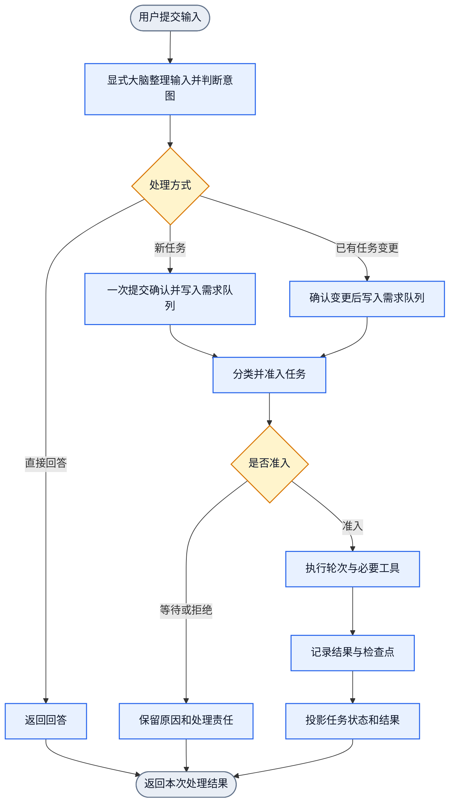
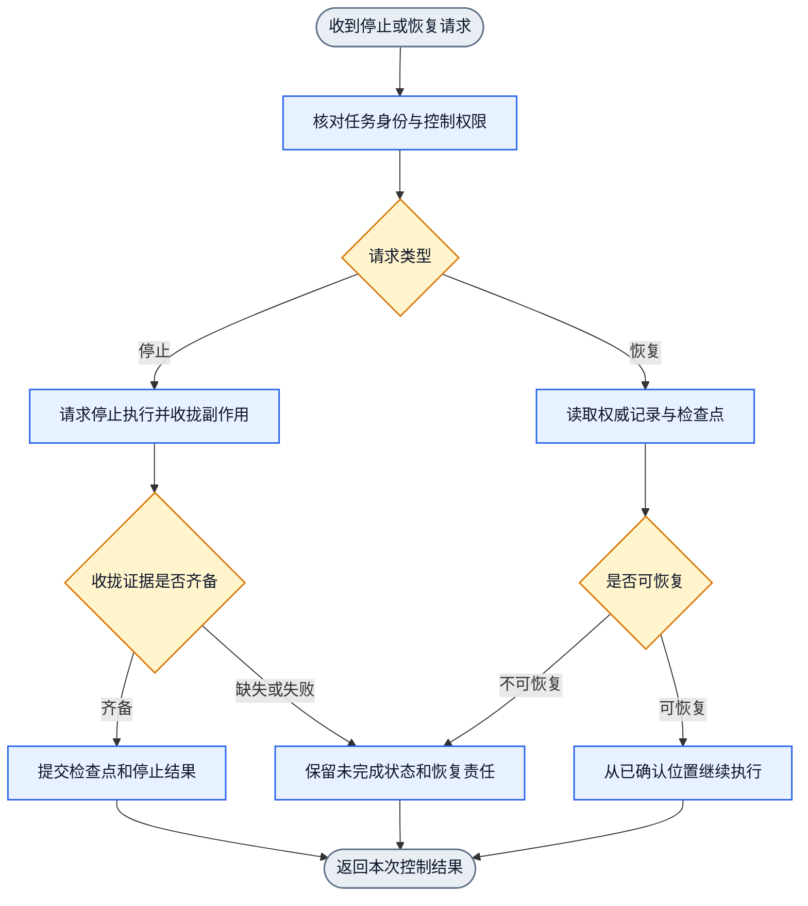
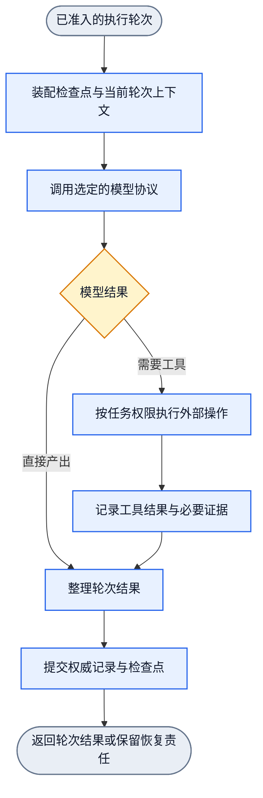

# HumanAgent 最小必要性与消融审计

状态：首轮静态审计，整体覆盖未完成；不代表运行时验收。基线为本机 main 工作树；已有未提交文档不作为已合并事实。没有修改产品代码。

## 判断原则

对每一项先确认当前有效需求、真实入口、唯一 owner、消费者和失败模式，再判断是否可删。仅有导出或测试不能证明生产使用；仓库内无引用也不能证明没有外部消费者。Journal 数据完整性、任务授权、停止收拢、恢复责任和两套 Provider 协议必须按需求保留。不同业务对象的独立状态不能因名称相似而合并。

## 新任务主线：目标语义草图

此图是用于审计的业务抽象，不是已验证的运行图或 DAGpipe 机器图。成功、失败及等待均汇入一次处理结果；长程续跑、定时触发和停止是独立对象流，不伪装成图内回边。

任务停止、故障恢复、定时任务和只读观测分别有不同入口，需沿现有独立图核对，不能混成一条串行链。`run/resume` 和 `serve` 是不同组装入口，任一入口的结果不能替代另一入口验收。

## 停止和恢复：独立对象流

## 执行轮次：责任边界草图

此图只表达一个执行轮次的责任边界。多轮编排、子任务、失败和恢复通过各自状态与下一次执行关联；静态图不证明这些路径已经运行或全部实现。

## 已核实事实与候选

| 项目 | 当前证据 | 消融判断与后续验收 |
| --- | --- | --- |
| 新任务草稿与确认链 | `docs/dagpipe/explicit-requirement.graph.json:48-50` 同时声明一次提交和固定草稿/修订/确认链；`packages/app/src/ui-runtime/service.ts:6687-6743` 在同次处理中仍注册 revision、确认并提交。 | 图把内部状态步骤作为固定业务节点，存在合并候选；不能据此认定 UI 有第二次点击，也不能直接删掉内部状态。先分开新任务与已有任务变更，验证一次提交、重复提交、崩溃恢复和旧版本变更拒绝后再压缩图与实现。 |
| 已撤回需求的模型控制块 | `.appsdk/requirements.json:256-268` 记录移除重复模型 control block；`packages/runtime/src/agent-io/request.ts:324` 仍解码，`packages/app/src/serve-runtime.ts:169-172` 仍组装其 coordinator。 | 已确认旧机制仍在代码与组装面，尚未证明实际产品请求走到它。先核实入口及其 summary 对轮次收口的依赖，按任务真相替换仍需的行为，再消融控制块解析及专属测试；验证简单直答结束和未完成任务续推。 |
| 旧工具适配器 | `packages/adapters/operations/src/legacy-route.ts:19` 实现并由 `index.ts:7-10` 导出；仓库内已找到的实例化仅在 `tests/adapters/operations/operations.test.ts`。 | 可疑退役路径。核实公开包、外部插件及配置无消费者后，连同专属类型、导出和只覆盖该路径的测试一起删除；验证现用工具的真实执行与授权。当前未证实外部无消费者。 |
| 固定值辅助函数 | `packages/core/src/steering.ts:90-92` 恒返回 false；仓库检索只找到 `tests/core/core.test.ts:206` 调用，`core/src/index.ts:4` 对外导出。 | 可删候选，但先核对外部消费者。真实停止语义仍由 stop operation、settlement 和 checkpoint 保证，不能删除相应状态转换及证据检查。 |
| 事件 Journal 的第二个构造器 | `packages/adapters/jsonl/src/index.ts:629` 的 `createJsonlEventPublicationJournal` 在仓库仅见测试调用；App 有自己的事件 Journal 实现。 | 需逐项比对幂等、顺序与恢复契约，确认外部无消费者后才能移除独立构造器及专属测试；不得删除权威 Journal 或事件实际写入链。 |
| 语义历史辅助封装 | `packages/runtime/src/checkpoints/semantic-history.ts:35-203` 导出提交和读取封装；已找到的跨文件调用来自语义历史与 checkpoint 的 public-consumer 测试，生产侧另有 `packages/app/src/checkpoint-journal.ts` 的持久化端口实现。 | 封装可能承担公开 consumer 与校验职责，不可仅凭生产源码无直接 import 删除。逐一比较参数校验、版本语义和公开 API 使用，再决定合并；必须保留精确 checkpoint 的读取、提交与恢复行为。 |
| 测试使用的 Hand 组装函数 | `packages/app/src/tool-execution-gateway.ts:171-172` 将 gateway 包装为 `HandOperationRuntime`；仓库中调用集中在 gateway 和 web-search 测试，并通过 `packages/app/src/index.ts:135` 导出。 | 测试辅助层候选。先核对外部 API 与测试是否需要该组装入口；若删去包装使测试更复杂或丢失独立行为保障，应保留。产品 gateway 与权限检查必须保留。 |
| 旧 Provider 参数 | `packages/app/src/cli.ts:746-775` 仍解析标记为 deprecated 的 `--mode`，并与 `--provider` 做冲突检查。 | 兼容路径候选；先确认 CLI 文档、脚本和外部用户是否仍依赖，制定迁移或弃用边界，再以真实 `serve` 入口验证配置选择、非法参数和错误反馈。不能因旧名字删掉真实 Provider 协议。 |
| 配置中的发布通道 | `packages/config/src/index.ts:160,910,925,991` 声明、解析并生成 `releaseChannel`；仓库 `packages/` 与 `scripts/` 中未发现读取该字段的业务消费者。 | 疑似无作用配置；仍须核查配置文件使用者、公开契约和实际安装升级流程。确认后删除配置字段、生成项及只保障该字段的专属测试，验证既有配置的兼容处理和安装入口。 |
| 遗留证据路径回退 | `packages/app/src/memory-runtime.ts:317-324` 对非 canonical locator 使用 `fallbackFilePathFor`。 | 先按真实数据确认历史 locator 是否仍可达、是否有迁移或保留要求。只有确认无数据及消费者后才能移除；否则保留读取能力。 |
| 旧交互原型 | `docs/ui/README.md:142` 称 `interaction.html` 是历史原型；`scripts/verify-package.mjs:64` 与 `tests/app/dashboard-e2e/scenarios/existing-task-change.mjs:61` 仍使用该路径。 | 它仍有测试和包验收消费者，不能直接删除。先确认已有任务变更的正式入口并迁移真实场景，再删除专属原型与多余断言；保留变更确认能力。 |
| 设计 mock 资产 | `docs/dagpipe/observation-read.graph.json:9` 明确 `docs/ui/semantic-observation-tour.html` 是独立 mock，不证明生产链。 | 与产品逻辑分开处理。先核对文档、历史证据和打包用途；不因静态图大就直接删除历史资产。 |
| DAG 校验重复和盲区 | `scripts/dagpipe-validate-graphs.mjs:44-47` 同时执行 DAGpipe 和绑定检查；`scripts/dagpipe-bind-graphs.mjs:27-112` 再检查端点、单源单汇和可达性。前者 `:11-13` 只扫描顶层图。 | 拓扑检查存在重叠候选，先用非法图反例证明 CLI 与本地检查的保障相同，再只移除重复部分；owner 路径/绑定是独立功能。嵌套图未被这个脚本自动发现是事实，但是否纳入该项目门禁需先判定该图是否正式纳管。 |

## 建议执行顺序

1. 先以新建任务、已有任务变更、停止恢复和只读观测为独立对象流，核对需求和现有图；优先查清已撤回的 control block 和实际收口链，消除图上不能证明独立职责的节点。先保留用户一次提交、FIFO 和真实失败语义。
2. 对旧适配器、固定值函数及旧 CLI 参数完成生产接线、公开导出和配置消费者核查。确认退役的候选按 owner 成组移除对应代码、专属类型与无独立保障的测试；仍被使用的保留，记录其使用者。
3. 对交互原型先迁移真实的已有任务变更验收入口，再决定是否删除原型；对历史证据回退先检查现有数据和恢复需求。
4. 对 DAG gate 分别执行合法图与悬空边、多入口、环等反例，证明两套检查的差异。只移除没有独立保障的重复部分；图变更后运行现有图校验。
5. 各批次完成对应真实入口回归：新任务一次提交及 FIFO；已有任务变更确认；工具执行及授权；stop、settle、checkpoint 和恢复；受影响的 Provider 协议录制回放或真实入口。完整可交付批次再整体 review 和集成。

## D19 逐项核查交付

以下结论以本轮静态源码及已注明的历史证据为界。`未知` 表示尚不能决定删除，既不是确认必要，也不是确认无用；真实入口未执行时不宣称已经复现。所有候选代码保持原样。

| Bug | 实际入口与已确认消费者 | 失败模式和证据 | 保留／移除／未知 |
| --- | --- | --- | --- |
| `69f2101` 模型控制块 | `serve` 的 `packages/app/src/cli.ts:1907` 创建组合对象；`packages/app/src/serve-runtime.ts:169-179` 提供 `agentIo.createRequest`，仓库未发现生产侧直接调用；`tests/runtime/agent-io/agent-io.test.ts:708-733` 直接使用 coordinator。 | `packages/runtime/src/agent-io/request.ts:324-354,374-421` 若被调用，缺 summary 会进入修复并可能终止；直接删会改变收口。有效需求已撤回重复块，但真实产品可达性和外部调用未证实。详见 `docs/architecture/control-block-ablation-evidence-2026-11-01.md`。 | 未知。先查可达性与收口 owner；不得保留重复控制，也不得伪造任务完成。 |
| `a807545` 草稿确认链 | 新任务从 `docs/ui/entry.js:1084-1151` 接收、解释并在同次提交中调用 confirmation；`packages/app/src/ui-runtime/service.ts:6687-6743` 管内部 revision、确认与 FIFO 提交。已有任务变更另有独立确认契约。 | `docs/dagpipe/explicit-requirement.graph.json:48-50` 同时描述单次确认和固定内部链；误删可能破坏重复提交幂等、恢复或变更确认。历史测试的 `tests/app/dashboard-e2e/lib/browser.mjs:1327` 可在需要时发 grant，不能以旧 SUCCESS 证明无额外审批。见 `docs/architecture/mvp-single-interface-intake-evidence-2026-11-01.md`。 | 未知。内部确认不等于第二次用户审批；逐节点证明职责后校正图。 |
| `f5cf73b` 旧适配器／常量函数 | `packages/adapters/operations/src/index.ts:7-10` 导出 `legacy-route.ts:19`；仓库实例化只见 `tests/adapters/operations/operations.test.ts:261` 等。`packages/core/src/steering.ts:90` 恒 false，已找到的调用为 `tests/core/core.test.ts:206`。 | 删除公开导出可能破坏仓库外消费者；误删同文件 stop/settle 逻辑会破坏停止收拢。生产引用未在仓库检索发现，外部消费者未知。 | 未知。确认退役后可移除专属路径；保留真实 stop、settle 和 checkpoint。 |
| `28469ed` 事件 Journal／语义历史封装 | `packages/adapters/jsonl/src/index.ts:629` 的构造器仓库消费者见 `tests/adapters/jsonl/journal.test.ts:921`；App 事件写入见 `packages/app/src/event-journal.ts:223`。`packages/runtime/src/checkpoints/semantic-history.ts:35-203` 被 `tests/app/semantic-history-public-consumer.test.ts:35-38` 调用；生产 checkpoint 读取见 `packages/app/src/ui-runtime/checkpoint-history.ts:372`。 | 幂等、版本与精确 receipt/recovery 可能不同；误删会破坏公开 consumer 或历史一致性。外部使用与行为等价性未证实。 | 未知。保留权威 Journal、资产完整性及现用恢复路径；先做契约对比。 |
| `353b2f1` 旧配置／回退 | `packages/app/src/cli.ts:751-775` 仍接受 `--mode`；`packages/config/src/index.ts:910-925,991` 接受并生成 `releaseChannel`；`packages/app/src/cli.ts:500` 向 `memory-runtime.ts:317-324` 注入历史证据路径回退。 | 删除 CLI 参数可能破坏既有调用；旧配置仍含 `releaseChannel` 时直接删 schema 会被 unknown-key 拒绝；删除回退可能使旧 evidence 无法读取。外部脚本与现存历史数据未查明。 | 未知。当前已证实仍有配置接线，应先核对使用及数据，再判断兼容边界。 |
| `b4f9f4f` 旧交互页面 | `docs/ui/README.md:142` 将其标为历史原型；`scripts/verify-package.mjs:64`、`tests/app/dashboard-e2e/scenarios/existing-task-change.mjs:61` 仍使用 `/interaction.html`。 | 直接移除会破坏包检查和已有任务变更验收；正式页面能否承载变更确认尚待实测。 | 当前保留。先迁移真实消费者及确认行为，再评估删除。 |
| `0016675` 图校验重叠 | `scripts/dagpipe-validate-graphs.mjs:11-13,44-47` 扫描顶层并调用 DAGpipe 与 binding 检查；`scripts/dagpipe-bind-graphs.mjs:27-53,60-81` 检查拓扑及 owner 文件。 | 重复检查可能增加无独立保障的负担；直接删可能放过 CLI 不覆盖的非法图或失去独立 binding 命令保障。嵌套图是否正式纳管未知。 | 未知。以合法、悬空边、多入口、多出口及环的反例比较两入口，再删等价部分；保留独立 owner 绑定检查。 |
| `5dcc763` Hand 包装 | `packages/app/src/tool-execution-gateway.ts:171-172` 把生产 gateway 包装为 Hand；`packages/app/src/index.ts:135` 导出；已找到消费者为 `tests/app/gateway-assembly.test.ts:541` 和 `tests/app/web-search-assembly.test.ts:68`。 | 删除可能破坏外部公开消费者或让测试不再验证该组装边界；其实际独立保障尚未证实。 | 未知。比较公开接口与测试价值；产品 gateway 和授权保持不变。 |
| `5be453f` 观测 mock | `docs/dagpipe/observation-read.graph.json:9` 声明 `docs/ui/semantic-observation-tour.html` 为独立 mock；`scripts/copy-ui-assets.mjs` 负责产品 UI 资产复制。 | mock 不能证明生产观测链；删除可能破坏文档、证据引用或打包约定。未证明历史资料与用户可访问路径已无消费者。 | 未知。先核对文档及包内用途；不能按体积认定可删。 |

本轮交付验收：九项均有源码或已限定的历史回执位置、入口、消费者、失败模式及结论。外部消费者、历史数据与真实入口可达性仍是明确未知；本轮未改候选产品代码、删除文件或操作生产状态。

## 证据和边界

- 本次执行 `node scripts/dagpipe-validate-graphs.mjs` 成功。它证明扫描到的图满足当前静态拓扑及绑定形状；不证明节点必要性、符号实际调用、业务正确性或线上运行。
- `explicit-requirement` 图标为 candidate/partial；图中历史生产接线行号并非当前源码定位，应以当前源码为准。
- App/UI、adapter/config 和运行时主线做了静态抽查；未逐项核实全部导出、动态调用、外部消费者和已存数据。运行时并行观察未形成完整交付，不能声称全项目代码审计完成。
- 本次 `nn-code calls` 对 `startUiRuntime` 的查询未在本次观察窗口内返回，已中止；本文的调用关系来自标注位置的源码核对，不冒称工具结果。
- 本文是静态审计与后续消融设计，不代表已完成运行验收。需继续核实代码全域和实际消费者，按「图 → 受影响 gate → 红测 → 唯一 owner → 真实入口回归」实施。
