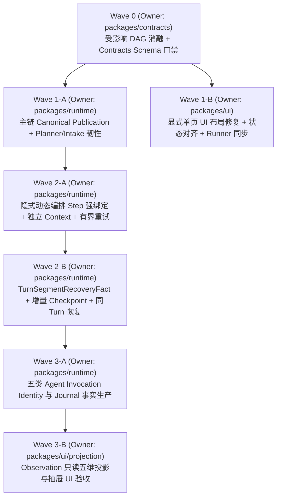

# HumanAgent 最小可用 MVP 审计与修复设计方案（v4 — 独立专家审查全项闭合版）

- 作者：Alice（Collab Peer，`codex-session-66376161386665362d393432652d346565362d616331352d343138386137383334306237`）
- 汇报与协调：Jason（CEO）、Jenny（Project Master）
- 审计基线：`origin/main` `ada11bec551a7cc525d1047f694879361c214e30`
- 独立专家审查闭环记录：
  - v1 审查报告：`/Volumes/Intel/playground/humanagent/.worker-runs/mvp-audit-alice-20261101/expert-review/expert-review-report.md`（提出 P0-1..P0-4、P1-1..P1-10、P2-1..P2-6）
  - v2 复核报告：`/Volumes/Intel/playground/humanagent/.worker-runs/mvp-audit-alice-20261101/expert-review/expert-review-v2-report.md`（关闭 P1-2..P1-9 共 8 项）
  - v3 复核报告：`/Volumes/Intel/playground/humanagent/.worker-runs/mvp-audit-alice-20261101/expert-review/expert-review-v3-report.md`（关闭 P0-2、P0-3、P0-4、P1-1..P1-10 及独立 Context 全部条目，仅剩 P0-1 要求消融 `deliveryText` 与 `summary.result.text` 的双字段冗余）
  - v4（本文档）：物理消融冗余顶层 `deliveryText` 字段，确立 `summary.result.text` 为唯一 Canonical 公开交付文本字段，完成设计层全部 P0/P1 闭合（代码实现与真实运行时交付仍须在后续 Wave 1–3 执行阶段按黑盒门禁逐项验证）。

---

## 1. 权威目标、有效项目需求与唯一 Owner 边界

### 1.1 用户定义的最小可用 MVP 四条标准

1. **目标 1（显式大脑交互界面）**：显式大脑为交互界面，交互清晰明确，状态呈现清晰准确，不让用户猜，不多显示不必要的内容。
2. **目标 2（显式→隐式→执行→返回结果主链）**：显式大脑执行任务整理后自动交付给隐式大脑进行编排，并且执行，返回结果。
3. **目标 3（隐式大脑 Checkpoint）**：隐式大脑的 Checkpoint 需要真实可用（覆盖每个 subagent 调用与 Turn 压缩、链式读取、中断与错误后的同 Turn/跨重启受控恢复）。
4. **目标 4（每个 Agent 的完整工具链 Debug 信息）**：每个 Agent 需要有完整的工具链显示 Debug 信息，包括当前 Turn 状态、上下文状态、工具状态、模型请求状态与错误链。

### 1.2 `.appsdk/requirements.json` 全量有效需求映射（含独立 Context 与异构 Provider/Model 契约）

| 需求 ID | 核心约束 | v3 对应契约与落地章节 |
|---|---|---|
| `humanagent-explicit-brain-simple-answer-or-standard-task-routing` / `humanagent-explicit-brain-task-kind-inference` | 简单问答直接回答结束；复杂问题由显式大脑自动推理任务类型并按标准模板派发，无需用户手选类型或二次确认 | §2.1、§5 Wave 1-A / Wave 1-B |
| `humanagent-human-readable-semantic-layered-ux-and-necessary-display` / `humanagent-task-list-truthful-result-and-action-boundary` | 不显示机械语言；按层次显示必要内容；消除“一个任务下放生成两个任务（等待决策+受阻）”“已完成还有无操作界面的下一步” | §4、§5 Wave 1-B：主视图聚合单一任务身份，剥离 `scheduled-task` / `subscription:requirement:` 机械双生暴露；终态 `succeeded` 不再显示无操作入口的“下一步” |
| `humanagent-responsive-ux-bottom-sheet-and-four-corner-configuration` | 兼顾手机和桌面排版，手机以下方弹抽屉进入下一层；**主动的配置是四个角落的 button** | §4、§5 Wave 1-B：**保留四角配置按钮**，通过页头/容器安全内边距消除四角按钮与正文卡片的 bounding box 重叠 |
| `humanagent-implicit-brain-budgeted-independent-orchestration` / `humanagent-dynamic-orchestrator-choice-and-agent-termination` | 隐式大脑为 `checkpoints + 最新 turn 完整 context`；**探索、plan、review、execute 是编排者自主动态选择，非写死固定阶段，agent 结束才结束**；每个 subagent 调用都是一个 checkpoint；**每个 agent 可用不同 provider 和 model，都是独立 context，不继承编排者上下文** | §3.2 `PlanRevisionRecord`、§3.4 `AgentInvocationIdentity`：显式定义每个 Agent / Subagent 的 `modelBinding` 与 `contextIsolation`（`inheritsOrchestratorContext: false`，仅由自身 checkpoint + 显式派单模板组装独立窗口） |
| `humanagent-turn-checkpoint-four-part-summary-and-planner-iteration` / `humanagent-standard-turn-closure-forced-reasoning-and-same-turn-recovery` | Turn 结束压缩为四段 checkpoint（目标、做了什么、结果、下一步预计做什么）并交 Planner 迭代；未执行标准结束动作则强制续推；**出现错误可多次 retry 后停下，恢复后继续当前 turn** | §3.1 唯一公开交付规则、§3.2 动态编排与重试、§3.3 `TurnSegmentRecoveryFact` 同 Turn 恢复 |
| `humanagent-provider-work-order-ablate-graph-governance-code` | **先消融图的节点，然后更新治理程序，然后再开始执行代码修改** | §2 Wave 0：受影响 DAG 消融与校验作为所有代码修改的前置阻塞门禁 |

### 1.3 唯一 Semantic Owner 与 Supporting Owner 边界（闭合 P1-1、P1-2、P1-3）

每项职责与每个实施阶段均只有**唯一一个 Canonical Semantic Owner**，其他包仅作为 Supporting Owner 按契约适配：

| 职责域 | 唯一 Canonical Semantic Owner | Supporting Owners（仅按契约适配，不拥有状态真源） |
|---|---|---|
| 跨层公共数据结构与协议 Schema 契约（含 DAG 拓扑绑定声明） | `packages/contracts` | `docs/dagpipe`（图文件承载拓扑声明，由 `scripts/dagpipe-validate-graphs.mjs` 校验绑定） |
| 领域状态机、错误策略、恢复裁决、任务生命周期 | `packages/core` | `packages/contracts` |
| 显式整理、隐式动态编排、Turn/Checkpoint 协调、独立窗口装配、公开结果最终发布（Publication） | `packages/runtime` | `packages/app`（依赖注入与端口组装，禁止二次结果归一化） |
| Organ Journal 权威历史追加与尾扫读取 | `packages/adapters/jsonl` | `packages/runtime`（通过 Journal Port 调用；Provider/UI 严禁直接写 Journal） |
| Provider 协议 Codec、模型身份提取、外部 Stop/Settle 探测 | `packages/adapters/provider` | `packages/runtime`（消费 typed `ProviderTurnTelemetry` 与 `ProviderSettleReceipt`） |
| 只读观测领域投影（View Model / `AgentDebugInspection`） | `packages/ui/projection` | `packages/contracts`（Schema）、`packages/ui`（`docs/ui` DOM 渲染）、`packages/app`（HTTP 只读路由挂载） |
| 浏览器交互视图与响应式布局 | `packages/ui` | `docs/ui`（静态资产实现）、`tests/app/dashboard-e2e`（验收 Runner 同步） |

---

## 2. Wave 0：受影响 DAG 消融与契约前置门禁（闭合 P0-4、P1-6）

遵照 `humanagent-provider-work-order-ablate-graph-governance-code`，在任何业务代码修改前，先完成以下 5 张 DAG 的节点消融与拓扑闭合，并通过 `node scripts/dagpipe-validate-graphs.mjs`：

1. `docs/dagpipe/explicit-requirement.graph.json`：
   - **消融**：删除表示“等待用户第二次确认”的旧节点语义，将 `create_reviewable_draft → confirm_exact_revision` 消融合并为显式 Brain 单次提交内部整理节点 `normalize_and_commit_requirement_envelope`（新建任务表单提交即完成确认并同次投递 FIFO `RequirementEnvelope`；仅“修改已有任务范围/目标”才走 `confirm_existing_task_change` 分支）。
   - **新增约束**：提交后入口视图保持 `stay_on_single_entry_surface`，不再触发强制跨页跳转。
2. `docs/dagpipe/implicit-turn-closure.graph.json`：
   - **补正**：将隐式编排表示为编排者主导的动态循环（`orchestrator_select_action` → 可选多次 `subagent_explore / subagent_plan / tool_execute / subagent_review`，每次均绑定 `planRevisionId` + `stepId` 与独立 Context → 每次 subagent 完成写入 `commit_subagent_checkpoint` → Turn 收口写入四段 `commit_turn_checkpoint` → `planner_align_iteration` 产出下一 `task-plan-revision.published`）。
   - **新增门禁**：`validate_canonical_public_output` 节点——当 Turn 声明完成任务时，必须通过结构化公开交付校验，否则进入 `force_continuation_reasoning`。
3. `docs/dagpipe/native-turn-checkpoint.graph.json` 与 `docs/dagpipe/native-turn-segment-recovery.graph.json`：
   - **闭合**：接入 `record_operation_effect_ledger` → `reconcile_in_flight_operations` → `persist_recovery_checkpoint` → 按 `effect_safety_predicate` 确定性分流至 `auto_resume_same_turn_segment`（无未知写副作用）或 `enter_recovery_hold`（存在未知写副作用，开放显式 `recover` 动作）。
4. `docs/dagpipe/observation-read.graph.json`：
   - **新增节点**：`bind_agent_invocation_identity` → `project_five_dimension_agent_debug` → `render_readonly_agent_drawer`，闭合五类 Agent 从 Organ Journal 到只读 UI 抽屉的完整数据流。

---

## 3. 四大 P0 架构缺陷与权威需求的精确闭环契约（闭合 P0-1 至 P0-4、P1-10）

### 3.1 公开业务结果唯一真源与发布契约（闭合 P0-1、P1-3）

- **唯一 Canonical Semantic Owner**：`packages/runtime`（`packages/runtime/src/ui-runtime/coordinator.ts`）。`packages/app/src/ui-runtime/standard-turn-composition.ts` 只做参数 Schema 校验与原样透传，严禁执行二次结果推导。
- **严禁非结构化推导与双字段冗余**：物理删除任何“从字串化摘要、日志或 checkpoint 自由文本截取公开结果”的逻辑，同时物理消融 `StandardTurnEndPayload` 中冗余的顶层可选字段 `deliveryText`，确立结构化 `summary.result.text` 为**唯一**的公开交付文本字段（对齐 `humanagent-turn-checkpoint-four-part-summary-and-planner-iteration` 四段式结构）。
- **唯一 Canonical Schema（`packages/contracts/src/standard-turn-end.ts`）**：
  ```ts
  export interface StandardTurnEndSummary {
    readonly goal: string;
    readonly actions: readonly string[];
    readonly result: {
      readonly status: 'completed' | 'partial' | 'blocked';
      /** 唯一 Canonical 公开交付文本字段；与 actions/nextStep 内部恢复字段严格隔离 */
      readonly text: string;
    };
    readonly nextStep: string;
  }

  export interface StandardTurnEndPayload {
    readonly outcome: 'completed' | 'continue' | 'blocked';
    readonly summary: StandardTurnEndSummary;
    readonly deliveryRefs?: readonly string[];
  }
  ```
- **Canonical Publication 确定性规则（仅在 `coordinator.ts` 执行一次）**：
  1. 仅当 `payload.outcome === 'completed' && payload.summary.result.status === 'completed'` 时，允许进入公开交付发布流程。
  2. **唯一文本真源**：读取 `payload.summary.result.text.trim()`，当其长度 `> 0` 时作为公开交付文本发布。
  3. **幂等提交**：生成的公开交付以唯一 `publicationId = pub:${operationId}:${turnId}` 写入 `publicOutput.commits` 并同步至 `record.output`；同一 `(operationId, turnId)` 重复调用保持幂等。
  4. **拒绝空交付与非完成状态发布**：
     - 若 `payload.outcome !== 'completed'` 或 `payload.summary.result.status !== 'completed'`，严禁向 `publicOutput.commits` 发布任何文本。
     - 若 `payload.outcome === 'completed'`，但 `payload.summary.result.text.trim()` 为空串（且无声明的非文本交付资产），校验立即失败并抛出 `standard-turn-end.missing-public-deliverable`，触发 `humanagent-standard-turn-closure-forced-reasoning-and-same-turn-recovery` 在同一 Turn 内强制续推重问，绝不产生 `state: "succeeded"` 且 `publicOutput.commits: []` 的空结果假成功。

### 3.2 隐式大脑动态编排、步骤强绑定与独立 Context 契约（闭合 P0-4、P1-4 及 `.appsdk` 独立上下文需求）

- **唯一 Canonical Semantic Owner**：`packages/runtime`（`packages/runtime/src/ui-runtime/coordinator.ts`）；Supporting Owner：`packages/app`（`packages/app/src/ui-runtime/service.ts`）。
- **消除双轨旁路**：
  - 删除 `service.ts:7241-7245` 中 `defaultOrchestrate()` 对 `this.nativeDriverBound` 返回 `{}` 的旁路分支，以及 `service.ts:2406` 在 `executionPorts` 绑定时撤回 `providerRetry` 的逻辑。
  - `--mode rcc` 统一进入 `orchestrated: true` 的隐式大脑受控通道；Native Provider Driver 仅作为隐式编排下的底层步骤执行算子（Execution Port），不拥有独立于 Coordinator 之外的第二条执行或重试循环。
- **动态编排与 `PlanRevisionRecord` 强绑定契约（`packages/contracts`）**：
  ```ts
  export interface AgentModelBinding {
    readonly provider: string;
    readonly requestedModel: string;
    readonly actualModel: string | null;
  }

  export interface SubagentContextIsolationPolicy {
    readonly contextRootId: string; // ctx:${taskId}:${operationId}:${stepId}:${epoch}
    readonly parentContextId: string | null;
    /** 强制为 false：Subagent 严禁继承编排者完整对话窗口 */
    readonly inheritsOrchestratorContext: false;
    /** 仅允许注入该 Subagent 自身前序 Checkpoint 与显式派单模板输入 */
    readonly allowedInputSources: readonly ('explicit-dispatch-template' | 'subagent-own-checkpoints' | 'declared-evidence-refs')[];
  }

  export interface PlanRevisionStep {
    readonly stepId: string; // step:${planRevisionId}:${index}
    readonly kind: 'explore' | 'plan' | 'execute' | 'review';
    readonly targetAgentRole: 'orchestration' | 'execution' | 'review';
    readonly objective: string;
    readonly state: 'pending' | 'running' | 'completed' | 'failed';
    readonly effectPolicy: 'readonly' | 'mutating';
    readonly modelBinding: AgentModelBinding;
    readonly contextIsolation: SubagentContextIsolationPolicy;
    readonly inputEvidenceRefs: readonly string[];
    readonly outputEvidenceRefs: readonly string[];
  }

  export interface PlanRevisionCommittedRef {
    readonly eventKind: 'task-plan-revision.published';
    readonly commitId: string; // plan-commit:v1:${planRevisionId}
    readonly journalSeq: number;
    readonly state: 'committed';
  }

  export interface PlanRevisionRecord {
    readonly planRevisionId: string; // plan-rev:${taskId}:${operationId}:${revisionSeq}
    readonly taskId: string;
    readonly operationId: string;
    readonly executionEpoch: number;
    readonly predecessorCheckpointId: string | null;
    readonly decision: 'continue' | 'complete' | 'replan' | 'blocked';
    readonly steps: readonly PlanRevisionStep[];
    readonly committedRef: PlanRevisionCommittedRef;
  }
  ```
- **执行消费与步骤强绑定规则（闭合 P0-4）**：
  1. 任何 `explore / plan / execute / review` 子步骤派发前，必须已在 `task-control.jsonl` 存在 `committedRef.state === 'committed'` 的 `PlanRevisionRecord`，且其 `taskId`、`operationId`、`executionEpoch` 与当前运行态严格相等。
  2. 每次执行派发（`operation.event` / `provider.model` / `provider.tool`）必须显式携带 `boundPlanRevisionId` 与 `boundPlanStepId`（必须命中 `PlanRevisionRecord.steps[].stepId`）；若缺失或不匹配，Coordinator 立即拒绝派发并抛出 `orchestration.unbound-plan-step`。
  3. 每次 subagent 调用结束或每个 Turn 收口时，先落盘四段式 Checkpoint（`goal / actions / result / nextStep`），再由独立 Planner（使用独立 `contextRootId` 与配置的 `modelBinding`）产出下一版本 `PlanRevisionRecord`。

### 3.3 副作用安全的操作账本与 Checkpoint 同 Turn 恢复契约（闭合 P0-2、P1-8）

- **唯一 Canonical Semantic Owner**：`packages/runtime`（`packages/runtime/src/checkpoints/` 与 `coordinator.ts`）；Supporting Owner：`packages/adapters/jsonl`（持久化）、`packages/adapters/provider`（提供 `ProviderSettleReceipt`）。
- **结构化操作效果账本与恢复事实（`TurnSegmentRecoveryFact`）**：
  统一 `recoveryOutcome` 与 `checkpoint.committed` 的 `outcome` 枚举，明确定义 Provider Settle 确认来源与责任归属：
  ```ts
  export type CheckpointCommittedOutcome =
    | 'succeeded'
    | 'stopped'
    | 'recovery-auto-resumed'
    | 'recovery-hold-effect-unknown';

  export interface ProviderSettleReceipt {
    readonly providerRequestId: string | null;
    readonly state: 'not-sent' | 'stopped' | 'settled';
    readonly verifiedBy: 'lease-process-exit-reconcile' | 'provider-adapter-stop-ack' | 'response-stream-eof';
    readonly verifiedAt: string;
  }

  export interface ToolEffectLedgerEntry {
    readonly callId: string;
    readonly boundPlanStepId: string;
    readonly toolName: string;
    readonly effectPolicy: 'readonly' | 'mutating';
    readonly idempotencyKey: string;
    readonly state:
      | 'dispatched-effect-unknown'
      | 'effect-committed'
      | 'effect-failed-clean'
      | 'reconciled';
    readonly outputArtifactRef: string | null;
  }

  export interface TurnSegmentRecoveryFact {
    readonly taskId: string;
    readonly operationId: string;
    readonly turnId: string;
    readonly executionEpoch: number;
    readonly segmentSeq: number;
    readonly predecessorCheckpointId: string | null;
    readonly planRevisionId: string | null;
    readonly recoveryResponsibilityOwner: 'humanagent.runtime';
    readonly providerSettleReceipt: ProviderSettleReceipt;
    readonly toolEffects: readonly ToolEffectLedgerEntry[];
    readonly recoveryOutcome: 'recovery-auto-resumed' | 'recovery-hold-effect-unknown' | 'stopped';
  }
  ```
- **确定性恢复流程（闭合 P0-2）**：
  1. **增量落盘时机**：
     - 每次工具调用或 subagent 派发前追加 `dispatched-effect-unknown`（含 `providerRequestId` 与 `idempotencyKey`）；结果落盘后立即追加 `effect-committed` 与 subagent/loop 级增量 Checkpoint。
     - Turn 正常结束时写入四段式 Turn Checkpoint（`outcome: 'succeeded'`）。
  2. **进程崩溃（`SIGKILL`）或重启（`humanagent restart`）后的 Reconcile 与确定性分流**：
     - 启动 Hydrate 阶段首先执行 `reconcileInFlightOperations`：通过 Supervisor 租约 PID 退出验证（`lease-process-exit-reconcile`）与 Provider Adapter 停止确认（`provider-adapter-stop-ack`）生成 `ProviderSettleReceipt`（确保无悬空在途请求）。
     - **分支 A（确定性自动续跑 `recoveryOutcome: 'recovery-auto-resumed'`）**：当 `toolEffects` 中不存在任何 `effectPolicy === 'mutating' && state === 'dispatched-effect-unknown'` 的条目时，先落盘一条 `checkpoint.committed`（`outcome: 'recovery-auto-resumed'`，内含完整 `TurnSegmentRecoveryFact`），随后自动开启 `executionEpoch + 1`（`segmentSeq + 1`），跳过已 `effect-committed` 的步骤并直接注入其 `outputArtifactRef`，继续当前 Turn 直至完成。
     - **分支 B（确定性人工恢复挂起 `recoveryOutcome: 'recovery-hold-effect-unknown'`）**：当存在任何 `effectPolicy === 'mutating' && state === 'dispatched-effect-unknown'` 的条目时，先落盘一条 `checkpoint.committed`（`outcome: 'recovery-hold-effect-unknown'`），任务进入持久化 `blocked`（`allowedActions: ['recover', 'stop']`），严禁自动重放；用户点击 UI “确认并继续当前回合”（调用 `POST /api/tasks/:id/recover`）后，将该条目标记为 `reconciled` 并开启 `executionEpoch + 1` 继续当前 Turn。
     - **分支 C（用户主动 `humanagent stop`）**：落盘 `checkpoint.committed`（`outcome: 'stopped'`，`recoveryOutcome: 'stopped'`），重启后保持 `stopped`（`allowedActions: ['start']`）。

### 3.4 五类 Agent 真实调用身份、独立 Context 与只读五维 Debug 契约（闭合 P0-3、P1-2、P1-10）

- **职责分离（闭合 P1-2）**：
  - `packages/adapters/provider` 只负责从底层响应提取 `ProviderTurnTelemetry` 并返回给 `packages/runtime`，**严禁直接写 Organ Journal**。
  - `packages/runtime` 负责产生带 `AgentInvocationIdentity` 的生命周期与窗口事件，通过 Journal Port 交由 `packages/adapters/jsonl` 唯一写入。
  - `packages/ui/projection` 只读消费 Journal 与不可变证据引用，生成 `AgentDebugInspection`。
- **完整 TypeScript 契约与完备状态枚举（闭合 P0-3、P1-10）**：
  ```ts
  export type AgentRoleId = 'interaction' | 'orchestration' | 'execution' | 'review' | 'memory';

  export type AgentInvocationStatus =
    | 'not-invoked'
    | 'active'
    | 'completed'
    | 'failed'
    | 'rejected';

  export type DebugDimensionState =
    | 'collected'
    | 'invoked-without-model'
    | 'invoked-without-tools'
    | 'data-not-collected'
    | 'data-collected-but-not-projected'
    | 'collection-failed'
    | 'not-applicable'
    | 'not-invoked';

  export interface AgentInvocationIdentity {
    readonly invocationId: string; // inv:${agentRole}:${taskId ?? 'entry'}:${operationId ?? 'none'}:${turnId}:${seq}
    readonly agentRole: AgentRoleId;
    readonly sourceNodeId: string;
    readonly taskId: string | null;
    readonly operationId: string | null;
    readonly turnId: string;
    readonly executionEpoch: number;
    readonly boundPlanRevisionId: string | null;
    readonly boundPlanStepId: string | null;
    readonly parentInvocationId: string | null;
    readonly contextIsolation: {
      readonly contextRootId: string;
      readonly parentContextId: string | null;
      readonly inheritsOrchestratorContext: boolean; // subagent 恒为 false
    };
  }

  export type TokenUsageInspection =
    | {
        readonly state: 'collected';
        readonly inputTokens: number;
        readonly outputTokens: number;
        readonly totalTokens: number;
      }
    | {
        readonly state: 'data-not-collected' | 'not-applicable';
        readonly reason: 'provider-protocol-omitted' | 'stream-aborted' | 'no-model-call';
      };

  export interface AgentDebugInspection {
    readonly agentRole: AgentRoleId;
    readonly invocationStatus: AgentInvocationStatus;
    readonly latestInvocation: AgentInvocationIdentity | null;
    readonly invocationHistoryCount: number;
    readonly turn: {
      readonly state: DebugDimensionState;
      readonly turnId: string | null;
      readonly round: number | null;
      readonly lifecycleState: 'running' | 'completed' | 'failed' | 'rejected' | null;
      readonly startedAt: string | null;
      readonly completedAt: string | null;
      readonly durationMs: number | null;
    };
    readonly context: {
      readonly state: DebugDimensionState;
      readonly contextRootId: string | null;
      readonly inheritsOrchestratorContext: boolean | null;
      readonly messageCount: number | null;
      readonly charCount: number | null;
      readonly injectedRefs: readonly string[];
      readonly compacted: boolean | null;
      readonly omissionReason: string | null;
    };
    readonly model: {
      readonly state: DebugDimensionState;
      readonly provider: string | null;
      readonly requestedModel: string | null;
      readonly actualModel: string | null;
      readonly retryCount: number;
      readonly tokenUsage: TokenUsageInspection;
    };
    readonly tools: {
      readonly availableToolsState: 'collected' | 'invoked-without-tools' | 'data-not-collected' | 'not-invoked';
      readonly availableTools: readonly string[];
      readonly callsState: DebugDimensionState;
      readonly calls: readonly {
        readonly callId: string;
        readonly toolName: string;
        readonly state: 'running' | 'succeeded' | 'failed';
        readonly durationMs: number | null;
        readonly redactedInputSummary: string; // <= 256 chars, 敏感凭据脱敏
        readonly outputRef: string | null;
        readonly errorMessage: string | null;
      }[];
    };
    readonly error: {
      readonly state: 'present' | 'none' | 'data-not-collected';
      readonly code: string | null;
      readonly message: string | null;
      readonly owner: string | null;
      readonly retryable: boolean | null;
      /** 纯文本只读恢复提示；UI 严禁将其渲染为可执行按钮 */
      readonly readonlyNextActionHint: string | null;
    };
  }
  ```
- **默认持久化范围、保留策略与采集边界（闭合 P1-10）**：
  1. **产品观测 vs Debug 边界**：上述 `AgentInvocationIdentity`、`turn` 起止时间戳、`context.window.assembled` 统计计数（不含 Prompt 全文）、`provider.model.observed`（模型身份与 `TokenUsageInspection`）、工具调用元数据与 `error` 结构属于满足用户 MVP 目标 4 的轻量级产品观测事实，常驻写入任务对应的 Organ Journal（`~/.humanagent`）。
  2. **保留与淘汰策略**：完全复用已合入 `main`（`9a214a20e` + `3a90267b7`）的有界 Checkpoint + `delta-v1` 与分块反向尾扫机制；大体积原始 Provider SSE 帧与工具完整输出仅存入 `packages/adapters/filesystem`（`artifacts/ui-provider-evidence/`），Journal 只存不可变 `outputRef`/`evidenceRef` 指针，UI 抽屉仅在用户展开单条记录时按需只读加载。
  3. **逐字段缺失投影规则**：
     - 当某类 Agent 在本任务中未被调用：顶层 `invocationStatus = 'not-invoked'`，五维 `state` 均为 `'not-invoked'`；
     - 当某类 Agent 被调用但属于纯规则/准入步骤（未发起模型请求，如 `implicit.classify`）：`turn.state = 'collected'`，`model.state = 'invoked-without-model'`，`model.tokenUsage = { state: 'not-applicable', reason: 'no-model-call' }`；
     - 当发起了模型请求但底层协议（如 RCC Responses 流）未返回 usage 字段：`model.state = 'collected'`，`model.tokenUsage = { state: 'data-not-collected', reason: 'provider-protocol-omitted' }`；
     - 当 Agent 未绑定任何工具（如 `interaction` 或 `orchestration` Planner）：`tools.availableToolsState = 'invoked-without-tools'`，`tools.callsState = 'invoked-without-tools'`。

---

## 4. 物理删除与保留清单（闭合 P2-1 至 P2-6）

| 模块 | 物理删除的冗余/错误分支 | 保留并强化的唯一真源路径 |
|---|---|---|
| `docs/ui/entry.js` | 删除把直接回答写入顶部 `.status-banner` 的代码；删除新任务提交成功后 `window.location.assign` 跳出当前页的逻辑；删除宣传式 lede 文本 | 保留单一入口页面：直接回答渲染在主列 `#entry-direct-answer`；新任务原地渲染实时进度卡与完成结果 |
| `docs/ui/runtime-shell.js` & `runtime.css` | 删除四角配置按钮与正文重叠的无边距布局 | **保留四角配置按钮**（符合 `humanagent-responsive-ux-bottom-sheet-and-four-corner-configuration`），通过页头/容器安全内边距确保零遮挡 |
| `docs/ui/task-dashboard.js` & `service.ts` | 删除将 `subscription:requirement:*` 拼入主展示标题的逻辑；删除未归类观测记录循环生成上千个“查看只读证据”按钮的逻辑；删除主状态 chip 对 `currentState` 的混用绑定；删除 `succeeded` 任务展示无操作入口的“下一步”文案 | 主状态 chip 唯一绑定业务 `task.state`；主列表与详情统一展示单一任务 `semanticTitle`（Journal 原始 identity 不篡改，仅在展示投影层剥离前缀）；未归类记录聚合为单行计数 |
| `packages/contracts/src/standard-turn-end.ts` & `coordinator.ts` | 物理删除冗余的顶层可选字段 `deliveryText` 及 `refs-only` 跳过公开文本发布的分支 | 确立 `summary.result.text`（当 `outcome === 'completed' && summary.result.status === 'completed'` 时）为唯一 Canonical 公开结果文本来源 |
| `packages/app/src/ui-runtime/service.ts` | 删除 `defaultOrchestrate()` 中 `if (this.nativeDriverBound) return {}` 的旁路分支；删除 `service.ts:2406` 撤回 `providerRetry` 的分支 | `--mode rcc` 统一进入 `orchestrated: true` 受控通道 |
| `docs/ui/interaction-work-card.js` | 物理删除 `938-953` 行无条件追加“模型请求轨迹未投影 / 工具调用与返回轨迹未投影”假占位的逻辑 | 按 `AgentDebugInspection` 的 `DebugDimensionState` 精确渲染五维面板 |

---

## 5. 串并行分阶段实施与确定性黑盒验收合同（闭合 P1-1、P1-4、P1-5、P1-7、P1-8、P1-9）

各阶段均指定**唯一一个 Canonical Semantic Owner**，严格消除共享文件写冲突，按依赖拓扑推进：



### Wave 0：受影响 DAG 消融与契约定义（前置阻塞门禁）
- **Canonical Semantic Owner**：`packages/contracts`（Supporting Owner：`docs/dagpipe`）。
- **Allowed Paths**：`packages/contracts/src/**`、`tests/contracts/**`、`docs/dagpipe/*.graph.json`。
- **Forbidden Paths**：`packages/runtime/**`、`packages/app/**`、`packages/ui/**`、`docs/ui/**`。
- **交付与验收**：更新第 2 节所列 5 张 DAG 并通过 `node scripts/dagpipe-validate-graphs.mjs`；在 `packages/contracts` 落地 `StandardTurnEndPayload`、`PlanRevisionRecord`、`TurnSegmentRecoveryFact`、`AgentInvocationIdentity`、`AgentDebugInspection` 类型与负向 Schema 单测，`pnpm typecheck` 与 `tests/contracts` 全绿。

### Wave 1-A：主链公开结果唯一发布与 Planner/Intake 解析韧性（修复 B1、B3）
- **Canonical Semantic Owner**：`packages/runtime`（Supporting Owner：`packages/app` 的 `turn-planner.ts`、`explicit-brain-runtime.ts`、`standard-turn-composition.ts`）。
- **Allowed Paths**：
  - `packages/runtime/src/ui-runtime/coordinator.ts`
  - `packages/app/src/ui-runtime/standard-turn-composition.ts`
  - `packages/app/src/ui-runtime/turn-planner.ts`
  - `packages/app/src/explicit-brain-runtime.ts`
  - `tests/runtime/**`、`tests/app/*turn*`、`tests/app/*explicit*`
- **Forbidden Paths**：`docs/ui/**`、`packages/ui/**`、`packages/app/src/ui-runtime/service.ts`。
- **确定性红测与黑盒验收**：
  1. 正例：`outcome === 'completed' && summary.result.status === 'completed'` 且 `summary.result.text` 非空时，唯一从 `summary.result.text` 产生 `publicOutput.commits`（`publicationId = pub:${operationId}:${turnId}`），`dashboard.output` 与公开提交严格一致；
  2. 负向红测（防止伪结果）：当 `summary.result.text` 为空（即使 `summary.actions`、`summary.goal` 或日志含文本），或 `summary.result.status !== 'completed'`，或传入已退役的顶层 `deliveryText` 时，严禁产生 `publicOutput.commits`，抛出 `standard-turn-end.missing-public-deliverable` / Schema 校验错误并触发同 Turn 强制续推；
  3. Planner 首次返回 Markdown 围栏 JSON 或首次格式错误、第二次返回合法 JSON 时，Turn 正常收口为 `succeeded`；
  4. 显式 Intake 单次响应含多段 JSON 时准确提取单一决策，不抛 500。

### Wave 1-B：显式大脑单界面清晰呈现与 E2E Runner 合同同步（修复 A1–A5）
- **Canonical Semantic Owner**：`packages/ui`（Supporting Owner：`packages/app/src/ui-runtime/service.ts` 标题投影、`tests/app/dashboard-e2e`）。
- **Allowed Paths**：
  - `docs/ui/entry.js`、`docs/ui/runtime.css`、`docs/ui/runtime-shell.js`、`docs/ui/task-dashboard.js`、`docs/ui/observation.js`
  - `packages/ui/projection/**`
  - `packages/app/src/ui-runtime/service.ts`（仅限 `semanticTitle` 与状态标签映射）
  - `tests/ui/**`、`tests/app/dashboard-e2e/**`
- **Forbidden Paths**：`packages/runtime/**`、`packages/contracts/**`、`packages/app/src/explicit-brain-runtime.ts`。
- **确定性红测与黑盒验收（真实 RCC `127.0.0.1:4444`，`1280x720` + `390x844` 双视口）**：
  1. 简单问题直接回答：`.page-heading-copy` 宽度在 `1280x720` 下 `>= 320px`，答案在主列 `#entry-direct-answer` 独立卡片整宽显示，`#entry-live` 显示“本次请求已直接回答”；
  2. 四角配置按钮完整保留，且四角按钮与正文卡片 bounding box 交集面积为 `0`；
  3. 复杂任务提交后留在同一入口页原地展示实时进度卡与完成结果（用户主动点击卡片才打开详情），主状态 chip 与同刻 `/api` 的 `task.state` 严格一致，页面不出现 `subscription:requirement:`、`scheduled-task` 双任务或英文内部阶段名，终态 `succeeded` 不显示无操作入口的“下一步”。

### Wave 2-A：隐式大脑动态编排步骤强绑定、独立 Context 与有界纠正重试（修复 B2，依赖 W1-A + W1-B）
- **Canonical Semantic Owner**：`packages/runtime`（Supporting Owner：`packages/app/src/ui-runtime/service.ts`）。
- **Allowed Paths**：
  - `packages/app/src/ui-runtime/service.ts`、`packages/app/src/ui-runtime/index.ts`
  - `packages/runtime/src/ui-runtime/coordinator.ts`
  - `tests/runtime/**`、`tests/app/dashboard-e2e/**`
- **确定性红测与黑盒验收**：
  1. 正例：`--mode rcc` 任务 `operation.prepared.allocation.orchestrated === true`；每次执行步骤派发前已在 `task-control.jsonl` 存在 `committedRef.state === 'committed'` 的 `PlanRevisionRecord`，且执行事件携带的 `boundPlanRevisionId` 与 `boundPlanStepId` 精确命中 `PlanRevisionRecord.steps[].stepId`；
  2. 独立 Context 与异构 Model 断言：每个 `PlanRevisionStep` 包含 `modelBinding` 与 `contextIsolation.inheritsOrchestratorContext === false`，Subagent 窗口装配不包含编排者原始历史消息；
  3. 负向红测：缺失 committed `PlanRevisionRecord` 或 `boundPlanStepId` 不匹配时，Coordinator 抛出 `orchestration.unbound-plan-step` 拒绝执行；Native Driver 不启动第二条独立执行流；
  4. 真实 RCC `127.0.0.1:4444` 运行 `local-file-search` 与 503 注入用例：完整断言“单次提交 → 显式整理 → FIFO `RequirementEnvelope` → 隐式准入 → `task-plan-revision.published` 提交 → 绑定 `stepId` 的工具执行 → 503 触发 `execution.retry` → 重试成功 → 唯一 `publicOutput` 回到显式界面”。

### Wave 2-B：操作效果账本、增量 Checkpoint 与同 Turn 确定性恢复（修复 C1、C2，依赖 W2-A）
- **Canonical Semantic Owner**：`packages/runtime`（Supporting Owner：`packages/adapters/jsonl`、`packages/adapters/provider`）。
- **Allowed Paths**：
  - `packages/runtime/src/checkpoints/**`、`packages/runtime/src/ui-runtime/coordinator.ts`
  - `packages/adapters/provider/src/**`（`ProviderSettleReceipt` 映射）
  - `packages/app/src/ui-runtime/checkpoint-history.ts`、`packages/app/src/ui-runtime/scheduler.ts`
  - `tests/runtime/**`、`tests/app/**`
- **确定性红测与黑盒验收**：
  1. 每个 subagent 调用与工具回合完成时落盘增量 Checkpoint，Turn 收口落盘四段式 Checkpoint，均包含完整 `TurnSegmentRecoveryFact`；
  2. 分支 A 黑盒（只读工具执行中 `SIGKILL` → 正式 `humanagent restart`）：Hydrate 验证 `ProviderSettleReceipt` 并先落盘 `outcome: 'recovery-auto-resumed'` 的 Checkpoint，随后自动开启 `executionEpoch + 1`（`segmentSeq + 1`）复用已提交工具输出完成当前 Turn，已 `effect-committed` 的工具调用零重复执行，最终状态 `succeeded`；
  3. 分支 B 红测（含 `mutating` 且处于 `dispatched-effect-unknown` 的工具中断）：Hydrate 先落盘 `outcome: 'recovery-hold-effect-unknown'` 的 Checkpoint，任务进入持久化 `blocked`（`allowedActions: ['recover', 'stop']`），绝不自动重放；调用 `POST /api/tasks/:id/recover` 后开启 `executionEpoch + 1` 继续当前 Turn 至完成。

### Wave 3-A：五类 Agent Invocation Identity 与 Journal 事实生产（修复 D2 及 D1/D3 数据源，依赖 W2-B）
- **Canonical Semantic Owner**：`packages/runtime`（Supporting Owner：`packages/adapters/provider`、`packages/adapters/jsonl`、`packages/app`）。
- **Allowed Paths**：
  - `packages/adapters/provider/src/**`
  - `packages/runtime/src/**`
  - `packages/adapters/jsonl/src/**`
  - `packages/app/src/explicit-brain-runtime.ts`、`packages/app/src/ui-runtime/turn-planner.ts`、`packages/app/src/memory-runtime.ts`
  - `tests/adapters/**`、`tests/runtime/**`
- **确定性红测与验收**：
  1. Provider Adapter 仅输出 typed `ProviderTurnTelemetry`（含 `actualModel` 与 `TokenUsageInspection`），严禁直接写 Journal；
  2. Runtime 为 `interaction`、`orchestration`、`execution`、`review`、`memory` 产生带唯一 `invocationId` 与 `contextIsolation` 的生命周期事件及脱敏 `context.window.assembled` 事件（不含 Prompt 全文），由 `packages/adapters/jsonl` 唯一写入 Organ Journal。

### Wave 3-B：Observation 只读五维投影与抽屉 UI 闭环（修复 D1、D3，依赖 W3-A）
- **Canonical Semantic Owner**：`packages/ui/projection`（Supporting Owner：`packages/ui` / `docs/ui`、`packages/app` 路由挂载）。
- **Allowed Paths**：
  - `packages/ui/projection/**`
  - `packages/app/src/ui-runtime/service.ts`（仅 `observationProjection` 组装）
  - `docs/ui/observation.js`、`docs/ui/interaction-work-card.js`
  - `tests/ui/**`、`tests/app/**`
- **确定性红测与黑盒验收（逐一验证全部五类 Agent）**：
  1. 在真实 RCC `127.0.0.1:4444` 运行完整任务并配合受控触发矩阵，逐一验证全部 5 类 Agent 角色（`interaction`、`orchestration`、`execution`、`review`、`memory`），覆盖：`collected`、`invoked-without-model`、`invoked-without-tools`、`data-not-collected`（含 `provider-protocol-omitted` token 状态）、Planner 非法 JSON `failed`、Memory `rejected`、以及 `not-invoked` 状态；
  2. 用 Playwright 逐一打开 `observation.html` 五个 Agent 抽屉保存双视口截图并核对 `observation-api.json`：断言 5 类 Agent 均返回符合 §3.4 状态机的 `AgentDebugInspection`，`agentActivity.unknown` 为空数组，DOM 无硬编码“未投影”假占位，且 `readonlyNextActionHint` 仅渲染为纯文本 `<p class="debug-readonly-hint">`（无任何控制按钮或写请求）。
