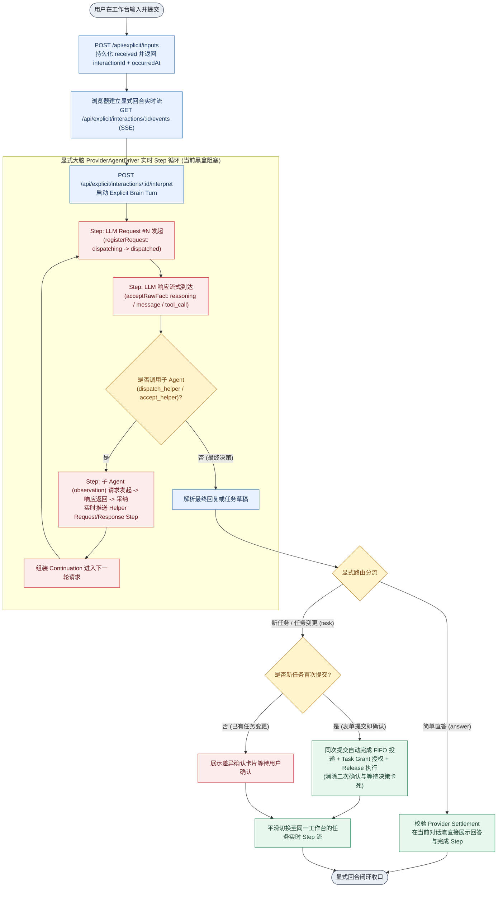
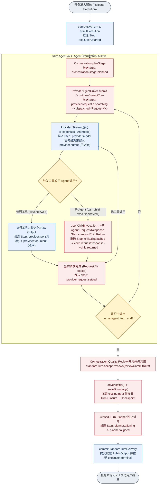
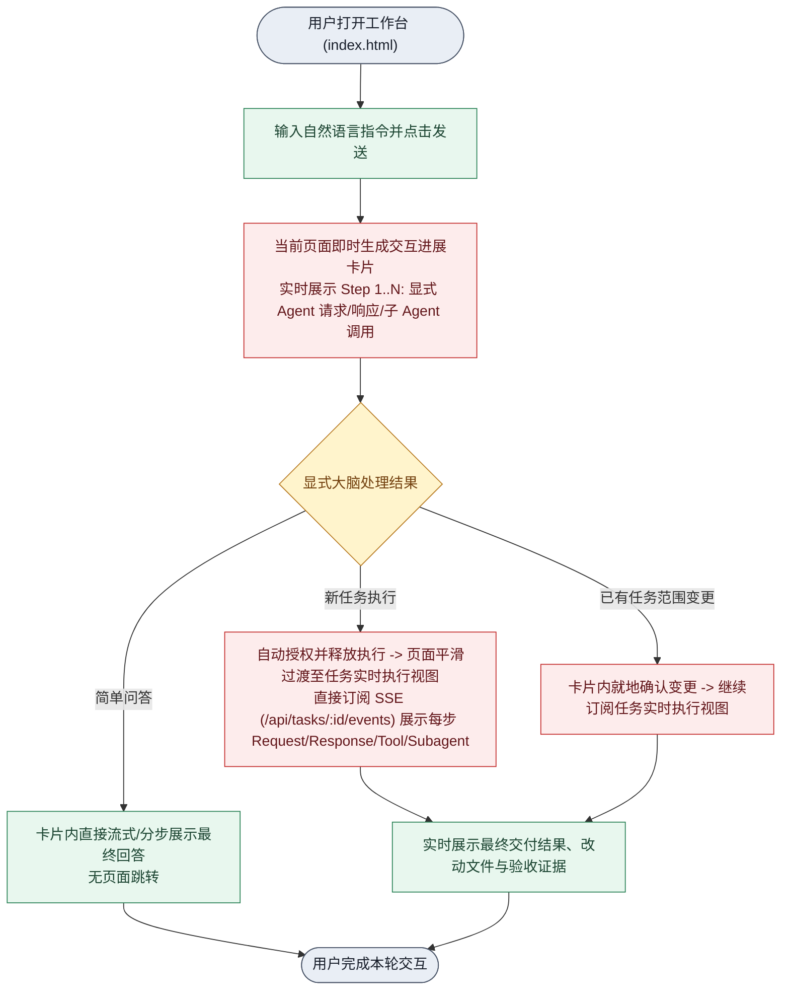
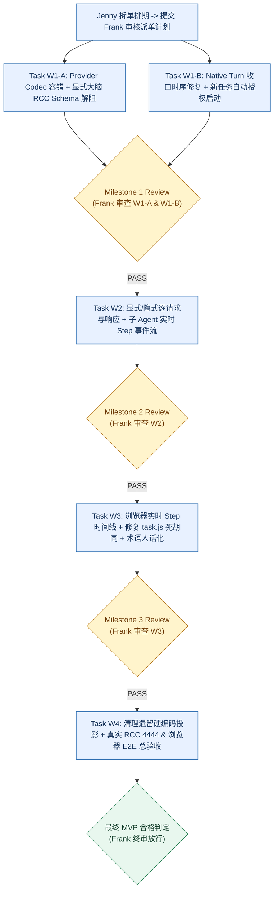

# HumanAgent MVP 全面深度审计、差距清单与修复执行计划 (2026-10-27)

- 角色与作者：`Frank`（Collab Peer · 总设计师 / Reviewer / 计划设计）
- 审计范围：`docs/ui/`、`packages/app/`、`packages/runtime/`、`packages/core/`、`packages/adapters/provider/`、`packages/ui/`
- 核心目标：围绕用户提出的三大核心诉求（**1. 输入后每一步实时状态反馈，含显式/隐式 Agent 调用及每次请求与响应的 step 更新；2. 全流程符合人类使用习惯的 UX；3. 消除硬编码与假死链路，交付真实可执行 MVP**），给出完整业务与执行 DAG、代码级差距表（Gap Matrix）和可直接派发给 Worker Peer 的分阶段修复计划。

---

## 一、 核心架构与业务流 DAG（现状断裂点 vs 目标闭环）

遵循 `flow-presentation` 规范，按三个独立业务生命周期分组绘制自上而下（`flowchart TD`）单源单汇（SESE）图，红色节点（`failure`）标注当前代码的真实断裂点。

### 图 1：用户输入与显式大脑（Explicit Brain）逐请求/响应实时反馈 DAG

**图 1 现状断裂点说明**：
1. **显式回合完全黑盒同步阻塞**：[`docs/ui/entry.js`](file:///Volumes/extension/code/humanagent/docs/ui/entry.js#L897-L899) 与 [`entry.js`](file:///Volumes/extension/code/humanagent/docs/ui/entry.js#L1163-L1164) 在调用 `api.interpretExplicitInput(interactionId)` 时仅显示静态文字 `'正在整理并提交任务…'`；后端 [`packages/app/src/explicit-brain-runtime.ts`](file:///Volumes/extension/code/humanagent/packages/app/src/explicit-brain-runtime.ts#L1239-L1329) 虽然在内部执行了 `registerRequest`、`acceptRawFact`、`dispatch_helper` 和 `accept_helper`，但 [`observations.note(...)`](file:///Volumes/extension/code/humanagent/packages/app/src/explicit-brain-runtime.ts#L1328) 只做预算计数，既无 SSE 端点推送，[`service.ts::inspectExplicitInteraction`](file:///Volumes/extension/code/humanagent/packages/app/src/ui-runtime/service.ts#L6024-L6030) 也只返回 `{ state: 'matching', nextAction: 'complete-task-matching' }`，导致用户在长达数十秒的多轮请求/子 Agent 调用期间看不到任何 step 更新。
2. **`dispatch_helper` 工具 Schema 含 `requiredCapabilities` 触发 RCC 400 拒绝**：[`explicit-brain-runtime.ts`](file:///Volumes/extension/code/humanagent/packages/app/src/explicit-brain-runtime.ts#L1253-L1254) 将内部字段 `requiredCapabilities` 暴露在发往 RCC Responses 的 function tool schema 中，被 RCC `V3Req04StandardizedResponses` 直接拦截报错。

---

### 图 2：隐式大脑与任务执行（Implicit Brain & Task Execution）逐请求/响应 Step 流与收口 DAG

**图 2 现状断裂点说明**：
1. **每次请求发起/完成（Request Lifecycle）未进入事件流**：[`packages/runtime/src/ui-runtime/coordinator.ts`](file:///Volumes/extension/code/humanagent/packages/runtime/src/ui-runtime/coordinator.ts#L2345-L2359) 的 `recordProviderRequestIdentity` 只覆盖内存字段 `record.requestIdentity`，**从未调用 `this.pushEvent(...)`**。因此前端收不到“第 N 次请求已发送 (`dispatching`/`dispatched`)”、“第 N 次请求响应完成 (`settled`)”的 step 更新。
2. **子 Agent 调用（`createChildCallPort`）与 Planner 对齐未进入实时事件流**：[`coordinator.ts`](file:///Volumes/extension/code/humanagent/packages/runtime/src/ui-runtime/coordinator.ts#L4166-L4226) 在 `prepare`、`recordReturn`、`recordAdoption`、`recordReviewCheckpoint` 时只写 `ActiveTurnContext`，不发 `pushEvent`；用户在界面上看不到子 Agent 的派发与返回 step。
3. **`saveBoundary()` 与 `acceptReviews()` 时序倒置导致必现死锁**：在 [`coordinator.ts`](file:///Volumes/extension/code/humanagent/packages/runtime/src/ui-runtime/coordinator.ts#L3955) 中，`executePreparedProviderAttempt` 在 `orchestration.dispatch` 内部先调用了 `composition.settle()`，而 [`execution-composition.ts`](file:///Volumes/extension/code/humanagent/packages/app/src/ui-runtime/execution-composition.ts#L1506-L1519) 的 `driver.settle()` 立即执行了 `await saveBoundary()`（此时 `acceptedReviewRefs` 仍为空 `[]`）；随后 `orchestration.dispatch` 完成质量审查并在 [`coordinator.ts`](file:///Volumes/extension/code/humanagent/packages/runtime/src/ui-runtime/coordinator.ts#L4868) 调用 `driver.standardTurn.acceptReviews(dispatched.reviewCommitRefs)`，触发 [`execution-composition.ts`](file:///Volumes/extension/code/humanagent/packages/app/src/ui-runtime/execution-composition.ts#L1370-L1375) 抛出 `execution.review-order.after-native-close`，导致真实编排执行在收口阶段必现崩溃并卡在 `blocked`。

---

### 图 3：端到端用户体验（UX）流 DAG（消除多页迷宫与死胡同跳转）

**图 3 现状断裂点说明**：
1. **新任务提交后跳入静态死胡同页面**：[`docs/ui/entry.js`](file:///Volumes/extension/code/humanagent/docs/ui/entry.js#L172-L182) 的 `taskLandingHref` 生成 `./task.html?task=<taskId>&projectKey=...&mode=...&interaction=<interactionId>`。当 [`docs/ui/task.js`](file:///Volumes/extension/code/humanagent/docs/ui/task.js#L1051-L1055) 检测到 URL 含有 `interaction=` 参数时，调用 `await renderInteraction(requestedInteraction, taskId)` 后在 **第 1055 行直接 `return`**！这导致 [`renderTask()`](file:///Volumes/extension/code/humanagent/docs/ui/task.js#L1033-L1034) 和 `subscribeTaskStream(operationId)` **永远不会被调用**，用户停留在标题为“确认任务”、内容为静态 `已确认，需求已进入 FIFO。当前状态：dispatched` 的死页面上。
2. **新任务表单提交后仍因缺少 Task Grant 卡在“等待决策”**：[`packages/app/src/ui-runtime/service.ts`](file:///Volumes/extension/code/humanagent/packages/app/src/ui-runtime/service.ts#L7138-L7143) 的 `executionAutoStartAllowed(taskId)` 检查 `taskGrantPort.readTaskGrant(taskId)`。在真实 `rcc` 模式下，新创建的任务尚未写入 `TaskGrant`，导致 `autoStart` 为 `false`（[`service.ts`](file:///Volumes/extension/code/humanagent/packages/app/src/ui-runtime/service.ts#L7186)），任务一创建就停在 `state: 'waiting'`（界面显示“等待决策”），违背了 `AGENTS.md` 与 `.appsdk/requirements.json` 中“新建任务表单的提交本身就是用户对该新任务的确认，不再要求第二次确认”的硬约束。
3. **四页割裂迷宫与内部术语裸露**：用户在 `index.html`（入口）、`task.html`（确认/旧详情）、`task-dashboard.html`（运行仪表盘）、`tasks.html`（列表）之间被迫来回跳转；主视图仍直接渲染 `FIFO · ${queue.requirementId}`、`${queue.state} · ${queue.code} · ${queue.nextAction}`（[`entry.js`](file:///Volumes/extension/code/humanagent/docs/ui/entry.js#L484-L486)）与 `owner=${error.ownerId} · next=${error.nextAction}`（[`entry.js`](file:///Volumes/extension/code/humanagent/docs/ui/entry.js#L360)）。

---

## 二、 全面差距清单（Gap Matrix）

### 维度 1：用户输入后每一步执行状态反馈（Step-by-Step Live Feedback）

| 编号 | 差距项 | 唯一 Owner 与代码位置 | 根因分析 | 用户感知影响 |
| :--- | :--- | :--- | :--- | :--- |
| **G1.1** | 显式大脑（Explicit Brain）调用期间无任何实时 step 反馈 | `packages/app` & `packages/runtime` [`explicit-brain-runtime.ts`](file:///Volumes/extension/code/humanagent/packages/app/src/explicit-brain-runtime.ts#L1239-L1329) [`service.ts`](file:///Volumes/extension/code/humanagent/packages/app/src/ui-runtime/service.ts#L6024-L6067) [`entry.js`](file:///Volumes/extension/code/humanagent/docs/ui/entry.js#L897-L899) | `POST /api/explicit/interactions/:id/interpret` 同步阻塞等待整个多轮 LLM + Helper 回合结束；`observations.note()` 仅做超时计数，未向 `inspectExplicitInteraction` 或 SSE 暴露 `parentJournal` / `helperJournal` 中的每次请求与响应 step。 | 用户点击发送后只看到静态“正在整理并提交任务…”，长达 10–60 秒无任何步骤变化，像页面卡死。 |
| **G1.2** | 每次 LLM 请求发起（Request Dispatch）与响应完成（Request Settled）未推送为实时 Step 事件 | `packages/runtime` [`coordinator.ts`](file:///Volumes/extension/code/humanagent/packages/runtime/src/ui-runtime/coordinator.ts#L2345-L2359) [`agent-driver.ts`](file:///Volumes/extension/code/humanagent/packages/adapters/provider/src/agent-driver.ts#L1246-L1273) | `ProviderAgentDriver` 已通过 `onRequestLifecycle` 发出 `dispatching`、`dispatched`、`waiting`、`settled`、`failed`、`cancelled`，但 `coordinator.recordProviderRequestIdentity` 仅更新内存字段 `record.requestIdentity`，未调用 `pushEvent` 写入事件流与 SSE。 | 用户无法看到“正在发送第 1 次模型请求”、“第 1 次响应已接收，正在发起第 2 次续接请求”等请求级生命周期进度。 |
| **G1.3** | 子 Agent（Helper / Execution Child / Review Child / Closed-Turn Planner）调用与返回未进入实时 Step 流 | `packages/runtime` & `packages/app` [`coordinator.ts`](file:///Volumes/extension/code/humanagent/packages/runtime/src/ui-runtime/coordinator.ts#L4166-L4226) [`execution-composition.ts`](file:///Volumes/extension/code/humanagent/packages/app/src/ui-runtime/execution-composition.ts#L1249-L1272) | `createChildCallPort` 的 `prepare`、`recordReturn`、`recordAdoption` 以及 `alignClosedTurn` 的 Planner 调用只写底层 Journal，未向父任务的实时 `operation.events` / SSE 广播可读的 Step 事件。 | 当主 Agent 派发子 Agent 或启动回合末 Planner 对齐时，主界面事件流长时间停滞，用户不知道当前是哪个子 Agent 在执行。 |
| **G1.4** | 新任务提交落地页提前 `return`，完全断开了任务 SSE 实时流订阅 | `packages/ui` (`docs/ui/`) [`entry.js`](file:///Volumes/extension/code/humanagent/docs/ui/entry.js#L172-L182) [`task.js`](file:///Volumes/extension/code/humanagent/docs/ui/task.js#L1051-L1055) | `entry.js` 跳转至 `task.html?task=...&interaction=...`，而 `task.js:1051-1055` 在存在 `interaction` 参数时只渲染静态交互确认详情就提前 `return`，跳过了第 1057 行的 `renderTask()` 与 `subscribeTaskStream()`。 | 即使后台任务在运行，用户提交后跳过去的页面也永远停在静态文本，看不到任何后续执行 step。 |
| **G1.5** | 输入回执丢失时间戳，导致用户消息卡片显示“时间未提供” | `packages/app` & `docs/ui/` [`server.ts`](file:///Volumes/extension/code/humanagent/packages/app/src/ui-runtime/server.ts#L1446-L1460) [`entry.js`](file:///Volumes/extension/code/humanagent/docs/ui/entry.js#L883) | `POST /api/explicit/inputs` 生成了 `occurredAt` 但响应体仅返回 `{ interactionId }`，前端只能回退显示 `"时间未提供"`。 | 刚发出的消息立即出现“时间未提供”，降低界面可信度。 |

---

### 维度 2：全流程 UX 符合人类使用习惯（Human-Centric UX）

| 编号 | 差距项 | 唯一 Owner 与代码位置 | 根因分析 | 用户感知影响 |
| :--- | :--- | :--- | :--- | :--- |
| **G2.1** | 新任务提交后仍被拦截在“等待决策”（双重确认反模式） | `packages/app` [`service.ts`](file:///Volumes/extension/code/humanagent/packages/app/src/ui-runtime/service.ts#L7138-L7186) | 用户在首页提交新任务时，`submitExplicitInput` 已代表用户确认，但 `dispatchRequirement` 在 `rcc` 模式下因 `taskGrantPort.readTaskGrant(taskId)` 为 `null` 而将 `autoStart` 设为 `false`，仅做 `prepareExecution` 而不 `releaseExecution`。 | 用户明明点击了发送任务，任务却莫名其妙停在“等待决策 / 等待执行准入”，不会自动开始跑。 |
| **G2.2** | 页面结构割裂（`index.html` / `task.html` / `task-dashboard.html` / `tasks.html` 四页迷宫） | `packages/ui` (`docs/ui/`) [`entry.js`](file:///Volumes/extension/code/humanagent/docs/ui/entry.js) [`task.js`](file:///Volumes/extension/code/humanagent/docs/ui/task.js) [`task-dashboard.js`](file:///Volumes/extension/code/humanagent/docs/ui/task-dashboard.js) | 首页提交跳 `task.html`（旧版静态交互/详情混杂页），而从任务列表点进去又是 `task-dashboard.html`（新版四栏仪表盘）。两套任务详情页并存且信息结构不一致。 | 用户在不同入口点进同一个任务看到完全不同的界面，且在提交后被迫跨页跳转、丢失上下文。 |
| **G2.3** | 主界面直接暴露底层状态机枚举、队列 ID 与内部错误字段 | `packages/ui` (`docs/ui/`) [`entry.js`](file:///Volumes/extension/code/humanagent/docs/ui/entry.js#L359-L360) [`entry.js`](file:///Volumes/extension/code/humanagent/docs/ui/entry.js#L480-L489) [`task.js`](file:///Volumes/extension/code/humanagent/docs/ui/task.js#L295) | 主界面直接拼接 `FIFO · ${queue.requirementId}`、`${queue.state} · ${queue.code} · ${queue.nextAction}`、`当前状态：dispatched`、`owner=${error.ownerId}`。 | 普通用户看到的是一堆机器内部状态码和 ID，不知道系统在做什么、自己该做什么。 |
| **G2.4** | 显式整理失败后交互锁死在 `matching`，无法在当前输入上直接重试或编辑重发 | `packages/app` & `packages/runtime` [`service.ts`](file:///Volumes/extension/code/humanagent/packages/app/src/ui-runtime/service.ts#L6056-L6067) | `interpretExplicitInput` 在调用模型前先把 `explicitIntake` 置为 `matching` 并落盘；一旦模型超时或报错，状态停留在 `matching`，再次调用或修改会触发 409 `explicit-brain.interpretation-state-invalid`。 | 网络抖动或模型偶发报错后，用户当前输入直接报废，无法点击“重试”。 |

---

### 维度 3：消除硬编码与 MVP 真实执行阻断项（De-Hardcoding & Execution Blockers）

| 编号 | 差距项 | 唯一 Owner 与代码位置 | 根因分析 | 用户感知影响 |
| :--- | :--- | :--- | :--- | :--- |
| **G3.1** | `saveBoundary()` 与 `acceptReviews()` 顺序倒置，导致真实编排任务收口必现崩溃 | `packages/app` & `packages/runtime` [`execution-composition.ts`](file:///Volumes/extension/code/humanagent/packages/app/src/ui-runtime/execution-composition.ts#L1370-L1375) [`execution-composition.ts`](file:///Volumes/extension/code/humanagent/packages/app/src/ui-runtime/execution-composition.ts#L1506-L1519) [`coordinator.ts`](file:///Volumes/extension/code/humanagent/packages/runtime/src/ui-runtime/coordinator.ts#L3955) [`coordinator.ts`](file:///Volumes/extension/code/humanagent/packages/runtime/src/ui-runtime/coordinator.ts#L4864-L4868) | `driver.settle()` 在 `executePreparedProviderAttempt` 内过早调用了 `saveBoundary()`，此时 `orchestration.dispatch` 的质量审查尚未执行；等质量审查完成后调用 `standardTurn.acceptReviews()` 时，因 `closingInput` 已冻结而必抛 `execution.review-order.after-native-close`。 | 真实任务即使模型和工具全部执行成功，也会在最后收口阶段报错变成 `blocked`，无法交付结果。 |
| **G3.2** | `dispatch_helper` 工具 Schema 暴露 `requiredCapabilities` 触发 RCC 4444 400 拒绝 | `packages/app` [`explicit-brain-runtime.ts`](file:///Volumes/extension/code/humanagent/packages/app/src/explicit-brain-runtime.ts#L1253-L1254) | RCC Responses 协议严禁请求体任何位置包含 `requiredCapabilities`（视为 RouteCodex side-channel 字段），而 `explicit-brain-runtime.ts` 在 `dispatch_helper` 的 JSON Schema 中定义了该同名属性。 | 真实 RCC 模式下显式大脑只要携带 `dispatch_helper` 工具发起请求就会被上游 400 拦截。 |
| **G3.3** | `ResponsesProviderCodec` 对流式 `reasoning_summary_text.delta` 等事件强校验 `item_id` 导致断流崩溃 | `packages/adapters/provider` [`codecs.ts`](file:///Volumes/extension/code/humanagent/packages/adapters/provider/src/codecs.ts#L1350-L1424) | 真实上游在部分 `response.reasoning_summary_text.delta` / `done` 事件中不带顶层 `item_id`（或放在 `item.id` / `output_index`），`requireString(record, 'item_id', ...)` 直接抛致命异常中断流。 | 模型一开始输出推理摘要（thinking delta）就触发 `missing.field` 崩溃。 |
| **G3.4** | `service.ts` 旧投影路径仍保留硬编码字段（`source: 'human'`、`requiredDecisions: []`、静态 `updatedAt`） | `packages/app` [`service.ts`](file:///Volumes/extension/code/humanagent/packages/app/src/ui-runtime/service.ts#L3880-L3980) | `dashboardFromSnapshots` 与旧 `taskDetail` 投影中仍有未从 Journal 真实记录派生的硬编码字段。 | 状态面板和详情的来源与时间展示失真。 |

---

## 三、 分阶段可执行修复计划（Worker Peer 派单合同）

按照依赖顺序与最小修改原则，拆分为 **4 个 Wave（共 5 个独占 Worktree 任务）**，每个任务均明确唯一 Owner、允许/禁止修改路径、红测反例与黑盒验收标准。

### Wave 1：打通真实 RCC 模型流与显式/隐式执行阻断（优先解阻 MVP 主干）

#### Task W1-A：修复 Provider Codec 流式容错与显式大脑 RCC Schema 阻断
- **唯一 Owner**：`packages/adapters/provider` & `packages/app/src/explicit-brain-runtime.ts`
- **Worktree 路径**：`/Volumes/Intel/playground/humanagent/w1a-provider-explicit-unblock`
- **允许修改路径**：
  - `packages/adapters/provider/src/codecs.ts`
  - `packages/app/src/explicit-brain-runtime.ts`
  - `packages/runtime/src/intake/explicit-intake.ts`
  - `packages/app/src/ui-runtime/service.ts`（仅限 `interpretExplicitInput` 失败恢复与重试状态迁移）
  - 对应单元与契约测试文件
- **禁止修改路径**：`docs/ui/`、`packages/core/`
- **具体设计**：
  1. 在 [`packages/adapters/provider/src/codecs.ts`](file:///Volumes/extension/code/humanagent/packages/adapters/provider/src/codecs.ts#L1350-L1424) 中，为 `response.reasoning_summary_part.*`、`response.reasoning_summary_text.*`、`response.reasoning_text.*` 提取统一的 `resolveReasoningItemId(record, context)`（优先读 `record.item_id`，次选 `record.item?.id` 或 `reasoning-${record.output_index ?? 0}-${record.summary_index ?? 0}`），消除因上游省略 `item_id` 导致的流中断。
  2. 在 [`packages/app/src/explicit-brain-runtime.ts`](file:///Volumes/extension/code/humanagent/packages/app/src/explicit-brain-runtime.ts#L1247-L1258) 中，将 `dispatch_helper` Wire Tool Schema 中的 `requiredCapabilities` 移除（或由 Runtime 根据 `selection.roleId` 固定派生 `['observation']`），确保发往 RCC 的 payload 零 `requiredCapabilities` 字段。
  3. 在 [`packages/app/src/ui-runtime/service.ts`](file:///Volumes/extension/code/humanagent/packages/app/src/ui-runtime/service.ts#L6052-L6080) 中，允许 `matching` 状态在 `interpretExplicitInput` 发生异常或未决时安全重入/回退重试，不再锁死 409。
- **红测与黑盒验收**：
  - 红测 1：输入不含 `item_id` 的 `response.reasoning_summary_text.delta` SSE 帧，断言解码成功且生成合法 `rawFacts`。
  - 红测 2：断言 `explicit-brain-runtime` 发送给 Transport 的 `tools` JSON 序列化字符串不包含 `"requiredCapabilities"`。
  - 真实入口验证：对本地 RCC 4444 发起真实 `POST /api/explicit/inputs` + `POST /api/explicit/interactions/:id/interpret`，成功返回回答或草稿。

---

#### Task W1-B：修复 Native Standard Turn 收口时序（`saveBoundary` vs `acceptReviews`）与新任务自动授权启动
- **唯一 Owner**：`packages/app/src/ui-runtime/execution-composition.ts` & `packages/runtime/src/ui-runtime/coordinator.ts` & `packages/app/src/ui-runtime/service.ts`
- **Worktree 路径**：`/Volumes/Intel/playground/humanagent/w1b-turn-closure-autostart`
- **允许修改路径**：
  - `packages/app/src/ui-runtime/execution-composition.ts`
  - `packages/runtime/src/ui-runtime/coordinator.ts`
  - `packages/app/src/ui-runtime/service.ts`
  - 对应 runtime / app 测试文件
- **禁止修改路径**：`docs/ui/`、`packages/adapters/`
- **具体设计**：
  1. **修复 `saveBoundary` 与 `acceptReviews` 顺序死锁**：
     - 在 [`execution-composition.ts`](file:///Volumes/extension/code/humanagent/packages/app/src/ui-runtime/execution-composition.ts#L1474-L1521) 中，`driver.settle()` 只负责 `drainCurrentTurn(boundaryId)`、校验 `acceptedEnd` 并准备 `closingInput` 基础事实，**不在 `driver.settle()` 内提前锁定 `reviewCommitRefs` 并调用 `saveBoundary()`**；
     - 将 `saveBoundary()` 统一收归到 `standardTurn.readCheckpoint()` / `standardTurn.align()` / `driver.close()`（在 `coordinator.ts:4868` 调用 `await driver.standardTurn.acceptReviews(dispatched.reviewCommitRefs ?? [])` 之后执行），保证 `closingInput.reviewCommitRefs` 完整包含本轮质量审查回执后再执行一次性原子 `saveBoundary()`。
  2. **修复新任务提交即确认的自动授权与自动启动（消除“等待决策”卡死）**：
     - 在 [`packages/app/src/ui-runtime/service.ts`](file:///Volumes/extension/code/humanagent/packages/app/src/ui-runtime/service.ts#L7138-L7250) 中，当用户通过显式入口提交新任务（`intent === 'create'` 且经 `submitExplicitInput` 确认）时，在创建任务同次事务中通过 `taskGrantPort` 写入面向该 `taskId` 的默认执行授权（或绑定新任务首轮确认授权），使 `executionAutoStartAllowed(taskId)` 为 `true`，自动完成 `prepareExecution` -> `releaseExecution`，让新任务立即进入 `running`。
- **红测与黑盒验收**：
  - 红测 1：带 `orchestrate: true` 且产出 `reviewCommitRefs` 的 `standardTurn` 执行完成后，断言不抛 `execution.review-order.after-native-close`，且最终状态顺利通过 Planner Alignment 进入 `succeeded`（并持久化 `publicOutput`）。
  - 红测 2：在 `rcc` 模式下提交新任务，断言任务直接进入 `running` -> `succeeded`，不会停在 `waiting`（“等待决策”）。

---

### Wave 2：全链路实时 Step 反馈（每次 Request/Response、工具与显式/隐式子 Agent 调用）

#### Task W2：显式大脑与隐式大脑的逐请求/响应（Per-Request / Per-Response / Subagent）实时 Step 流
- **唯一 Owner**：`packages/runtime` & `packages/app`
- **Worktree 路径**：`/Volumes/Intel/playground/humanagent/w2-live-step-feedback`
- **允许修改路径**：
  - `packages/contracts/src/`（补充显式/隐式 Step 事件类型）
  - `packages/runtime/src/ui-runtime/coordinator.ts`
  - `packages/app/src/explicit-brain-runtime.ts`
  - `packages/app/src/ui-runtime/service.ts`
  - `packages/app/src/ui-runtime/server.ts`
  - `packages/ui/projection/`
- **具体设计**：
  1. **显式大脑（Explicit Brain）实时 Step 流与 SSE 端点**：
     - 在 [`explicit-brain-runtime.ts`](file:///Volumes/extension/code/humanagent/packages/app/src/explicit-brain-runtime.ts#L1225-L1335) 中，为 `interpret()` 增加可选回调 `onStep?: (step: ExplicitInteractionStepEvent) => void`。
     - 在以下边界实时发出结构化、人类可读的 Step 事件（并缓存在活跃回合状态中，同时支持 `GET /api/explicit/interactions/:id` 读取 `steps[]` 与 `GET /api/explicit/interactions/:id/events` SSE 实时推送）：
       - `request.dispatching` / `request.dispatched`：`"正在向显式大脑发送第 N 次请求…"`
       - `response.reasoning` / `response.streaming`：`"正在接收显式大脑第 N 次响应（推理/整理中）…"`
       - `helper.dispatched`：`"正在调用子 Agent (${roleId}) 采集上下文…"`
       - `helper.request` / `helper.response`：`"子 Agent (${roleId}) 第 M 次请求已发送 / 响应已返回"`
       - `helper.accepted`：`"已采纳子 Agent (${roleId}) 结论，正在汇总…"`
       - `request.settled` / `turn.completed`：`"显式大脑已完成整理（第 N 次响应完成）"`
     - 在 [`server.ts`](file:///Volumes/extension/code/humanagent/packages/app/src/ui-runtime/server.ts#L1446-L1460) 中，`POST /api/explicit/inputs` 响应体一并返回 `{ interactionId, occurredAt }`，彻底修复“时间未提供”。
  2. **隐式大脑与任务执行（Implicit Brain / Task Execution）逐请求/响应与子 Agent Step 事件**：
     - 在 [`coordinator.ts`](file:///Volumes/extension/code/humanagent/packages/runtime/src/ui-runtime/coordinator.ts#L2345-L2359) 的 `recordProviderRequestIdentity(event)` 中，除更新 `record.requestIdentity` 外，当 `event.phase` 为 `'dispatching'`、`'dispatched'`、`'waiting'`、`'settled'`、`'failed'` 时，调用 `this.pushEvent(...)` 发出带 `requestId` / `turnId` / 请求序号的实时事件（如 `provider.request`：`"第 N 次模型请求已发送"` / `"第 N 次模型响应已完成"`）。
     - 在 [`coordinator.ts`](file:///Volumes/extension/code/humanagent/packages/runtime/src/ui-runtime/coordinator.ts#L4166-L4226) 的 `createChildCallPort`（`prepare`、`recordReturn`、`recordAdoption`）以及 [`execution-composition.ts`](file:///Volumes/extension/code/humanagent/packages/app/src/ui-runtime/execution-composition.ts#L1249-L1272) 的 Closed-Turn Planner 调用边界，向父任务 `pushEvent` 推送子 Agent 与 Planner 的实时 step（`"正在调用子 Agent [execution/review/planner]..."` -> `"子 Agent [execution/review/planner] 已返回结果"`）。
- **红测与黑盒验收**：
  - 红测 1：发起一次含 `dispatch_helper` 的显式输入，通过 `GET /api/explicit/interactions/:id/events` 断言按序收到：`request.dispatched (#1)` -> `helper.dispatched` -> `helper.returned` -> `request.dispatched (#2)` -> `turn.completed`。
  - 红测 2：发起一次多轮工具调用的任务执行，通过 `GET /api/tasks/:id/events` 断言每个请求轮次均有对应的请求发起与响应完成 step 事件，子 Agent 调用有明确的开始与完成 step。

---

### Wave 3：符合人类习惯的单工作台连贯 UX 与去机械术语改造

#### Task W3：打通首页到任务执行的连贯实时体验、修复 `task.js` 死胡同并清除裸露内部术语
- **唯一 Owner**：`packages/ui` (`docs/ui/` & `packages/ui/projection/`)
- **Worktree 路径**：`/Volumes/Intel/playground/humanagent/w3-human-ux-flow`
- **允许修改路径**：
  - `docs/ui/entry.js`
  - `docs/ui/task.js`
  - `docs/ui/task-dashboard.js`
  - `docs/ui/interaction-work-card.js`
  - `docs/ui/interaction-card-page.js`
  - `docs/ui/tasks.js`
  - `packages/ui/projection/`
- **具体设计**：
  1. **首页输入后实时展示 Step 进度时间线（消除静态死等）**：
     - 在 [`docs/ui/entry.js`](file:///Volumes/extension/code/humanagent/docs/ui/entry.js#L880-L920) 中，提交输入拿到 `{ interactionId, occurredAt }` 后，立即在当前对话工作卡内建立显式回合 SSE 监听（或高频 step 轮询），实时渲染每一步（“第 1 次请求已发送 -> 正在调用观测子 Agent -> 第 1 次响应已返回 -> 正在生成最终答复/任务单”）。
  2. **消除新任务跳转后的死胡同与页面割裂**：
     - 当显式大脑将新任务自动投递并释放执行后：
       - 在 `entry.js` 中，若留在当前工作台，直接在当前卡片内无缝接入该 `taskId` / `operationId` 的实时任务 Step 流；
       - 若跳转至详情页，统一跳转至主执行视图（并修复 [`docs/ui/task.js`](file:///Volumes/extension/code/humanagent/docs/ui/task.js#L1051-L1055) 中因 `interaction=` 参数提前 `return` 而不调用 `renderTask()` 和 `subscribeTaskStream()` 的致命 bug）。
  3. **把所有内部机器术语翻译为自然人话，技术证据收纳进折叠详情**：
     - 移除 [`entry.js`](file:///Volumes/extension/code/humanagent/docs/ui/entry.js#L484-L486) 的 `FIFO · ${queue.requirementId}`、`${queue.state} · ${queue.code} · ${queue.nextAction}`，改为自然语言进度描述（如“已排入执行队列，正在启动执行”）。
     - 移除 [`entry.js`](file:///Volumes/extension/code/humanagent/docs/ui/entry.js#L360) 主层裸露的 `owner=${error.ownerId} · next=${error.nextAction}`，主层展示清晰的人话原因与一键“重试”按钮，技术字段放入 `
` 诊断折叠区。
     - 统一请求与响应 Step 展示文案：明确标注 `请求 #1 已发送`、`响应 #1 已接收（调用工具 file.read）`、`请求 #2 已发送`、`响应 #2 已完成并交付结果`。
- **红测与黑盒验收**：
  - 浏览器 E2E 验收：在 `index.html` 输入简单问候和复杂任务两种场景，页面全程实时刷新每一步请求/响应 step，不出现“时间未提供”、不出现死页面、不出现裸露 `FIFO · req-...` 或 `owner=...`，新任务无需二次点击确认即可自动跑完并在界面展示最终结果。

---

### Wave 4：去硬编码清理与端到端真实浏览器 + RCC 4444 交付门禁验收

#### Task W4：清理 `service.ts` 遗留硬编码投影并完成 `dashboard-e2e-acceptance` 全流程实测
- **唯一 Owner**：`packages/app` & `tests/`
- **Worktree 路径**：`/Volumes/Intel/playground/humanagent/w4-dehardcode-e2e-gate`
- **允许修改路径**：
  - `packages/app/src/ui-runtime/service.ts`
  - `tests/`
  - `docs/evidence/`
- **具体设计**：
  1. 清理 [`service.ts`](file:///Volumes/extension/code/humanagent/packages/app/src/ui-runtime/service.ts#L3880-L3980) 中遗留的硬编码 `source: 'human'`、`requiredDecisions: []` 等旧投影分支，全部从权威 Journal 记录派生。
  2. 按照 [`docs/ui/dashboard-e2e-acceptance.md`](file:///Volumes/extension/code/humanagent/docs/ui/dashboard-e2e-acceptance.md) 执行真实 RCC 4444 + 真实浏览器全链路验收（含简单直答、复杂任务自动启动与多步 Request/Response/Subagent 实时更新、已有任务变更确认、停止收拢与清理）。

---

## 四、 任务依赖拓扑（Worker Peer 派发顺序）

---

## 五、 角色分工、Milestone Review 门禁与最终合格判定规程（用户明确授权指令）

1. **职责边界**：
   - **总设计师 / 计划与 Milestone Reviewer (`Frank`, `codex-session-65616635633065662d343034352d343032392d386463332d633732643461613538376461`)**：负责架构设计、每次派单计划审核、每个 Milestone（Wave 1 / Wave 2 / Wave 3 / Wave 4）的独立审查（含唯一 Owner、控制/业务隔离、红测与真实入口黑盒证据核验），以及最终 MVP 是否合格的终审判定。
   - **Master 调度 (`Jenny`, `codex-session-30316131366530612d646262302d373039302d613038612d383535643538386365316565`)**：基于本文档负责 Worker Peer 容量盘点、Worktree SESE 治理核对、任务分配与进度推进。
   - **Worker Peers (`Alice`, `Carol`, `David`, `Emma`, `Bob`)**：在 `/Volumes/Intel/playground/humanagent/<task-slug>` 独占 clean worktree 中执行具体编码、红测与真实入口验证。

2. **强制审查门禁（每次计划与每个 Milestone 必经 `Frank` Review）**：
   - **派单计划 Review**：`Jenny` 在生成或调整每波具体派单计划时，先发消息交 `Frank` Review 确认边界、唯一 Owner 与验收条件无偏差。
   - **Milestone 1 Review（Wave 1 完成边界）**：`Task W1-A` 与 `Task W1-B` 在各自 Worktree 完成作者自检、受影响单测与 RCC 4444 真实请求验证后，合并入 `main` 前必须提交 `Frank` 进行 Milestone 1 Review（附上 branch/commit、changed files、红测与真实入口回执）。未经 `Frank` 出具 `PASS`，不得合入 `main` 或宣称完成。
   - **Milestone 2 Review（Wave 2 完成边界）**：`Task W2` 完成显式与隐式逐次 Request/Response 及子 Agent Step SSE 流后，提交 `Frank` 进行 Milestone 2 Review，重点核验每次请求发送、流式响应、子 Agent 派发/返回是否均有真实事件而非假定时器或硬编码模拟。
   - **Milestone 3 Review（Wave 3 完成边界）**：`Task W3` 完成前端实时 Step 时间线、`task.js` 死胡同修复与内部术语清理后，提交 `Frank` 进行 Milestone 3 Review，重点核验人类使用习惯（零双重确认、零死胡同跳转、零裸露内部状态码、无“时间未提供”）。
   - **最终合格判定（Milestone 4 / MVP Final Sign-off）**：`Task W4` 完成硬编码投影清理与 `docs/ui/dashboard-e2e-acceptance.md` 全流程真实浏览器 + RCC 4444 验收后，将完整证据包交 `Frank` 进行最终合格判定。只有 `Frank` 核验三大目标全部达成并给出 `QUALIFIED (PASS)` 后，方可视为 MVP 交付合格。

