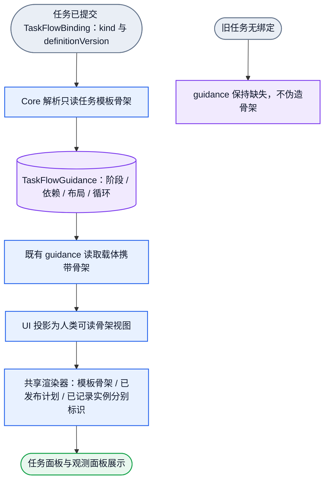

# 原生任务模板骨架设计

日期：2026-10-18（America/Los_Angeles）

状态：DRAFT / 待独立设计 Review。未获该次 Review 的 PASS 前，不得改动任何产品代码。

需求绑定：项目 `.appsdk/requirements.json`（`requirements_version: 14`）的活跃需求。

证据边界：本文只整理只读源码与既有回执证据。产品行为未改动，实时渲染仍为 UNVERIFIED。

## 1. 目标与范围

本文定义只读的任务模板骨架：任务模板如何声明阶段、强制依赖、布局与循环，如何经既有读取路径投影为人类可读字段，以及共享渲染器如何把模板骨架与已发布计划、已记录实际执行区分开。

模板骨架只描述方向，不描述某一次真实执行。它不覆盖已发布的计划 revision，也不覆盖已记录的实际执行事实。

范围只覆盖三个既有任务种类：`one-shot`、`inspection`、`long-running`。本文不新增任务种类，不新增执行引擎，不新增第二份持久历史。

相关需求条目：

- `humanagent-explicit-brain-simple-answer-or-standard-task-routing` v9：复杂输入整理为任务并用标准任务模板派发。
- `humanagent-continuation-oriented-by-explicit-dispatch-template` v11：续推依据任务模板的目标、阶段和完成标准，不写死固定角色顺序。
- `humanagent-dynamic-orchestrator-choice-and-agent-termination` v3：探索、规划、审查、执行由编排者动态选择并可重复，Agent 结束才结束。
- `humanagent-turn-checkpoint-four-part-summary-and-planner-iteration` v4：每个轮次结束后先做四段式检查点，再让 Planner 计划对齐，迭代到任务完成或失败。
- `humanagent-human-readable-semantic-layered-ux-and-necessary-display` v12 与 `humanagent-responsive-ux-bottom-sheet-and-four-corner-configuration` v13：默认层只显示自然中文语义，机械键留在技术详情；桌面与手机共用同一渲染。
- `humanagent-provider-work-order-ablate-graph-governance-code` v14：先改图与设计，再改契约，最后改代码。

展示审计绑定：`docs/ui/semantic-observation-audit-2026-10-07.md` 的 G9 与 F15。G9 要求节点、边、checkpoint 和循环共用渲染控件，模板配置阶段、骨架依赖、布局和循环，实际 revision 决定实例图。F15 要求三模板与多视角使用同一渲染器，骨架与实际依赖分开，不建第二套 taxonomy 或逐页图与 CSS 副本。

## 2. 现状缺口（只读源码证据）

当前产品只有文字化指导，没有 typed 模板骨架。产品行为未改动。

1. `packages/contracts/src/task-flow.ts` 的 `TaskFlowGuidance` 只有 `kind`、`aim`、`selectionGuidance`、`displayGroups`，缺少 typed 阶段、阶段依赖、布局和循环字段。`TaskFlowBinding` 只有 `kind` 与 `definitionVersion`。
2. `packages/core/src/task-flow-definition.ts` 的 `TASK_FLOW_GUIDANCE` 只定义静态英文 `aim`、`selectionGuidance` 和分组标签（例如 `['Deliverable', 'Review', 'Closure']`）。既有的 `displayGroups` 无法表达模板阶段、骨架依赖、布局或循环。
3. `packages/ui/projection/actual-execution-graph.ts` 的 `projectGuidance` 只透传 `aim`、`selectionGuidance` 和 `displayGroups`，不投影阶段、依赖、布局或循环，默认层因此会直接显示原始英文 `aim`。
4. `docs/ui/task-display.js` 的 `renderTaskActualExecutionGraphSection` 只渲染 `处理方式：${kindLabel}`、`aim` 与技术详情，未与已发布计划、实际执行节点共享卡片与关系渲染。

已有的实际执行图与已发布计划 revision 已交付，本文不重开、不替换它们。实际执行是已记录的原生事实，已发布计划是 Planner 的 revision；两者都不是任务模板骨架。

## 3. 产品对象流

下图只表示产品对象流：已绑定的任务模板解析为只读骨架，经既有读取路径投影并在共享渲染器中分开呈现。图不含开发或交付流程。



三个含义必须始终分开：模板骨架是静态方向；已发布计划 revision 是 Planner 的节点与关系；已记录实际执行是 Journal 派生的真实实例。任何一方都不得冒充另一方。

## 4. 三个任务模板（产品业务真相）

三个模板只使用真实业务边界：一个动态选择区、轮末必经检查点、轮末必经规划对齐；`inspection` 额外有一个轮次触发边界。模板不包含开发、派单或里程碑审查节点。

```mermaid
flowchart TD
  subgraph OneShot["单次交付 one-shot"]
    OD["轮内动态选择区：探索 / 规划 / 审查 / 执行，可多次任意顺序"]:::action
    OC["轮末四段式检查点：目标 / 动作 / 结果 / 预期下一步"]:::action
    OP["轮末规划器对齐：完成 / 失败 / 继续"]:::action
    OD --> OC --> OP
    OP -. "loops.turn-iteration 元数据：未完成则开启下一轮" .-> OD
  end

  subgraph Inspection["巡检 inspection"]
    IT["轮次触发与基线绑定"]:::action
    ID["轮内动态选择区：探索 / 规划 / 审查 / 执行"]:::action
    IC["轮末四段式检查点"]:::action
    IP["轮末规划器对齐"]:::action
    IT --> ID --> IC --> IP
    IP -. "loops.turn-iteration：同一巡检轮次内继续" .-> ID
    IP -. "loops.occurrence-repetition：下一次触发开启新巡检轮次" .-> IT
  end

  subgraph LongRunning["长程 long-running"]
    LD["轮内动态选择区：探索 / 规划 / 审查 / 执行"]:::action
    LC["轮末四段式检查点"]:::action
    LP["轮末规划器对齐与计划演进"]:::action
    LD --> LC --> LP
    LP -. "loops.turn-iteration：持续驱动后续轮次与阶段" .-> LD
  end

  classDef action fill:#E8F1FF,stroke:#2563EB,color:#0F172A,stroke-width:1.5px
```



虚线边只表示模板声明的逻辑循环元数据。它们不是 HTTP 读 DAG 的边，也不表示强制的运行时调度。

区分两条巡检循环：`turn-iteration` 是同一 Agent 在同一巡检轮次内的轮次迭代；`occurrence-repetition` 是下一次定时或事件触发开启的新巡检轮次，与历史巡检基线对比。二者语义不同，必须分别声明。

## 5. 最小 typed 静态模板形状与唯一 owner

唯一真源是 Core 的 `packages/core/src/task-flow-definition.ts`。类型定义在 `packages/contracts/src/task-flow.ts`。Core 复用既有 `TaskFlowBinding` 的 `kind` 与 `definitionVersion` 解析骨架，不新增绑定字段。

静态模板的最小形状如下。每个字段都对应一项当前需求，去掉即丢失对应展示能力。

```ts
type TaskFlowStageRole =
  | 'occurrence-trigger'          // 巡检轮次触发边界
  | 'dynamic-choice-region'       // 唯一动态选择区
  | 'mandatory-turn-checkpoint'   // 轮末必经检查点
  | 'mandatory-planner-alignment'; // 轮末必经规划对齐

type TaskFlowLayoutMode =
  | 'turn-closure-loop'
  | 'occurrence-and-turn-closure-loop';

type TaskFlowLoopKind = 'turn-iteration' | 'occurrence-repetition';

interface TaskFlowStageGuidance {
  readonly stageId: string;            // 依赖与循环的引用身份
  readonly title: string;              // 人类可读阶段名
  readonly summary: string;            // 人类可读说明
  readonly role: TaskFlowStageRole;    // 区分可选动态区与轮末必经阶段
  readonly group: string;              // 展示分组
  readonly dynamicChoices?: readonly string[]; // 仅动态选择区使用
}

interface TaskFlowStageDependency {
  readonly fromStageId: string;
  readonly toStageId: string;
}

interface TaskFlowLoopGuidance {
  readonly kind: TaskFlowLoopKind;
  readonly title: string;
  readonly fromStageId: string;
  readonly toStageId: string;
  readonly summary: string;
  readonly stopCondition: string;
}

interface TaskFlowGuidance {
  readonly kind: TaskFlowKind;
  readonly aim: string;
  readonly selectionGuidance: string;
  readonly displayGroups: readonly string[];
  readonly layout: TaskFlowLayoutMode;
  readonly stages: readonly TaskFlowStageGuidance[];
  readonly dependencies: readonly TaskFlowStageDependency[];
  readonly loops: readonly TaskFlowLoopGuidance[];
}
```

字段必要性说明：

- `layout` 选择整体呈现：只有轮内进展，还是先有巡检触发再进入轮内进展。
- `stages` 承载阶段身份、分组、角色与人类可读文本。`role` 是区分可选动态选择区与轮末必经阶段的唯一依据。
- `dependencies` 只声明真实强制顺序：动态区到检查点、检查点到规划对齐，巡检再加触发到动态区。
- `loops` 以数据声明逻辑循环，避免把循环写成非法读 DAG 边。
- `dynamicChoices` 只出现在唯一的动态选择区，表示探索、规划、审查、执行可任意重复。

Core 的三个模板语义：

1. `one-shot`：`displayGroups` 为 `['Dynamic Work', 'Turn Checkpoint', 'Planner Alignment']`，`layout` 为 `'turn-closure-loop'`；依赖为 `dynamic-work -> turn-checkpoint`、`turn-checkpoint -> planner-alignment`；循环为一条 `turn-iteration`。
2. `inspection`：`displayGroups` 为 `['Occurrence Trigger', 'Dynamic Work', 'Turn Checkpoint', 'Planner Alignment']`，`layout` 为 `'occurrence-and-turn-closure-loop'`；依赖为 `occurrence-trigger -> dynamic-work`、`dynamic-work -> turn-checkpoint`、`turn-checkpoint -> planner-alignment`；循环为一条 `turn-iteration` 与一条 `occurrence-repetition`。
3. `long-running`：`displayGroups` 为 `['Dynamic Work', 'Turn Checkpoint', 'Planner Alignment']`，`layout` 为 `'turn-closure-loop'`；依赖同 `one-shot`；循环为一条 `turn-iteration`。

`resolveTaskFlowGuidance` 必须克隆返回的 `displayGroups`、`stages`、`dependencies` 和 `loops`，使调用方不能改写静态定义。

边界校验只覆盖既有 typed 契约边界：`layout` 取值合法、`stages` 非空且字段齐全、`dependencies` 的 `fromStageId` 与 `toStageId` 非空、`loops` 非空且字段齐全、`role` 与 `kind` 取值合法。静态 Core 自有定义不需要通用图校验引擎，因此不新增 Kahn、DFS、环检测或深度引擎。

## 6. 公共投影与共享渲染

公共投影 owner 是 `packages/ui/projection/actual-execution-graph.ts`，配套契约在 `packages/ui/contracts/actual-execution-graph.ts`。既有读取载体继续使用 `RuntimeAgentActivityProjection.actualExecutionGraph`，骨架作为既有 guidance 字段的一部分携带，不新增第二份载体或第二端点。

投影把静态模板转为人类可读字段：

- `aimLabel`：模板目的的中文说明，使默认层不显示原始英文 `aim`。
- `layout` 与 `layoutLabel`：整体呈现的中文标签。
- `stages`：每阶段带 `title`、`summary`、`roleLabel`（如巡检触发边界、编排动态选择区、轮末必经检查点、轮末必经规划对齐）、`groupLabel`、可选 `dynamicChoices`，以及前置阶段名列表 `prerequisiteTitles`。
- `dependencies`：带 `fromTitle` 与 `toTitle` 的骨架依赖边。
- `loops`：带 `kindLabel`、阶段名与 `stopCondition` 的循环说明。

渲染 owner 是 `docs/ui/task-display.js`。抽出共享卡片助手与共享关系标签助手后，三类内容复用同一组控件，并用不同数据属性分开标识：

- 模板骨架：`data-task-flow-guidance="skeleton"`、`data-template-stage`、`data-template-dependency`、`data-template-loop`。
- 已发布计划：`data-plan-node`、`data-relation-kind`。
- 已记录实际执行：`data-actual-execution-node`、`data-actual-execution-edge`。

默认层只显示自然中文语义和非实例徽标（模板骨架仅指导方向，非实际执行记录）。机械键（`kind`、`layout`、`stageId`、`aim`、`selectionGuidance`、`displayGroups`）只放在技术详情中。桌面侧栏与手机底部抽屉使用同一渲染。

## 7. 读 DAG 治理

模板骨架在既有 `docs/dagpipe/observation-read.graph.json` 的 SESE 读路径内流动，不新增节点、边或图。

- `load_task_truth` 已从 `task.created.taskFlow` 解析 `TaskFlowGuidance`。骨架只是该 guidance 的 typed 内容，随既有 `task_projection` 载体向下游流动。
- `project_semantic_views` 已投影 `actualExecutionGraph.guidance`，继续分开模板骨架、当前计划与已记录实例。
- `browser_view` 已渲染 `actualExecutionGraph`，新增只改变骨架块内部呈现，不改变读取拓扑。

逻辑循环保留为模板元数据（`loops`），不写成 HTTP 读 DAG 的环。现有 8 节点与 8 边的拓扑保持不变。本次只更新该图及 `observation-read.graph.semantic.json`、`observation-read.graph.binding.json` 中受影响的契约描述文字。

## 8. 缺失绑定与不支持版本

- 旧任务没有 `task.created.taskFlow` 时，`resolveTaskFlowGuidanceFromBinding` 继续返回 `undefined`。渲染层因此不产生 `data-task-flow-guidance="skeleton"` 块，也不伪造空骨架。
- 未知 `kind` 或未知 `definitionVersion` 继续抛出既有 `ContractError`。这是既有错误行为，本文不新增降级或 fallback。
- 缺失或不可用的实际执行来源继续显式保留，不转成伪造的空历史。

## 9. 边界与非目标

本文不做以下事项：新增任务种类或第二 taxonomy；新增第二份持久历史、CAS、摘要、冻结快照、候选身份或缓存；新增运行时协议、图校验引擎或循环执行引擎；让前端拥有模板定义；把模板骨架写成覆盖已发布计划或实际执行的第二真源；把开发、派单或里程碑审查流程写进模板节点；把逻辑循环写成 HTTP 读 DAG 的环；从实际 Journal 派生模板。

本文不声明任何已实现行为或运行时行为。所有 typed 形状、投影字段和渲染属性都是待评审的设计。

## 10. 移除要素的影响

| 要素 | 移除后的破坏 |
| --- | --- |
| 独立设计 Review 门禁 | 跨模块契约（contracts、core、ui、docs/ui）在未对齐 v3/v4/v12/G9/F15 前进入代码。 |
| `role` 区分动态区与轮末必经阶段 | 可选的探索、规划、审查、执行被误画成固定串行，或丢失轮末检查点到规划对齐。 |
| 两条循环声明 | 巡检无法区分跨轮次触发重复与同一 Agent 的轮内迭代，或被迫写成非法读 DAG 回边。 |
| UI 中文投影 | 默认层继续显示原始英文 `aim`，且缺少阶段与循环标签。 |
| 共享卡片与关系助手 | G9 的共享渲染要求失败，模板骨架、已发布计划与实际执行继续各自为政。 |

## 11. 未知与待 Review 项

- 生产链路上是否还有其它测试手工构造 `TaskFlowGuidance` 或 `TaskActualExecutionGuidanceProjection`，需在实现阶段用实编译确认。本文不预判。
- 实际运行数据可能同时含已绑定任务与旧的无绑定任务，实现阶段必须在真实入口同时核对两种表现。本文不预判具体数据。
- 骨架的视觉密度与分组在手机底部抽屉中的可读性仍需渲染验收，本文不预判结果。

## 12. 状态

状态：DRAFT。等待一次独立设计 Review 的 PASS。未获 PASS 前，不进入产品代码改动。
