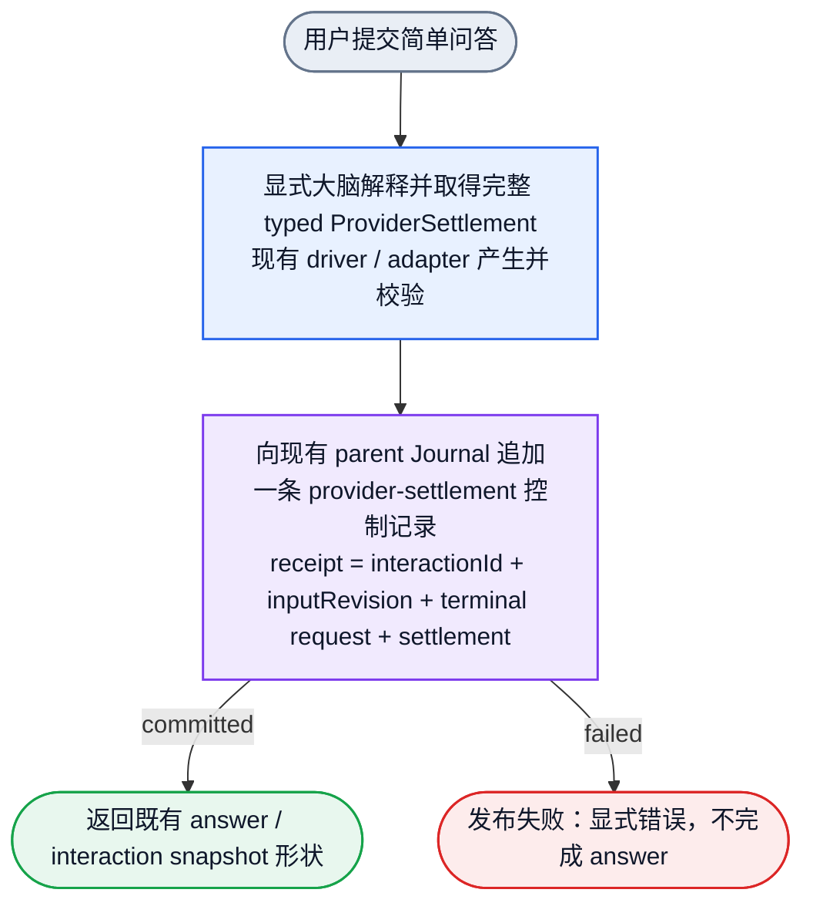
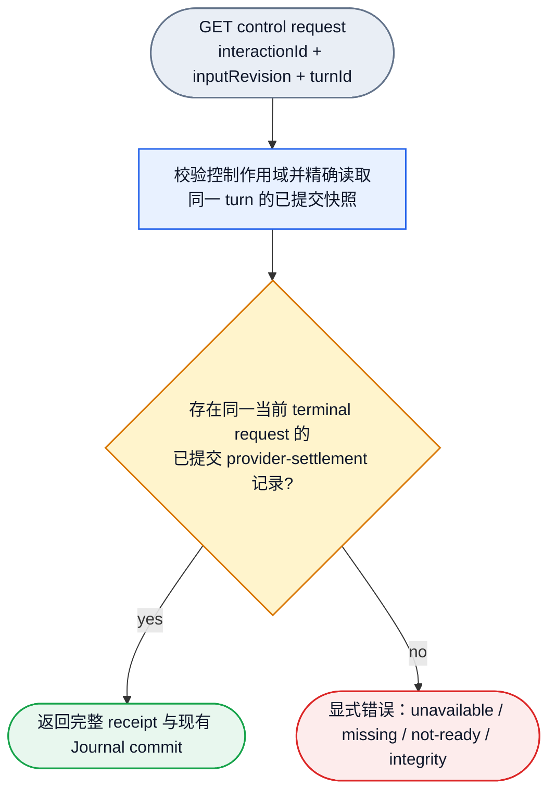

# Taskless Provider Settlement Design

Status: DESIGN-ONLY / UNVERIFIED / NOT IMPLEMENTED

Date: 2026-10-18

Base: `origin/main` at `314f53aa9de5c4dac18a087ddaf138824f776bd5`

This document defines one bounded design. It does not implement, test, build, run,
install, restart, merge, or push anything. It does not authorize product code.
The design Review is a separate gate before code.

## 1. Goal And Boundary

The current explicit-brain taskless answer path can obtain a complete, typed,
validated `ProviderSettlement` inside the interpretation process. The formal
public answer result cannot expose or read that settlement. The formal App
composition also does not select the existing publication callback.

This design closes only that bounded gap:

1. Persist the original full typed Provider settlement as one typed control
   record in the existing interaction-parent Journal.
2. Associate it with the original interaction, input revision and real terminal
   Provider request.
3. Consume it through one independent read-only control GET.
4. Keep the existing answer API, taskless behavior, FIFO behavior and Provider
   binding/model/protocol unchanged.

This design does not:

- create a Task, Draft, FIFO delivery or task checkpoint for a simple answer;
- add a second settlement producer, store, registry, history or projection;
- change Provider codecs, transport, model selection or request shape;
- replay the original Provider request or advance a physical epoch;
- claim the original socket failure root cause;
- claim that any proposed type, function, route or record exists today.

The accepted planner plan is
`/Volumes/Intel/playground/humanagent/.worker-runs/native-reasoning-d0-20261012/native-taskless-settlement-wiring-plan-r519-20261018/oauth-plan.md`.
The observer reception is
`/Volumes/Intel/playground/humanagent/.worker-runs/native-taskless-settlement-read-observe-20261018/owner-reception.md`.

The Root correction overrides the planner plan at three points:

1. Beyond the existing `continue` owner-reconciliation branch, a physical close
   may be followed only by the new settlement control record. Request and
   raw-history appends remain frozen after close.
2. The cold-branch receipt requirement applies only to incomplete recovery that
   needs settlement evidence.
3. An already completed answer read must not regress when upgraded old history
   has no receipt.

## 2. Actual Requirements And Source Facts

### 2.1 Applicable project requirements

The actual `.appsdk/requirements.json` is `schema_version: 1`, ledger version
`14`. The following current results constrain this design.

| Requirement ID | Current version | Constraint used here |
| --- | ---: | --- |
| `humanagent-explicit-brain-simple-answer-or-standard-task-routing` | 1 | A simple question is answered directly by the explicit brain. It must not become a Task. |
| `humanagent-explicit-brain-semantic-turn-context` | 1 | The current reasoning turn keeps its full semantics. A settlement receipt does not replace raw history or a semantic checkpoint. |
| `humanagent-generic-reorientation-prompt-and-boolean-stop-control` | 2 | The redundant model stop-control block was removed. This design adds no model success label or stop protocol. |
| `humanagent-provider-work-order-ablate-graph-governance-code` | 1 | Read and ablate the graph first, update the affected governance description, then code. |

The actual project `AGENTS.md` also requires:

- `packages/app` owns composition.
- `packages/adapters/jsonl` owns the authoritative Organ Journal.
- `packages/adapters/provider` owns Provider binding, protocol, readiness and
  settlement mapping.
- Control truth and business payload stay separate.
- `~/.humanagent` is the only persistence root.
- Focused tests and real-entry black-box evidence are required before delivery.

### 2.2 Current source facts

These are current facts, not proposed behavior.

| Area | Actual current fact |
| --- | --- |
| Full settlement producer | `packages/adapters/provider/src/agent-driver.ts:776-821`: `ProviderAgentDriver.settle()` calls the port, validates identity, stores the full result in the private `providerSettlement`, and `settlement()` returns a `structuredClone`. `AgentClosure` is only `{ state, evidenceRefs }`. |
| Adapter validation | `packages/adapters/provider/src/adapter.ts:547`: `ProviderAdapter.settle()` calls `validateProviderSettlement(result)` and checks execution identity. |
| Settlement contract | `packages/contracts/src/index.ts:1230`: `ProviderSettlement<TIdentity>` is `TIdentity` plus `state`, `evidenceRefs`, `resourceRelease`, `persistence`, optional `error`, `ownerId`, `nextAction`. |
| Settlement validator | `packages/contracts/src/index.ts:1797`: `validateProviderSettlement()` checks state, evidence, resource release, persistence and identity. `succeeded` requires released resources, committed persistence and no error. |
| Request identity | `packages/contracts/src/provider-request-context.ts:6` imports `ProviderRequestIdentityRef`; `ProviderRequestContextHookInput` carries `request: ProviderRequestIdentityRef` at line 78. |
| Existing callback | `packages/app/src/explicit-brain-runtime.ts:386-390`: optional `publishProviderSettlement` receives `{ interactionId, inputRevision, settlement }`. |
| Fresh answer call | `packages/app/src/explicit-brain-runtime.ts:736-745`: after `driver.settle`, an answer may call the optional callback with `driver.settlement()`. |
| Continuation call | `packages/app/src/explicit-brain-runtime.ts:438-444`: `finish()` may publish the retained settlement. |
| Formal composition gap | `packages/app/src/ui-runtime/index.ts:420-453` creates the interpreter with a `JsonlInteractionParentTurnJournal`, but does not pass `publishProviderSettlement`. The observed installed equivalent also omits it. |
| Business answer shape | `packages/app/src/explicit-brain-runtime.ts:128-164` returns an `answer` variant with normalized input, known facts, answer and decision refs. It has no settlement. |
| Public snapshot shape | `packages/runtime/src/intake/explicit-intake.ts:123` defines `ExplicitInteractionSnapshot` with product state, reply and draft fields, but no settlement. |
| Interpret service path | `packages/app/src/ui-runtime/service.ts:5244-5340` interprets, calls `completeAnswer()` on an answer, and returns the interaction snapshot. |
| Interpret HTTP route | `packages/app/src/ui-runtime/server.ts:1290-1292`: `POST /api/explicit/interactions/:interactionId/interpret` returns the snapshot. |
| Parent Journal port | `packages/runtime/src/explicit-brain/interaction-parent-turn-raw.ts`: `InteractionParentTurnRawJournalPort.transactTurn`, `readTurnSnapshot`, `InteractionParentCommittedFact`, and `InteractionParentOpenedTurnScopeReadPort.readScopeOpenedTurns` already exist. |
| Journal append kinds | `packages/adapters/jsonl/src/interaction-parent-turn-journal.ts`: the decoded append discriminants are `turn-input`, `request`, `accepted-fact`, `resource-close`, `owner-reconciliation`. There is no full settlement record. |
| Post-close rule | `decodeTurn()` in `interaction-parent-turn-journal.ts` rejects request and accepted-fact appends after a committed resource close. Only a `continue` owner reconciliation may follow a close. `resource-close` is a `ProviderCloseResult`, not settlement success. |
| Explicit semantic DAG | `docs/dagpipe/explicit-semantic-turn.graph.json`: 5 nodes, 4 edges, one input `explicit_input`, one output `return_result`. |

### 2.3 Design unknowns

The following are unknown and must not be invented:

- The original socket-disconnect root cause.
- Whether the original question succeeds under the current tool shape.
- The exact future error-code names beyond the existing `UiRuntimeApiError`
  conventions.
- Whether an independent read flow needs its own persistent DAG. This remains an
  explicit design Review question. No new graph file is created here.
- Future implementation compile, focused-test, public-consumer and installed
  runtime results.

## 3. DAG Ownership And Closure

### 3.1 Actual graph shape

The actual affected graph is
`docs/dagpipe/explicit-semantic-turn.graph.json`:

```text
explicit_input
  -> assemble -> route -> outcome -> history -> return
  -> return_result
```

The graph has one source (`assemble`), one sink (`return`), five nodes and four
edges. Every node is on the source-to-sink path. It is SESE and acyclic. Provider
request iteration stays outside the graph.

The existing settlement boundary is already present in the graph metadata and
semantic file. This design only clarifies that boundary. It does not add a node,
edge, input, output or second entry.

### 3.2 Node ownership

| Node | Actual semantic owner | Current binding owner |
| --- | --- | --- |
| `assemble` | `packages/runtime` | `packages/runtime/src/intake/explicit-intake.ts` |
| `route` | `packages/runtime` | `packages/runtime/src/context/active-turn-materializer.ts` |
| `outcome` | `packages/runtime` | `packages/runtime/src/explicit-brain/index.ts` |
| `history` | `packages/runtime` | `packages/runtime/src/context/interaction-semantic-context.ts` |
| `return` | `packages/app` | `packages/app/src/explicit-brain-runtime.ts` |

The actual Runtime and JSONL owners that the proposed persistence work will use
are already the owners of the existing parent Journal:

- `packages/runtime/src/explicit-brain/interaction-parent-turn-raw.ts`
- `packages/adapters/jsonl/src/interaction-parent-turn-journal.ts`

### 3.3 Why the independent GET is not inserted into this graph

The existing graph is one product object flow from one explicit interaction input
to one explicit turn return. Adding a GET control resource as another entry would
create a second source and break SESE. The control GET is therefore described as
a separate read-only product object flow.

Whether that independent read flow deserves its own persistent graph is not
settled here. It is a design Review question. This document does not create a
second graph engine, graph file, node set or governance scaffold.

### 3.4 Static checks already run

The actual CLI was available at `/Users/fanzhang/.cargo/bin/dagpipe` version
`0.1.1`. The current graph checks were run before any edit:

```sh
dagpipe graph validate docs/dagpipe/explicit-semantic-turn.graph.json
# valid DAG: humanagent-explicit-semantic-turn@1 (5 nodes, 4 edges, 5 waves)

dagpipe graph inspect docs/dagpipe/explicit-semantic-turn.graph.json
# Graph humanagent-explicit-semantic-turn@1; linear edges assemble -> route -> outcome -> history -> return

node scripts/dagpipe-bind-graphs.mjs docs/dagpipe/explicit-semantic-turn.graph.json
# bound humanagent-explicit-semantic-turn: 5 nodes ok
```

These checks prove static topology and binding shape only. They do not prove
product behavior.

## 4. Product Object Flows

### 4.1 Taskless answer and settlement publication

This is the product object flow, not a development or review process.



The answer response and the control record are separate outputs. The receipt is
not inserted into the answer, reply, decision refs, prompt, metadata,
`explicit-brain.state`, task payload or task checkpoint.

### 4.2 Independent read-only control GET

This flow is a separate product object flow. It has one GET entry and one typed
response contract. The diagram shows the success data output and the explicit
error terminal as the two mutually exclusive variants of that single response
contract. It does not write, reconcile, replay or advance an epoch.



The GET never reconstructs a receipt from an answer, resource close, checkpoint
or log. It returns only a committed typed record. If no exact matching record
exists, it returns an explicit error and does not return `200` with `null`.

## 5. Types, Records And Call Contracts

### 5.1 Current versus proposed symbols

| Concern | Current symbol or fact | Proposed symbol or change | Owner |
| --- | --- | --- | --- |
| Full settlement | `ProviderSettlement<TIdentity>` exists | Reuse unchanged | `packages/contracts` |
| Settlement validation | `validateProviderSettlement()` exists | Reuse, then validate the envelope association | `packages/contracts` |
| Full settlement access | `ProviderAgentDriver.settlement()` exists | Reuse unchanged | `packages/adapters/provider` |
| Publication callback | Optional `publishProviderSettlement` exists | Change its payload to the new receipt and wire it in formal composition | `packages/app` |
| Journal record | No settlement record exists | Add one `provider-settlement` variant | `packages/runtime` + `packages/adapters/jsonl` |
| Journal read | No settlement reader exists | Add one exact reader | `packages/runtime` |
| Public control read | No control GET exists | Add one service facade and one GET | `packages/app` |

### 5.2 Proposed receipt

One new contract module, for example
`packages/contracts/src/interaction-provider-settlement.ts`, exports one narrow
receipt and re-exports it from the existing contracts barrel:

```ts
export interface InteractionProviderSettlementReceipt {
  readonly interactionId: string;
  readonly inputRevision: number;
  readonly request: ProviderRequestIdentityRef;
  readonly settlement: ProviderSettlement<InteractionParentProviderExecutionIdentityRef>;
}
```

The receipt contains no timestamp, digest, random receipt identity, store key,
registry entry or copied business metadata. `interactionId` and `inputRevision`
must match the settlement's `interactionTurn`. `request` must be the real terminal
request from the same physical execution epoch. It is not parsed from an error,
log or reply.

The validator first calls `validateProviderSettlement()`. It then checks:

- the envelope interaction identity matches `settlement.interactionTurn`;
- `inputRevision` is a positive integer;
- `request` is a valid request identity;
- the request belongs to the same turn, execution and epoch as the settlement.

### 5.3 Existing parent Journal extension

The existing `InteractionParentTurnAppend` union gains one variant:

```ts
{
  readonly kind: 'provider-settlement';
  readonly turn: InteractionTurnIdentity;
  readonly execution: InteractionParentProviderExecutionIdentityRef;
  readonly fact: InteractionProviderSettlementReceipt;
}
```

The existing `InteractionParentTurnSnapshot` gains:

```ts
readonly providerSettlements:
  readonly InteractionParentCommittedFact<
    InteractionProviderSettlementReceipt
  >[];
```

This is an extension of the existing Journal transaction and snapshot. It is not
a new store, lock, file or history. A list is required because different physical
epochs and requests have distinct real settlements. A "latest success" shortcut
would lose identity and is forbidden.

The JSONL codec adds the matching discriminant. Lifecycle rules:

- `turn-input` must still be first and unique.
- `request` and `accepted-fact` remain frozen after a committed resource close.
- `provider-settlement` may append after a committed resource close, because it
  is control evidence for the just-finished original execution.
- The existing `continue` owner-reconciliation branch remains unchanged.
- A same turn/execution/request with identical receipt content is idempotent and
  returns the committed fact.
- A same key with different content is a conflict and must not overwrite.
- `resource-close` remains physical close only and never implies settlement.

### 5.4 Runtime publish and read functions

The existing Runtime owner module exports two narrow functions:

```ts
publishInteractionProviderSettlement(input: {
  readonly journal: InteractionParentTurnRawJournalPort;
  readonly receipt: InteractionProviderSettlementReceipt;
}): Promise<InteractionParentCommittedFact<InteractionProviderSettlementReceipt>>;

readInteractionProviderSettlement(input: {
  readonly journal: InteractionParentTurnRawJournalPort;
  readonly turn: InteractionTurnIdentity;
}): Promise<InteractionParentCommittedFact<InteractionProviderSettlementReceipt>>;
```

Publication:

- locates the existing turn from `receipt.settlement.interactionTurn`;
- checks the committed turn input, active execution epoch and actual terminal
  request inside the existing transaction;
- preserves the original settlement object without trimming or rebuilding it;
- writes one `provider-settlement` append;
- returns the committed fact and existing `JournalCommitRef`.

Read:

- reads one consistent snapshot;
- derives the current physical terminal request from the typed turn input,
  owner reconciliations and request records;
- returns the receipt for exactly that request and epoch;
- never returns a receipt from an older epoch;
- performs no reconciliation, close, model call or append.

### 5.5 App read port and public GET

The App service gains one narrow injected port:

```ts
interface ExplicitProviderSettlementReadPort {
  read(input: {
    readonly interactionId: string;
    readonly inputRevision: number;
    readonly turnId: string;
  }): Promise<
    InteractionParentCommittedFact<InteractionProviderSettlementReceipt>
  >;
}
```

The service exposes:

```ts
readExplicitProviderSettlement(input: {
  readonly interactionId: string;
  readonly inputRevision: number;
  readonly turnId: string;
}): Promise<InteractionParentCommittedFact<InteractionProviderSettlementReceipt>>;
```

The only public read resource is:

```text
GET /api/explicit/interactions/:interactionId/control/provider-settlement
    ?inputRevision=<positive integer>
    &turnId=<original logical turn id>
```

It follows the existing `/api/` guard, error mapping and JSON response style. It
returns the existing `{ fact, commit }` shape. It is read-only and cannot consume
the interaction, create a Task or advance an epoch.

### 5.6 Formal composition

`packages/app/src/ui-runtime/index.ts` creates one reusable
`JsonlInteractionParentTurnJournal` over the existing `taskControlJournal`. The
same instance is used for:

- the interpreter's `parentJournal`;
- the publication callback;
- the App read port.

Persistence stays under the existing `~/.humanagent` control root derived by
config. No second file, cache or state owner is added.

## 6. Success, Failure, Taskless And Compatibility

| Situation | Required behavior |
| --- | --- |
| Normal simple answer | Existing answer and interaction snapshot shape are unchanged. One committed settlement control record is available through the independent GET. |
| Settlement publication fails | The interpret call fails explicitly. `completeAnswer()` is not called. The answer is not reported as a successful completion. |
| Control GET not composed | Return explicit unavailable. Do not fabricate an empty receipt. |
| No receipt for an exact turn and revision | Return explicit missing, normally 404. Do not return `200` with `null`. |
| Receipt not ready for the current request | Return explicit not-ready or conflict, normally 409. Do not return an old epoch receipt. |
| Journal read or integrity failure | Use the existing error channel and preserve the cause. |
| Invalid or conflicting receipt | Reject publication or consumption. Do not overwrite or downgrade. |
| Provider settlement not `succeeded` | It is not accepted as a successful answer receipt. The original settlement and error semantics are not rewritten. |
| Simple answer | No Draft, FIFO delivery, product Task or task checkpoint. |
| Clarification, status query or requirement | Keep existing routing. Do not extend this receipt product to them. |
| Existing completed answer with old history and no receipt | The completed answer read keeps working. The control GET reports explicit missing. No receipt is forged and no request is replayed. |
| Incomplete recovery that needs settlement evidence | Require the exact receipt. If it is missing, return an explicit incomplete-recovery error. Do not silently fall back to legacy output. |
| Same-process retry after a committed receipt | Return the original committed fact. Do not publish a second receipt. |

The key compatibility distinction is:

- **Completed answer compatibility**: an already completed answer remains
  readable without a receipt. A missing receipt is an observability gap, not a
  reason to break the answer.
- **Pending or incomplete recovery**: if recovery needs settlement evidence, the
  exact receipt is mandatory. Missing evidence stops the recovery explicitly.

There is no silent legacy fallback and no second truth.

## 7. Dataflow And Ownership

| Object | Producer | Durable owner | Consumer |
| --- | --- | --- | --- |
| Answer text and existing interaction snapshot | Existing explicit-brain interpreter and service | Existing interaction intake state | Existing interpret route and UI |
| Full typed Provider settlement | Existing `ProviderAgentDriver.settle()` | Existing interaction-parent Journal via one new control record | Existing Runtime reader and new App read facade |
| Real terminal request identity | Existing terminal parent output and request records | Existing request records in the same parent Journal | Runtime publication validation and read association |
| Control GET response | App read facade | No new durable object; reads the Journal record | External control consumer |

Ownership rules:

- Provider adapter owns settlement semantics.
- Runtime owns the typed control-record publication and exact-read rules.
- JSONL Journal is the only append and lock owner.
- App owns composition, the read facade and the HTTP route.
- UI and business payload do not own or mirror settlement.

## 8. Minimal Failure Tests And Public-Consumer RED Plan

These are future tests. No test is run by this document.

| Test | Failure basis and probability | Impact if missing | Execution and maintenance cost |
| --- | --- | --- | --- |
| Formal-composition public consumer: submit a fixture simple question through the real interpret entry, assert unchanged answer shape, then read the receipt through the control GET and validate identity/request/settlement | Current formal composition omits the callback; probability of regression is unknown | The public answer exists but the required settlement evidence cannot be read | One recorded public flow using the existing App harness; low to medium |
| Receipt envelope and request association counterexample | The current settlement type does not statically carry the request; a wrong envelope is plausible | An old or unrelated request could masquerade as the current success | A small contract and transaction test; low |
| Post-close append rule | Continuation can publish after close, while the decoder currently rejects ordinary post-close raw appends | Either continuation publication fails, or the change accidentally reopens raw writes | Reuse a Journal fixture and assert receipt append succeeds while request and accepted-fact remain rejected; low |
| Incomplete-recovery missing receipt | Current cold branches do not read a receipt | Recovery could proceed without evidence or replay a model request | Focused interpreter fixture with a reconstructed reader; medium |
| Completed-answer old-history compatibility | Upgraded old history has no receipt by construction | A compatibility change could break already completed answers | Focused interpreter fixture with no receipt; low |
| Publication failure does not complete the answer | A new mandatory durable commit adds an I/O failure point | Empty success or lost recovery responsibility | Existing Journal fault injection; low to medium |
| Control GET unavailable, missing, not-ready and integrity errors | The new read boundary must not forge a receipt | Silent `200` or a fabricated success | Small service and route test; low |

The original public-consumer RED must come from the real missing formal path, for
example:

- the control GET does not exist;
- the formal composition has no committed receipt;
- the callback is not wired.

It must not be manufactured by deliberately writing a wrong answer. After the
implementation, the same consumer must pass without removing the existing
business-compatibility assertions.

The existing `tests/app/explicit-brain-runtime.test.ts:1831` callback assertion
proves only that an injected callback works. It does not catch the formal
composition omission. The new public consumer must use the real formal
composition and must not hand-inject the callback.

## 9. Implementation Dependencies And Gates

This is an implementation dependency order, not a product flow diagram.

1. **Foundation (contracts)**: add the narrow receipt contract and envelope
   validation. Freeze this interface before upper layers.
2. **Persistence**: extend the existing Runtime parent-turn owner and JSONL
   Journal codec with the single control record and exact reader.
3. **App write path**: wire the existing callback to the Runtime publication
   function for fresh and continuation answers.
4. **App read path**: add the service facade and the single GET. Steps 3 and 4 may
   run in parallel after persistence is verified, but they must not edit the same
   test file.
5. **Composition**: wire one shared Journal instance into interpreter,
   publication callback and read port.
6. **Author public acceptance**: run the formal-composition public consumer and
   the focused failure tests.

Before code:

- the design Review must cover producer uniqueness, request association, Journal
  ownership, post-close lifecycle, completed-answer compatibility, incomplete
  recovery, taskless behavior and the single GET;
- the graph and binding descriptions in this change must validate.

After author public acceptance:

- one whole-milestone Review covers the complete candidate and cross-module
  architecture;
- findings are rechecked only for the finding and affected behavior.

Delivery is a separate Root action under the standard project process: integrate
to main, rebuild, install, restart through the official channel, verify the
installed entry, push `origin/main`, archive evidence and clean owned resources.
This design does not claim any of those steps.

## 10. Design Review Questions

1. Is one `provider-settlement` control record in the existing parent Journal the
   smallest correct durable boundary?
2. Is the real terminal request association strong enough to prevent old-epoch
   substitution?
3. Does allowing only this control record after physical close preserve the raw
   and request freeze?
4. Is the completed-answer compatibility rule separate enough from incomplete
   recovery to avoid a hidden legacy fallback?
5. Does the independent GET need its own persistent DAG, or is the existing
   explicit-semantic-turn graph plus a documented read-only resource sufficient?
6. Are the four explicit error classes sufficient without inventing new
   governance or a registry?

## 11. Status

- Current design: `DESIGN-ONLY`.
- Implementation: `NOT IMPLEMENTED`.
- Verification: `UNVERIFIED`.
- Graph topology: unchanged, 5 nodes and 4 edges.
- New graph files: none.
- New governance, store, registry, history or hash identity: none.
- Original request attempt: not performed.
- Original socket root cause: unknown.
