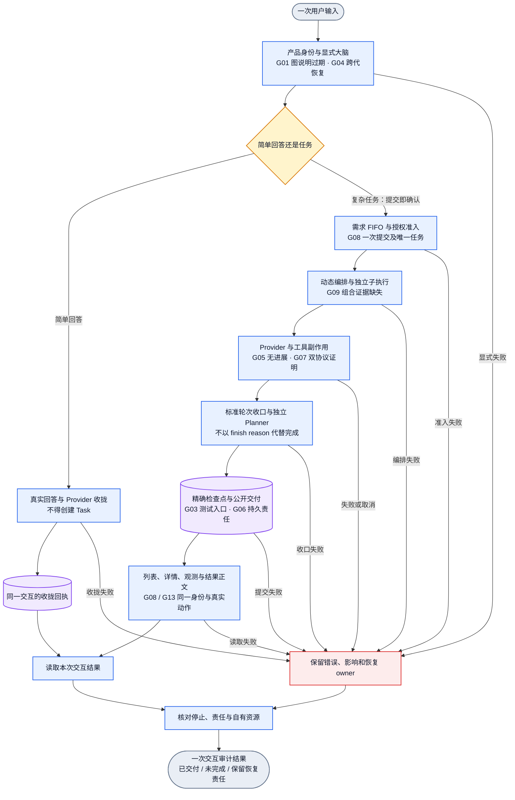
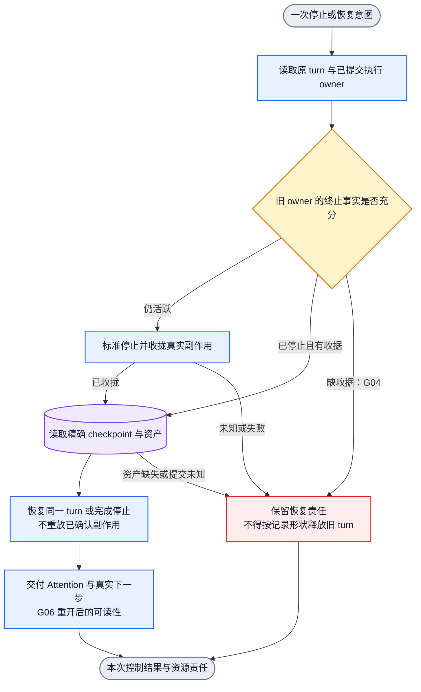
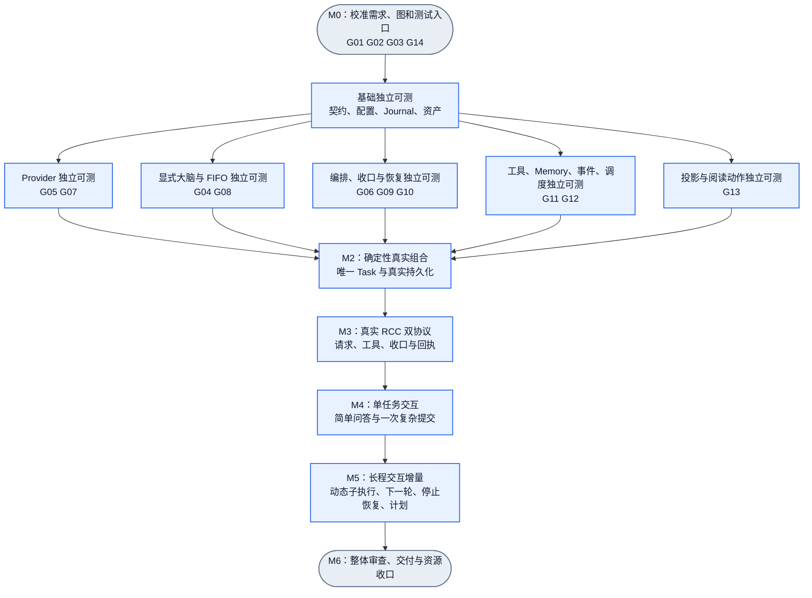

# MVP 缺口图与验收依赖

状态：2026-10-24 审计候选。图描述当前应验证的业务边与后续验收依赖，不代表运行通过。缺口编号、证据和关闭条件以[架构报告](../../architecture/mvp-test-path-2026-10-24.md)为准。执行派单见[计划](../../goals/mvp-test-execution-plan-2026-10-24.md)。

现有 30 张业务 DAG 已通过静态校验。它们的业务调用、图中 pending 说明、跨图版本与真实证据仍有缺口。下图不替换现有业务图，不建立第二套运行时控制状态。

## 1. 一次用户输入到交付：哪些边仍须验收

只画一次外部输入的对象流。简单回答和任务执行在各自真实收口后汇总为交互结果。失败可以在任何 owner 边界产生，不能只在链尾处理。

图中 C/P/T 表示一次当前轮次的职责，不规定角色调用顺序。需要继续时由既有外层状态机创建下一次执行；不在 DAG 加回边。用户任务完成才结束长程目标。新一轮仍须满足 checkpoint、Planner 与恢复契约。

## 2. 停止与恢复：最优先补齐的断边

具体证据：SupervisorLeaseRecord 只保留最近 takeover；显式 Brain 比对 committedOwner 与 current.takeover。G04 必须覆盖跨两次接管仍未恢复的原 turn。G05 的无进展退出也汇入同一 stop/settle 与恢复责任路径，不能在 Provider 下游伪造成功终态。

## 3. 自底向上的验收 DAG

下面是测试依赖，不是业务运行时。每个框交付一份含成功/失败/未验证的证据；失败只阻断真实下游，独立模块继续。

底座后五个分支可以并行，但同一共享源文件或 dist 只有一个 writer。上图为全部范围的汇总依赖；某分支的可选扩展不阻断单任务核心，例如定时/周期的完整场景在 M5 验收。M1 要求每个单元有独立运行方法，不要求提前验证所有长程组合。

## 4. 与现有业务图的对应

| 本图责任 | 沿用的现有业务图 | 重点缺口 |
|---|---|---|
| 配置、启动、配对 | default-product-adoption、workspace-selection、pair-issuance、serve-launch、humanagent-auth-session、daemon-restart | G01/G14：过期说明；G04：跨代恢复证据 |
| 显式输入与分流 | explicit-requirement、explicit-semantic-turn | G04/G08：失败释放、一次提交、简单回答独立收口 |
| 编排与轮次 | native-admitted-turn、subagent-call-checkpoint、implicit-turn-closure、native-turn-checkpoint、turn-continuation-request | G03/G09：真实动态组合和测试入口 |
| 执行与控制 | serve-task、task-grant-control-entry、native-turn-segment-recovery、checkpoint-path-reentry | G04/G05/G06/G07/G10 |
| 工具、事件与计划 | hand-search-websearch、context-events、memory-curation、scheduled-occurrence、subscription-control | G02/G11/G12 |
| 阅读与浏览器 | observation-read、task-liveness-display、human-readable-ux-reading、dashboard-e2e-* | G08/G13：同一 Task、动作、正文与双端 |

## 5. 机器图与校验边界

`acceptance.graph.json` 是本次验收工作的单源单汇依赖图，12 个节点、15 条边。operator 是审计责任标签，不是已注册的产品 Runtime Operator。语义标签见配套 semantic 文件；owner 责任在图 meta 与架构报告 U01–U13 中。

对该图运行 `dagpipe graph validate` 和 `dagpipe graph inspect`。项目现有顶层 validator 只枚举 docs/dagpipe 第一层，因此不会自动包含本目录；不修改产品 gate 来伪装本计划为产品业务图。静态通过只证明拓扑与标注，不证明任何 MVP 已完成。Mermaid 源码已检查；本次未进行浏览器渲染验收。
