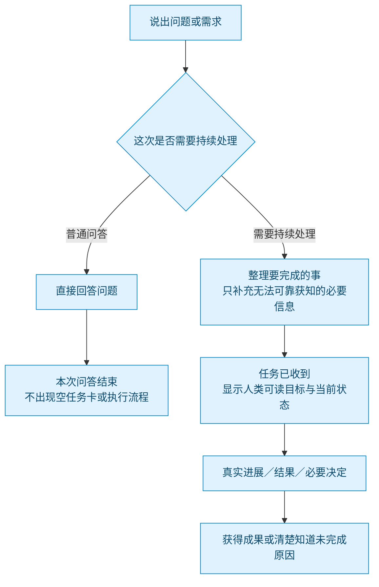
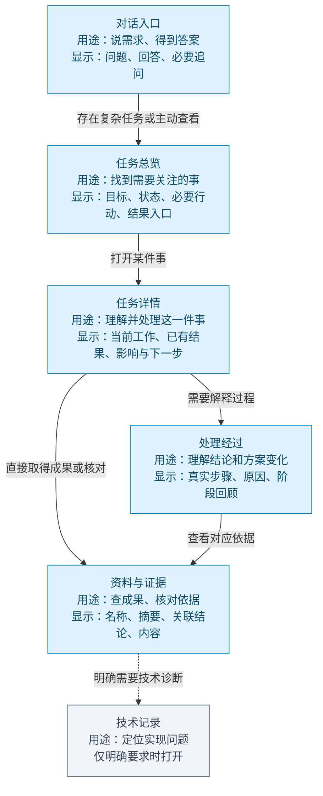
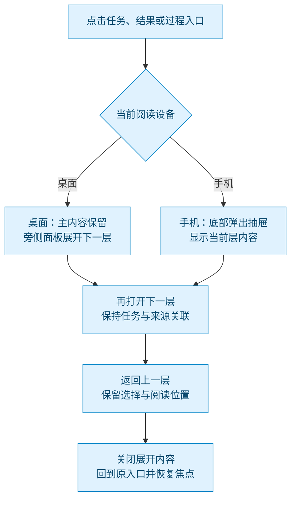
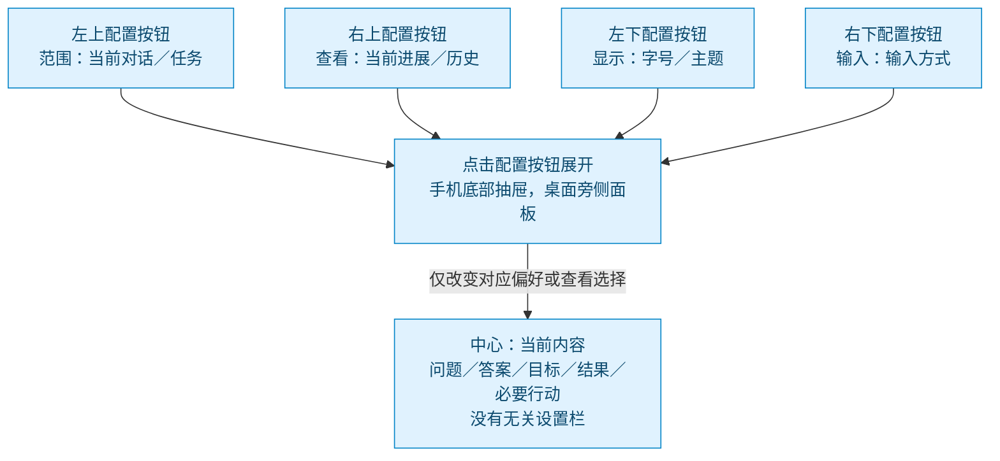
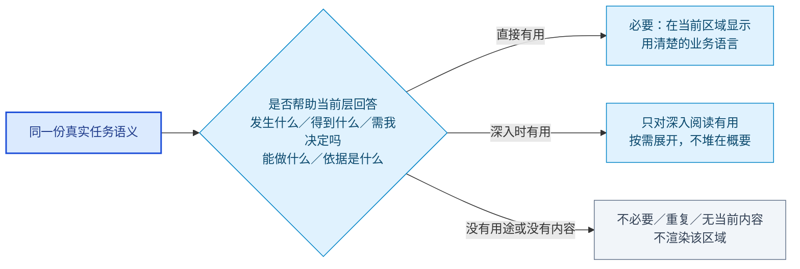
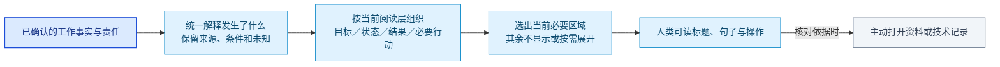
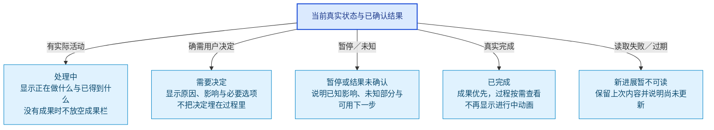
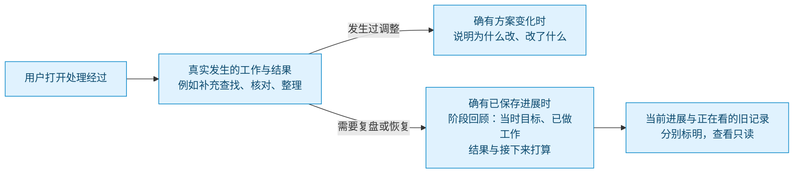
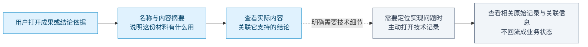

# HumanAgent UX 图册：语义分层、双端排版与四角配置

需求库版本 13。默认入口：[面向人的 UX 图与展示示意](index.html)。内部产品运行图保留在 [运行结构图册](runtime-design.html)，不与默认展示层级堆放。

[分层显示正文](../../ui/human-readable-layered-ux-design-2026-10-11.md)逐层说明用途、必须显示什么、出现条件与默认隐藏项。手机以下方抽屉进入下一层，桌面旁侧展开；主动配置在四个角落。示意内容有明确标签，不是实际任务或产品验收。

## 从提问到结果：只展示这次交互需要的内容

对话先服务用户问题。普通问答直接回答；需要持续处理的需求才出现任务目标与进展。信息缺口只问具体问题，不把整个内部任务模型变成输入表单。

## 逐层阅读：每层有用途，不必逐层走完

层级是用户选择的阅读深度。概要不复制全部细节；需要决定的内容、结果与重要失败可直接访问。技术记录只有明确需要时出现。 桌面按主内容旁的面板展开；手机下一层统一从底部抽屉进入，返回上一层保留位置。

## 桌面与手机：同一语义，不同展开方式

阅读层级和语义不变。桌面让主内容与下一层并列，手机用同一个底部抽屉递进；返回上一层保留阅读位置，关闭回到原入口，不堆叠多个抽屉。

## 主动配置：四个角落入口

四角持续可见的按钮是主动配置入口，内容中的结果/决定/阅读入口是当前工作的一部分，不是第五个全局配置按钮。每个表面沿用同一位置和职责；配置内容只列当前真实可用项，不改变阅读层级或绕过原任务控制 owner。该位置已进入设计，产品壳目前尚未实现。

## 当前层显示什么：按用户问题决定必要性

只显示服务当前阅读/决定的信息；无内容区域、重复摘要、纯内部字段不显示。隐藏技术细节不隐藏失败、未知或影响。

## 从真实工作到人类可读呈现

语义来自共同事实链，界面只按当前用途组织与呈现。未知保持未知；不把一次请求结束或一个工具结果翻译成任务已完成。详细实现 owner 在设计正文中，默认阅读图不露出代码名。

## 状态与行动：在用户需要的时候出现

以下是表达结构而非新增状态机。需要决定、暂停、未知、过期都必须说明其真实影响；操作只显示当前实际允许的动作。

## 处理经过：展示真实工作，不展示固定角色骨架

只有用户要理解过程或恢复时展开。多次探索/计划等显示为实际业务进展与调整原因，不变成四个永远占位的角色卡。查看旧回顾不改变正在执行的状态。

## 资料与证据：先看内容，技术记录最后展开

成果可从任务详情直接打开。资料层回答这份材料是什么、支持哪个结论；代码/结构化文件如果本来就是成果可直接看。原始协议和内部标识仅用于主动技术诊断。

## 设计 owner 与来源

| 产品真相／派生结果 | 唯一 owner |
|---|---|
| 生命周期、Brain 队列规则、错误策略、steer、恢复许可 | packages/core |
| 分类/准入、Pipeline、调度、窗口、checkpoint、恢复编排 | packages/runtime |
| 权威 Organ Journal | packages/adapters/jsonl |
| 不可变资产与工具输出 | packages/adapters/filesystem |
| 共同 canonical/pairing/narrative/digest | packages/context-events |
| 展示投影、产品控件、viewed 选择 | packages/ui 与既有 docs/ui 产品壳 |
| 配置、项目/control-root 路径、展示偏好配置合同 | packages/config |
| 公开 API 与组装 | packages/app |

- [UX 核心框架](../../ui/ux-core-framework-2026-10-10.md)
- [框架修订：真相与派生、模式与视角分离](../../ui/ux-core-framework-amendment-2026-10-11.md)
- [权威 UX 需求](../../ui/semantic-observation-audit-2026-10-07.md)
- [项目 owner 规则](../../../AGENTS.md)

本图册只修正文档表达。后台错误消费、三模板、revision 历史、多视角与 checkpoint 产品查询等黄色边仍是待实现/待证实设计，不能当作已落地能力。展示偏好的持久边已在图 12 落地：`packages/config` 的 `[ui.display]` 存 `<controlRoot>/config.toml`，`packages/app` 暴露 `/api/ui/display-preference` 的 GET/PUT/DELETE，共享控制器挂载在 task-dashboard 与 observation 两个表面；整体事件与共享消费者边、其他共享壳页面接入仍未闭合。

UX 对象流 `human-readable-ux-reading.graph.json` 只做静态拓扑检查，未声称生产接线或行为验收。
