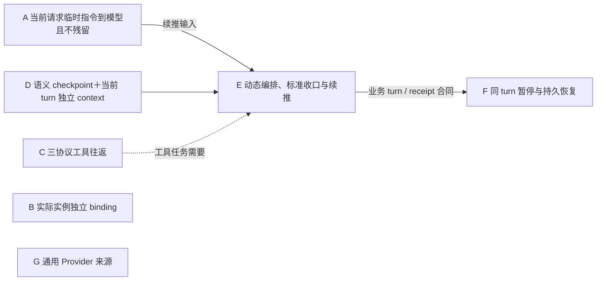

# HumanAgent 原生 Provider 分层 gap 与交付计划

状态：`PROVIDER-INCREMENT-OPEN / FULL-NATIVE-UNVERIFIED`。Provider 总图仍为 7 个业务能力节点 A–G。2026-10-18 已接收 A/B 的当前合同、wire、转发和配置消费证据，C/G 的工具与通用来源充分性裁决，以及 D/E/F 的语义上下文、标准收口和恢复回执。它们各有证明范围，不能汇总成完整原生目标完成。当前明确未闭合的是原 canonical taskless 问答和 peer 治理交付；逐工具语义审查覆盖也在定点核对。图不新增节点，本计划不替代 [Provider 唯一设计](../architecture/provider-adapters.md)。

当前证据索引：既有 RUN 为 `/Volumes/Intel/playground/humanagent/.worker-runs/native-reasoning-d0-20261012`。A/B 见 r403/r414；C/G 见 `native-provider-evidence-sufficiency-r315-20261017/plan.md`；D 见 r288/r410/r415；E/F 见 r341/r363/r375/r391 与 peer `prepared-cold-delivery-20261018`。最新 M3 与 Response 所有权增量见 `native-provider-lifetime-execute-r441-20261018/owner-acceptance.md`、`native-m3-provider-review-r442-20261018/classification.json`、`native-m3-provider-delivery-r443-20261018/delivery.md`。源码已入 main 并完成安装、正式重启、installed 原 M3 1 PASS、推送和自有资源清理。

原 taskless 问答在 gen40 上只恢复一次至 epoch5，仍 HTTP409 / `UND_ERR_SOCKET`，当次 failed/closed、无 accepted output/helper/语义完成 checkpoint；没有 epoch6。r449 实际回执、r450 精确链观察与 r451 成功/失败 wire 比较均保留。已确认 start HTTP200 后流中断；同时间 RCC503 只是未关联候选，原因仍 UNKNOWN。成功 peer Task 使用相同 model/protocol/endpoint/route，不能代替 taskless 入口成功。不得据此改 schema、切模型或盲重放。

当前 C/G 依据：[唯一进度记录](native-reasoning-progress-2026-10-08.md)中的 main 派生三协议真实工具循环（各 2 requests、合计 3/3 PASS）、通用 HTTP 默认入口及 credential omission RED→GREEN。配置消费、HTTP 工具循环和各协议 wire 已有独立 consumer。无需再建 source × protocol 全组合矩阵。main、候选与 installed 的证据范围分别保留；installed Responses 不扩称 installed 全协议。厂商/实际模型归属、业务 closure、stop 和持久恢复仍按对应 owner 的证据判定。r315 原文保留于既有 RUN 根 `native-provider-evidence-sufficiency-r315-20261017/plan.md`。下文未更新的早期作者回执属于历史，不覆盖本段。

历史证据与集成边界（2026-10-12，不作当前运行状态）：当时基线为 `db915e7a`，存在未提交组合候选。计划内 5 项编译、6 组公开 consumer/replay、三协议 transport continuation 各 1/1、N2 续接 3/3、N3 离线 replay 11/11 有历史回执。单次 RCC Responses 请求返回 `OK`、settlement succeeded；route log 的 model/wire_model 为 `kimi-k3`，请求侧 `gpt-5.5` 不证明实际生成模型。HumanAgent receipt 缺 RCC request id，raw artifact 不可读，一对一请求归属仍未验证。原始证据保留在 `/Volumes/Intel/playground/humanagent/provider-native-abcd-governance-20261012/dist/provider-live-proof/result.md`。当时整体交付 0/7、G 通用来源、D/E/F 接线、F2 typed capture/completion、Runtime 冷恢复等仍有缺口；W2 为 3/3，W1-1 为 9 项但有未排空 producer 与空内容反例。这些历史结果不升级为当前 PASS。

当前推进复用整体长程计划和 owner 节点笔记。删除候选 digest 重算、exact-candidate 身份包装和无提交标识即阻断交接的要求；用实际 diff、受影响行为结果和普通 Git 交付回执接收。保留请求归属、业务 completion、Journal 冷恢复和真实入口验收；治理 review 不能替代完整 milestone review，历史证据只在仍适用时复用。

需求绑定：现场 `.appsdk/requirements.json` version 14。Provider 顺序仍为先消融图节点、更新受影响治理、再改源码；已完成的图与治理前置不重做。当前另有 peer 负责最新治理消融迁移，尚未整体交付，不能用早期局部 Review PASS 代替。v12 人类可读语义分层、v13 手机/desktop 排版、底部抽屉和四角配置入口由 UX owner 实现。Provider 相关语义继续有效：显式 Brain 分流，通用临时续推依据显式派单模板，不强制存在 goal/阶段结果/交付字段，不增加重复模型 control block 或停止布尔标签。

本计划依据已完成的两份独立源码审计与独立 gpt-6.1-sol READY Planner，不另设计一套流程。审计基线为 main `4fe42f5418e21a8bb98fcff0bd7e73595bf6e546`；主树已有大量 dirty，源码事实与作者 worktree 增量分别记录。原始材料位于 `/Volumes/Intel/playground/humanagent/.worker-runs/native-reasoning-d0-20261012/provider-req7-reconcile/` 的 `observation.md`、`protocol-observation.md`、`context-observation.md`、`plan.md`；目录 req7 是历史名称，Planner 实际绑定 v11，当前分支重绑 v14。源码观察证明实现位置与缺口，不证明运行成功。图消融由 parent 接受后，仅由单一 writer 修改本计划文档；本轮 v14 计划纠正同样只改文档，未执行代码、测试、build、DAGpipe gate 或真实请求。

## 1. 共同目标与唯一责任

完整目标仍是 HumanAgent 拥有两类大脑的长程推理闭环：显式 Brain 保留最新完整语义 turn，前序任务为语义 checkpoints；预算内 N 个隐式 runtime 独立编排，动态选择、重复或并行调用各角色，主要接收 subagent 精炼结果。每次调用建立 checkpoint；turn 收口形成目标、做了什么、结果、下一步四项语义，并由 planner 对齐目标与计划，迭代至任务完成或失败。各实例/subagent 可选独立 provider/model/context，保留历史选择、纠正、路径记忆、准确恢复责任和原生同入口证据。

**语义上下文边界（有效 requirement，本计划不改语义）。** 最新/活动 turn context 保留 raw tool execution results；跨 turn checkpoints 只保存语义事实及证据引用（目标、做了什么、结果、下一步），不能回放历史 raw。父编排者接收各 child-agent 的精炼交付，不接收 child raw transcript；子 agent 的完整活动留在其自身证据归属。该边界已由既有 Runtime context 合同拥有，不在此新增第二套：handoff 语义见 [native-agent-handoff.md](../architecture/native-agent-handoff.md)（结果引用 semantic claims + evidence refs，不复制 raw），跨 turn Context 装配见 [context-contract.md](../architecture/context-contract.md)（只装配已提交 checkpoint 的语义，raw 留在不可变 owner）。

| Owner | 本分支责任与协作接口 |
|---|---|
| `packages/contracts` | 实际生产 `AgentInput`、`ProviderExecutionInput` 的最小中性合同；临时指令与 BusinessPayload 分离。 |
| `packages/config` | per-agent/role 有效 binding 解析、校验与编译；输出已校验配置，不复制 RCC 凭据。 |
| `packages/adapters/provider` | 独立三协议编码、typed 工具调用/结果、请求身份、错误、readiness、外部 stop/settle 能力与本地资源事实。 |
| `packages/app` | 显式 Brain、实际 child/reviewer 等实例消费有效 binding；组装真实端口，保持实例输入与 context 独立。 |
| `packages/core` / `packages/runtime` | 业务 turn/task 完成权、预算准入、语义 context 装配、显式分流和派单、通用 renderer、续推触发、四项 checkpoint、retry 与持久恢复。Provider 提供接口并协同验证。 |
| `packages/ui` / projection | 消费既有 Runtime 事实实现 v12/v13 语义分层与响应式展示；不从 Provider finish reason 推断业务完成。 |

Provider 不规定 observation/plan/execute/review 固定顺序。请求终态、driver-local turnId、不同 driver UUID、配置对象存在、编译成功，都不能代替业务 turn 收口、持久身份、独立 context 或真实路由证据。

## 2. 九项能力要求的当前证据与剩余缺口

表中早期 source 描述只代表审计基线，不再用于派发当前实现。以下按已接受的当前证据更新，仍保留各层验收边界，不把后继 Runtime/Core 要求从完整目标删除。“唯一 owner”列引用 §3 的 A–G 业务能力节点。历史作者回执继续保留在后文。

| Gap | 业务要求 | 生产 source 事实 | 缺口 | 唯一 owner | 最小交付行为 | 依赖 | 证据状态 |
|---|---|---|---|---|---|---|---|
| **G1 实际请求输入合同** | 临时续推只进入当次请求，与业务输入分离 | 当前独立输入合同及消费实现已存在 | 未发现新缺码；不能用旧“未提交”回执覆盖当前来源 | Contracts（A） | 当前请求指令与 BusinessPayload 分离，无重复布尔 control block | 复用现有合同 | r403/r414 接收合同与当前来源；不扩大为所有 installed 组合 |
| **G2 三协议临时编码与隔离** | 通用临时提示参与当前推理，不进入下一请求/context | 当前三协议各自编码临时输入，已有 request-local consumer | 无新增矩阵理由 | Provider（A） | 当次指令不进入历史或后续 continuation | 复用既有 wire 合同 | r403/r414 及既有 provider-request-context consumer；历史 raw 排除另见 D |
| **G3 Runtime 生产转发** | Runtime 供应的临时输入确实到达模型 | 当前 forwarding 和 Responses 组合来源及回执已核对 | codec 与组合证据仍分范围，不用一方代替另一方 | Runtime（A） | 真实链传递独立字段，不回填 payload | 复用现有 typed seam | r403/r414 接收转发和组合证据；不再派旧“缺字段”实现 |
| **G4 独立 binding 配置** | 各 agent 可独立选 provider/protocol/model/endpoint | 有效 binding 编译、App endpoint/model/credential 消费与通用 HTTP 来源已实现 | G 来源能力证据充分；B 的角色组合范围仍按各自回执判断 | Config（B/G）、Provider（G）、App（B/G） | 保留 per-agent 优先、顶层继承、unconfigured 与旧配置兼容 | 不新增整节点屏障 | binding/source/default-entry consumer 与真实 credential omission 红绿见唯一进度记录；不扩称 installed 全组合 |
| **G5 Chat typed 工具闭环** | OpenAI Chat 可实际执行工具并继续任务 | 工具声明、typed call、assistant tool_calls 与配对 tool result 续接已实现 | 本能力证据充分，无新增实现或测试 | Provider（C） | 声明、执行、配对结果并续接至终态 | 已有 consumer 与 live receipt | main 派生三协议真实工具循环 3/3 包含 Chat；实际模型归属不由此证明 |
| **G6 Anthropic typed 工具闭环** | Anthropic 可实际执行工具并继续任务 | 独立 tools、typed tool_use 与 tool_result messages 续接已实现 | 本能力证据充分，无新增实现或测试 | Provider（C） | 独立协议工具往返至终态 | 已有 consumer 与 live receipt | main 派生三协议真实工具循环 3/3 包含 Anthropic；不复用 Responses wire 作为证明 |
| **G7 实际角色 binding 与独立 context** | 显式 Brain、N 个 runtime、child 各自独立模型与 context，父接收精炼结果 | 角色 binding 消费、父子输入隔离、精炼结果和 checkpoint 历史已接线 | 不以 UUID 或一次配置编译代替行为证明 | App（B）、Runtime（D） | 父接收精炼交付，历史 raw/隐藏链不跨 turn；child 不继承父 context | 复用 B/D 已验 seam | r414、r288/r415、installed helper r410 和 M3 r443；受控预算并行证据不外推任意 N 或所有角色组合 |
| **G8 标准 turn 续推与同 turn 恢复** | 不看 finish reason；缺压缩/总结/交付则继续；错误可停，恢复继续当前 turn | 四项收口、Planner 迭代、inspection stop、失败 capture/close 和 prepared cold 恢复已有交付 | 保留原 taskless 实际失败；不把标准机制已验误写成所有真实任务已成功 | Core/Runtime（E/F）、Provider 执行事实 | durable receipt 后换 turn；恢复保留业务身份、context 与责任 | 复用现有标准 turn/恢复接口 | installed r341/r363/r375/r391、prepared PR3 两例和 r443 两周期；本地 close 不外推远端副作用停止 |
| **G9 完整原生同入口证明** | 每项宣称能力在用户实际入口成立；错误/stop 事实准确 | 三协议工具 consumer/live receipt、installed helper/M3 与 peer 真实 Task 请求已有各自证据 | 原 canonical taskless epoch5 仍失败，精确 RCC 归因缺失；最新治理与逐工具审查覆盖尚待收口 | 各 adapter/Runtime、App 与 master 验收 | 保留实际入口、业务 closure、恢复及资源证据，不建立全组合矩阵 | 对应能力的必要证据；不等无关节点 | r315/r410/r443 和 peer 成功 Task 仅覆盖各自范围；r449/r450/r451 明确保留失败、原因 UNKNOWN，完整目标未完成 |

Chat `[DONE]` 无 finish_reason 的终态差异只是一条未运行观察假设，不列为必修 gap、不据此扩测。RCC 配置/listener/HTTP 200 也不是 G9 的交付证据。

## 3. 七个业务能力节点、依赖边与 writer 排程

旧文档用 10 个显式节点 `T0/T1/T2/T3a/T3b/T4/CTX/TURN/REC/LIVE` 描述交付，另有 1 个已记录但未画入图的必要能力（通用 Provider 来源）。本轮按业务能力消融为 7 个节点 A–G，并把证据步骤、层级屏障和文件协调移出业务拓扑。

计数采用同一口径：

- 旧图：**10 个显式节点，另有 1 个未画出的必要来源能力，实际责任共 11 项**。
- 新图：**7 个业务能力节点**。
- 消融：T0/T1/T2 合并展示减少 2；T3a/T3b 合并展示减少 1；LIVE 移出业务图减少 1；将原已存在的来源缺口显式画出增加 1。即 **10−2−1−1+1=7**；按完整责任口径 **11→7**。
- 合并展示不合并源码 writer；没有删除三协议、checkpoint、恢复或 generic Provider 能力来凑缩减数量。

| 节点 | 业务能力 | 唯一实现 owner（writer 独立） | 当前证据 |
|---|---|---|---|
| **A** | 当前请求临时指令到达 wire 且不残留 | Contracts（输入合同）＋ Provider（三协议编码）＋ Runtime（生产转发），独立 writer | 当前合同、三协议 wire、Runtime forwarding 和 Responses 组合见 r403/r414；不再沿旧“未集成”状态派单 |
| **B** | 实际实例独立 binding 消费 | Config（有效 binding 编译）＋ App（实例消费），独立 writer | 当前配置与 App 消费见 r414；父子独立输入及精炼回传另见 r288/r410/r443，不用 UUID 代替证明 |
| **C** | 三协议 typed 工具往返 | Provider | 当前能力证据充分：既有 typed consumer 与 main 派生真实工具循环 3/3；停止扩测，不扩称完整框架 |
| **D** | 语义 checkpoint ＋当前 turn 独立 context | Runtime | r288/r415 接收跨 turn raw 排除与 helper 连续性，r410/r443 有 installed 公开 consumer；不外推全部 live 组合 |
| **E** | 动态编排、标准收口与续推 | Core 判定不变量，Runtime 编排 | r363/r443 installed 两周期、四项 checkpoint、Planner continue/complete；没有新增固定角色链 |
| **F** | 同 turn 暂停与持久恢复 | Core/Runtime | r341/r375/r391 与 prepared PR3 installed 恢复/失败收拢证据；原 taskless epoch5 失败另列 G9，不冒全目标完成 |
| **G** | 通用 Provider 来源机制 | Config 解析，Provider readiness/transport，App 组装 | 通用 HTTP 来源、配置/凭据消费及默认入口证据充分；保留具体 main/候选/installed 边界，不新增全组合门禁 |

旧 T 编号到 A–G 的迁移映射（仅作历史对照；旧 T 标签只作历史作者证据标识，出现在本表、§4 作者回执及其引用处，不构成当前交付节点）：

| 旧节点／分组 | 新归属 | 删除机制的具体损失 |
|---|---|---|
| T0 实际输入合同 | A（Contracts writer） | 实际生产输入无法表达独立指令，或控制文本混入 BusinessPayload。合同机制保留。 |
| T1 三协议临时编码 | A（Provider writer） | 指令到不了模型，或拼进 `initialPayload` 后被工具续接重放。三协议独立编码保留。 |
| T2 Runtime 生产转发 | A（Runtime writer） | adapter 单测通过而真实入口仍丢字段。真实生产链保留。 |
| T3a 独立配置编译 | B（Config writer） | agent 不能表达独立协议/model/endpoint，或旧默认兼容被破坏。有效 binding 编译保留，不外推 generic 来源。 |
| T3b App 消费 | B（App writer） | 配置正确但仍请求同一模型；实例输入串入。实际消费与隔离断言保留。 |
| T4 Chat/Anthropic 工具 | C | 两协议仅能文本观察，不能执行工具、配对结果并继续。不能删除或用 Responses 实现代替。 |
| CTX Runtime 语义 context | D | raw 跨 turn 混入、目标/恢复责任丢失，父子 context 相互继承。 |
| TURN 标准 turn/renderer | E | Provider terminal 被当业务完成；缺压缩/总结/交付时不继续；缺四项 checkpoint/planner 对齐。 |
| REC 同 turn 持久恢复 | F | retry/resume 丢业务 turn、活动 context、已完成动作 receipt，可能重复副作用。 |
| LIVE 同入口组合证明 | 移出业务图；附着为 A–G 的验收 receipt | 删除“节点”不损失业务功能；删除实际验收会失去公开入口接通证明，所以 receipt 保留，不能独立形成证据任务 DAG。 |
| G4 隐含的通用来源后继 | G | 只能选择 RCC，不能声称完整原生 Provider 来源机制。不得静默关闭。 |
| L0–L5 六层 | 结构分组；删除层完成屏障 | 仅作阅读分组，不再派“整层交付”任务。 |

**业务依赖边。** 下图是能力依赖图，不是编译执行图，也不是角色阶段流水线：

- **A→E**：E 的续推需要 A 的真实输入依赖。删除会使 orientation 指令到不了生产请求。
- **D→E**：E 需要 D 的目标、当前 turn 和恢复责任上下文。
- **C 条件性 gate E**：只对工具任务成立；非工具任务不等待 C。删除会让工具任务无法续接。
- **E→F**：F 依赖 E 的业务 turn/receipt 身份与收口合同；不要求 E 全部实现放行才能编写 F。删除会无法证明“恢复同一 turn”。
- **A/B/C/G 之间没有相互完成屏障**，只保留显式接口 seam（工具合同、binding 消费签名等）。A-P 与 C 的共享 Provider 源码、A-R 与 B-App 的共享 App 测试是排程约束，不是业务边。

**组合验收（非整节点调度门）。** B＋D 共同证明实际实例输入/context 独立；B＋G 共同证明 generic 来源可供实例选择。这是组合验收关系，不能转成 D 必须等待 B、B 必须等待 G 的整节点屏障。

**writer 排程（与业务边分开）。**

| Writer | 排程约束 |
|---|---|
| A-P，Provider writer（`ProviderAgentDriver.submit→port.start→codec→HTTP body`） | 先写 Provider 源码；释放共享文件后 C 才能写 |
| A-R，Runtime writer（coordinator/composition→AgentRuntime→现有 wrapper→driver） | 生产转发；释放共享 App 测试 `tests/app/ui-runtime.test.ts` 后 B-App 才能写 |
| B-App，App writer（explicit Brain、child/reviewer 实例组装） | 消费 Config writer 的 `agentProviderBindings`；共享 App 测试等 A-R 交接 |
| C，Provider protocol writer | 等 A-P 释放共享 Provider 源码后写入 |
| G，Config/Provider 来源后继 | 下一派单依据唯一 Provider 设计冻结最小来源/配置/transport seam；不能仅把 enum 改成任意 string 就声称 generic 机制完成 |

**动态编排边界（均不能消融）：**

- 编排者在预算与准入约束内选择 observation、plan、review、execute，可重复、并行或跳过当前不需要的角色；删除动态选择会违背有效 requirement。
- 每次 subagent 调用建立 checkpoint 关联；返回结果的语义采纳由编排者决定。删除调用 checkpoint 会丢失调用前恢复锚点和责任关系。
- turn 结束必须形成“目标／做了什么／结果／下一步”四项 checkpoint，之后 planner 对齐并由编排者采纳。删除这些强制边界会丢长程 orientation；它们不意味着 turn 内固定角色顺序。
- Provider terminal 只证明请求事实；Core/Runtime 依据任务真相和 durable receipt 判断继续、完成、失败或暂停。删除该分界会把 finish reason 误升为业务完成。
- 本地 abort/settle 只证明本地资源事实；标准停止仍须 operation、副作用结果及收拢 checkpoint。删除真实停止责任会把取消模型请求误报为停止完成。

**G1–G9 → A–G 映射（与 §2 gap 表一致）：**

| Gap | A–G 节点 |
|---|---|
| G1 实际请求输入合同 | A（Contracts writer） |
| G2 三协议临时编码与隔离 | A（Provider writer） |
| G3 Runtime 生产转发 | A（Runtime writer） |
| G4 独立 binding 配置 | B（Config writer）；通用来源后继 → G |
| G5 Chat typed 工具闭环 | C |
| G6 Anthropic typed 工具闭环 | C |
| G7 实际角色 binding 与独立 context | B（App writer）＋ D（Runtime context 后继） |
| G8 标准 turn 续推与同 turn 恢复 | E（收口/续推）＋ F（同 turn 恢复） |
| G9 完整原生同入口证明 | 附着 A–G 的验收 receipt；App 组合，parent 验收 |

当前明确 **7 个业务能力节点** A–G，不是总目标的封闭任务总数。G 是开放的通用来源残余；D/E/F 等后继在真实 seam 与 owner 输入 ready 后细化派单；不预造角色注册表、第二状态库或 Provider 业务状态机。

## 4. 当前两个基础作者回执

这是作者证据摘要，文档作者没有执行以下测试，也不计为 main 或总目标完成。T0 归入 A 的 Contracts writer，T3a 归入 B 的 Config writer；旧 T 编号仅作历史作者证据标识，在 §2/§3 节点表、§5 证据列、§3 迁移映射与本 §4 中引用，均不构成当前交付节点。

| 节点 | 当前交付与证据 | 仍缺什么 |
|---|---|---|
| **T0** | 已 freeze 两个实际输入的 `transientInstruction?: string`；CONTROL_KEYS 拒绝 business payload 控制键。作者在未修合同取得 TS2353 红编译，修后 `pnpm build:contracts` 通过；request-local 定向 **1 PASS / 0 FAIL**，同文件 **42 PASS / 0 FAIL**。候选 commit=`b2ac04eb478c127b9acbed83b92c0967624b2ad0`，包含在组合基础 `46f012ca`。 | 尚未入 main；没有 wire 编码、生产转发、renderer 或 live 证明。 |
| **T3a** | 已产出 `EffectiveAgentProviderBinding { agentId, roleId, source: 'agent'|'inherited'|'unconfigured', provider?: ProviderConfig }`、`compileAgentProviderBindings(config)` 和 `LoadedConfiguration.agentProviderBindings`。agent provider 优先/继承/未配置与 model 覆盖已锁定；支持 `[[agents]]` 下 dotted provider keys。作者 config build/test compile 通过；定向 **4 PASS / 0 FAIL**，同文件 **36 PASS / 0 FAIL**。原型污染负例已红/绿修复并独立 Review PASS。候选 commit=`a7acc2bf`，组合基础 `46f012ca`。 | 尚未入 main；实际 App 尚未消费编译结果，独立真实请求路由 **UNVERIFIED**；ProviderId/PROVIDERS 仍为 RCC-only，per-agent protocol/model/endpoint 编译不能证明通用 Provider 来源完成，G4 保留 Config/Provider 后继。 |

原始回执为该材料目录下 `t0-contract/result.md`、`t3a-config/result.md`。当前源码并发按真实 owner 与文件冲突排程：A-P 与 A-R 均已交回未提交候选和各自定向红/绿证据；A 的同入口组合断言正在 `/Volumes/Intel/playground/humanagent/provider-a-compose-proof-20261012` 编写，输入同时包含 A-P/A-R 候选。`tests/app/ui-runtime.test.ts` 已由 A-R 明确释放。B-App 已交回五路径候选及两角色实际组装定向断言，结果见 `/Volumes/Intel/playground/humanagent/.worker-runs/native-reasoning-d0-20261012/provider-app-binding-consumption-20261012/result.md`。G Planner 的来源设计给出最小 HTTP 来源切片；G-Config 初版编译候选已红/绿，但因候选使用 `provider='rcc', source='http'`、ProviderId 仍 RCC-only 的语义未裁定，暂不接受/集成。独立 schema Planner 正在裁定最小正确字段契约。C 已从含 A-P 候选的独立基线开始 Chat/Anthropic 工具往返；A-P 写入已结束。D 的语义 context 最小任务由独立 Planner 按 v14 正在细化，不与 A 组合测试或 C 文件重叠。作者基础证据不能把 G2/G3/G7/G8/G9 一并核销。

## 5. 最小必要充分验收

每个断言直接对应本次 gap。新增测试前先记录失败可能性依据、影响、执行/维护成本；无依据可记“未知”。未运行的源码反例写 **UNVERIFIED**，不能写成已有红测。一次可执行反例抓到原错、修后必要断言成立，即停止扩测；只有新失败、合同改变或未解疑点才补检查。

| 对应 gap / 具体错误 | 必须失败的断言与抓错反例 | 失败可能性依据、影响、成本 | 当前证据 |
|---|---|---|---|
| G1 只改 framework、实际输入缺字段或业务控制混入 | 从实际 AgentInput 到 ProviderExecutionInput 使用 sentinel；旧类型应编译失败，assertBusinessPayload({transientInstruction: sentinel}) 必须拒绝。 | 审计缺字段；临时输入无法到模型/控制污染；编译与单条动态检查低成本、低维护。 | T0 作者红 TS2353、绿编译与定向检查；仅合同证据 |
| G2 当次 wire 没指令或污染业务输入 | 从 adapter start 捕获三协议实际请求；sentinel 位于各自指令位置且一次，原 payload 不含 sentinel；缺编码时必须失败。 | 现有 codec 无 overlay；续推无效/业务污染；本地 deterministic 低执行成本。 | 源码反例未运行，**UNVERIFIED** |
| G2 下一工具/独立请求重放临时指令 | 带 sentinel → 工具 result → typed continuation → 新请求不供应 sentinel；后续 wire/history 不含它，既有业务内容和 call/result 仍保留。把文本拼 initialPayload 时必须失败。 | initialPayload 重用是明确路径；跨请求污染；复用多轮工具 harness，低至中维护。 | 可执行反例待作者运行，**UNVERIFIED** |
| G3 driver 单测接通但生产链丢字段 | 通过 RuntimeTaskCoordinator 公开执行入口、真实 ProviderAgentDriver 与捕获 transport，断言临时输入到 wire；仅直调 codec 成功必须失败。 | 现有 composition 只传 prompt；假接通；复用 coordinator fixture，中执行成本。 | **UNVERIFIED**；stub 不证明触发策略 |
| G4 agent 配置被拒绝/选择串值/破坏旧默认 | 实际 config.toml 编译不同 agent protocol/model/binding；旧 validateUserConfig unsupported-key、缺导出或 dotted-key invalid 应失败；旧单 provider 保持兼容。 | 作者记录原拒绝路径；错模型/配置不可用；配置本地低执行/维护成本。 | T3a 作者红例与 4 条定向 PASS；不证明 App 路由 |
| G5/G6 工具只是观测/重复执行/错误配对/submit unsupported | 每协议最小一次工具：片段形成一份 typed call、executor 只执行一次、result 匹配原 call、下一请求终态。tools=[]、观察-only 或错误 callId 必须失败。 | 三项明确源码缺口；任务不能完成或错误副作用；复用 executor/driver，录制 fixture 中维护成本。 | 两协议完整闭环 **UNVERIFIED** |
| G7 配置正确却 App 仍共享 binding 或 context 串入 | 两个现有实例配置不同协议/model，交错运行，捕获各自 binding/wire/context；对方 marker 出现或 shared binding 必须失败。父接收 child 的精炼交付且编排者 context 不含 child raw transcript；该精炼交付/无 raw 语义若已由 Runtime context 合同拥有（`docs/architecture/native-agent-handoff.md`、`docs/architecture/context-contract.md`，F-S/Context owner `packages/runtime/src/context/`），指向该 owner，不重复建测。跨 turn 再断言历史 raw/hidden response chain 排除。 | 现有共享 serve binding、builder 未接；错模型/上下文泄漏；assembly 中成本，后继语义装配单独验。 | **UNVERIFIED**；fresh UUID 不满足断言 |
| G8 请求结束误关闭业务 turn，恢复重做已完成动作 | 缺标准动作时请求 terminal 后必须继续；四项 checkpoint 与持久 receipt 后才换 turn；错误耗尽暂停后冷恢复，业务 turn/context/receipt 保留、新 request 可变化、确认副作用不重做。旧直接 finalize/新 turn identity 必须失败。 | 当前链未证明、source 指出直接结束路径；恢复责任丢失/重复副作用影响高；持久恢复高成本，后继 owner ready 才加入。 | 原反例未运行，**UNVERIFIED** |
| G9 fake 成功却真实入口失败，abort 被误写 stopped | 所宣称 binding 从同公开入口真实发送最小 request/response，route attribution（请求 model/route）与 receipt 关联正确；协议工具往返由既有 fake/replay（C）范围覆盖，只有产品声称依赖 live 工具执行时才断言真实工具 call/result；HTTP 200 或本地 abort 单独作为闭环、remoteStopSupported=false 却声称远端已停必须失败。 | 当前有单次 Responses live receipt（Provider-level lifecycle PASS），但无 identity-bound route/body attribution；错误完成/停止误报影响高；每项所声称 binding 一次最小 request/response，失败定向复验。 | Provider-level live lifecycle **PASS**；完整 live coverage、业务停止与组合恢复 **UNVERIFIED** |

A 只验证实际合同、真实转发及 wire 隔离（Contracts/Provider/Runtime 三个 writer）；B 验证配置与实际 assembly；C 验证独立协议工具闭环和本次受影响的错误/停止断言；D/E/F/G 按 §3 的 UNVERIFIED 状态后继推进。复用 `pnpm build:contracts`、受影响 tests 的 tsc 与 `node --test --test-name-pattern='<具体用例>' <实际 emitted file>`，派单由 owner 填实命令，避免宽泛全量。

fake contract 证明本地合同/组合链，recorded replay 证明对应协议样本，真实 RCC 4444 同公开入口才证明本次真实路径。Provider 直连总交付保留适用三层证据；编译或 stub 不替代任一层。完整重大交付单元经作者组合验收后安排一次独立整体 review，覆盖 owner、控制/业务分离、协议隔离、binding/context、业务终态和恢复；不为每个内部节点追加重复门禁。

## 6. Provider / Runtime / UX 必要协同接口

| 事实或输入 | 协作约束与后继 owner |
|---|---|
| 本请求临时输入 | Runtime 根据当前有效显式派单与真实状态生成 → 经生产分离输入 → Provider 当前协议编码。下一工具请求不自动继承；再次需要时 Runtime 重新生成。它不进入 canonical history/checkpoint。 |
| 请求、调用与业务 turn 身份 | 复用 requestId/parentRequestId、callId/continuationRef、assignment attempt/execution epoch 的明确关联。driver-local turnId 不自动升级为持久业务 turn；对应关系由 Runtime 证明，不能按事件顺序猜。 |
| 标准收口与四项 checkpoint | Core/Runtime 判定压缩、总结、交付与 durable receipt，形成四项语义并触发 planner；Provider 只报告请求 terminal/错误/工具事实。renderer 不要求固定 goal 字段，也不重新引入模型 control block。 |
| retry / 恢复 / stop | Provider 保留原协议错误、可重试性、local settle 与能力限制。Runtime 保留同一业务 turn/context、已完成动作、operation duty 与恢复责任；本地 abort 不等于远端 effect stopped，业务停止必须有 checkpoint 和实际副作用结果。 |
| 语义历史与 UX | Runtime 从 Journal/恢复资产装配语义 checkpoint + 最新完整 turn，实际父子输入明确独立；父接收 child 精炼交付，不含 child raw transcript（owner：`docs/architecture/native-agent-handoff.md`、`docs/architecture/context-contract.md`）。已有 RuntimeTaskEvent 的 terminalPhase provider/final 等事实经既有 projection 给 UX；当前 final 也不能宣称已满足最新标准 turn closure。UX v12/v13 人类可读分层展示、手机/desktop 排版与入口由 UX peer 完成。 |

范围保持原 READY 计划：不引入 Dashboard 搜索、AItest、ACP/DSH/OpenCode、传输安全专项或相邻 backlog；不修改 RCC 真源/凭据。当前文档落盘没有执行代码、测试、build 或真实请求。总目标继续 OPEN；能力按各自证据逐项验收，缺口有后继 owner 和明确恢复条件。

## 7. 同 turn segment 恢复目标图与治理绑定

G8 的同 turn 持久恢复由独立 SESE 图表达：[`docs/dagpipe/native-turn-segment-recovery.graph.json`](../dagpipe/native-turn-segment-recovery.graph.json)，配套 [`native-turn-segment-recovery.graph.semantic.json`](../dagpipe/native-turn-segment-recovery.graph.semantic.json) 与 [`native-turn-segment-recovery.graph.binding.json`](../dagpipe/native-turn-segment-recovery.graph.binding.json)。该图把 G8 的“恢复同一业务 turn”展开为最小对象链：exact 读取原 v1 与 predecessor receipt、当前 grant 与精确 business registration、segment-opened 提交、本 epoch 生产窗口与逐次准入、本 segment v2 capture/drains/recovery assets，单一 typed 输出返回 receipts 或保留恢复责任。

状态与边界：`DESIGN-PLANNED` / `implementationStatus: UNVERIFIED`。它是 TG1 精确 reservation → D-S segment admission → J1 v2 durable backing → A 同 turn 冷 reentry 这条 corrective 链（S/J/L/M/A）的目标合同与治理绑定，不证明 Operator 已注册、runtime 已执行或产品已验收。图不改变 §3 的 A–G 能力拓扑，也不新增注册表、schema 或治理框架；责任落到现有 `.graph.binding.json` 组件，owner 为 D-S Runtime、TG1 grant/registration adapter、J1 JSONL/immutable assets 与 A 共享 final App。
