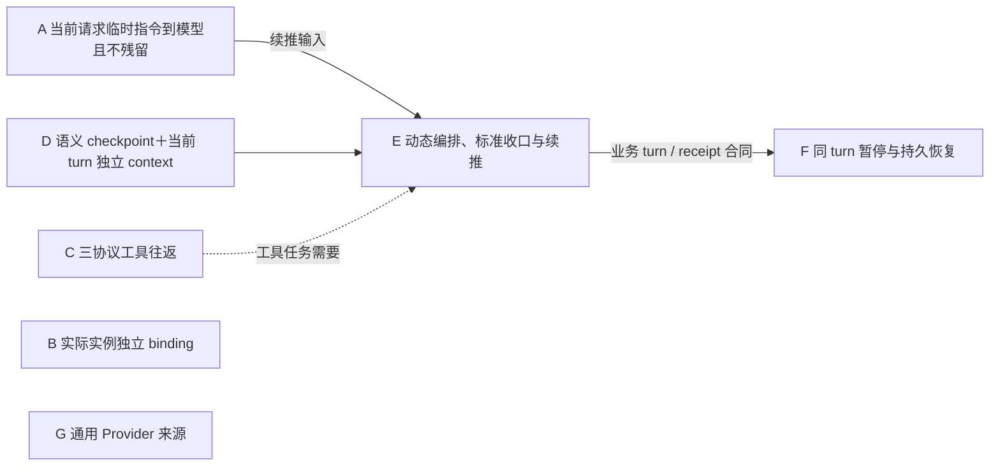

# HumanAgent 原生 Provider 分层 gap 与交付计划

状态：`PROVIDER-INCREMENT-OPEN / FULL-NATIVE-UNVERIFIED`。宿主 goal 当前为 **active**；Provider 总图有 7 个业务能力节点 A–G，完整生产节点 **0/7 完成**，总目标未关闭。parent 已接受独立 READY Planner 的图消融：Provider 图从旧 10 个显式节点消融为 A–G，并保留未完成的通用 Provider 来源能力。这是现有完整原生推理目标的 Provider 分支，不缩小总目标，也不替代 [Provider 唯一设计](../architecture/provider-adapters.md)。

证据与集成边界：最新 `origin/main=db915e7ae41e9b4fc1bf6199c862b57571cad516` 上有未提交选择性组合候选，基线 HEAD=`db915e7ae41e9b4fc1bf6199c862b57571cad516`，worktree dirty。先前内容 digest=`d0a24e7cea11cf1b1d0a605fccc947bd6fe702450d47c4d6fef3a333a55db6bc` 已因 N3 proof consumer 的改动失效；待当前候选所有写入结束后重算，不以 HEAD 代表全部内容。计划内候选 5 项编译命令、6 组公开 consumer/replay 命令、diff-check 与随后补跑的三协议 transport continuation（Responses、OpenAI Chat、Anthropic 各 1/1）有历史回执；N2 续接专项为 3/3。N3 consumer 的离线 replay 11/11、TS compile、脚本语法和 diff-check 通过；后续唯一计划内 live proof 已完成：单次 RCC Responses request 对 `127.0.0.1:4444` 返回 `OK`（exit 0、`ok:true`、settlement succeeded），Provider-level request lifecycle **PASS**；RCC 原始 route log 显示 route `thinking`、provider `xmcc:responses_key1:key2:kimi-k3`、model/wire_model `kimi-k3`。HumanAgent receipt 缺 RCC request id 且对应 raw artifact 不可读，故严格一对一 identity/body attribution 与同一 RCC request id 的绑定仍 **UNVERIFIED**；请求 model `gpt-5.5` 是 HumanAgent 请求侧模型，不是上游实际生成 model。证据：`/Volumes/Intel/playground/humanagent/provider-native-abcd-governance-20261012/dist/provider-live-proof/result.md`。候选无 commit、未入 main、尚无当前 exact candidate 的整体 Review；治理 Review PASS 不替代整体 Review。完整生产节点仍 **0/7 完成，main 集成 0**。G 通用来源仍开放；其只读计划指出真实非 RCC source 身份、endpoint、协议、model、认证条件与可关联证据未知，G-S/G-V 无法验收；只有 G-P/G-A 可以在基线、owner 与共享路径稳定后独立继续。D/E/F 的完整生产接线仍未核销。F2 两份观察确认当前活动 raw context 缺完整 typed capture、成功副作用缺可读 typed durable completion receipt。W2 `file.write` 切片作者验证 3/3 PASS；无 candidate SHA，且 worker task 的 allowlist 漏列 plan §9 授权的 App composition 文件，需在集成前记录并核对。W1-1 typed contract 初版 compile/9 tests PASS，但发现 stable cut 接受未排空 producer、拒绝空内容 `lastSeq=0`；follow-up 修复运行中。Runtime 观察已完成，确认当前无生产 `AdmittedTurn`、child invocation/checkpoint receipt 或 pause capture/read，及 request identity projection 不从 Journal 冷恢复。

需求绑定：现场 `.appsdk/requirements.json` **version 14**。v14 决定 Provider 执行顺序：**先消融图的节点 → 再更新治理程序 → 之后才开始执行代码修改**（graph ablation → governance update → then source implementation）；图消融已接受，治理候选已更新并独立 Review PASS，源码阶段已启动。治理候选尚未进入 main。v12 人类可读语义分层、v13 手机/desktop 排版、底部抽屉和四角配置入口均由 UX owner 实现，不改变 Provider v10/v11 语义。Provider 相关 v10/v11 决定继续有效：显式 Brain 分流，通用临时续推依据显式派单模板，不强制存在 goal/阶段结果/交付字段，不增加重复模型 control block 或停止布尔标签。

本计划依据已完成的两份独立源码审计与独立 gpt-6.1-sol READY Planner，不另设计一套流程。审计基线为 main `4fe42f5418e21a8bb98fcff0bd7e73595bf6e546`；主树已有大量 dirty，源码事实与作者 worktree 增量分别记录。原始材料位于 `/Volumes/Intel/playground/humanagent/.worker-runs/native-reasoning-d0-20261012/provider-req7-reconcile/` 的 `observation.md`、`protocol-observation.md`、`context-observation.md`、`plan.md`；目录 req7 是历史名称，Planner 实际绑定 v11，当前分支重绑 v14。源码观察证明实现位置与缺口，不证明运行成功。图消融由 parent 接受后，仅由单一 writer 修改本计划文档；本轮 v14 计划纠正同样只改文档，未执行代码、测试、build、DAGpipe gate 或真实请求。

## 1. 共同目标与唯一责任

完整目标仍是 HumanAgent 拥有两类大脑的长程推理闭环：显式 Brain 保留最新完整语义 turn，前序任务为语义 checkpoints；预算内 N 个隐式 runtime 独立编排，动态选择、重复或并行调用各角色，主要接收 subagent 精炼结果。每次调用建立 checkpoint；turn 收口形成目标、做了什么、结果、下一步四项语义，并由 planner 对齐目标与计划，迭代至任务完成或失败。各实例/subagent 可选独立 provider/model/context，保留历史选择、纠正、路径记忆、准确恢复责任和原生同入口证据。

**语义上下文边界（有效 requirement，本计划不改语义）。** 最新/活动 turn context 保留 raw tool execution results；跨 turn checkpoints 只保存语义事实及证据引用（目标、做了什么、结果、下一步），不能回放历史 raw。父编排者接收各 child-agent 的精炼交付，不接收 child raw transcript；子 agent 的完整活动留在其自身证据归属。该边界已由既有 Runtime context 合同拥有，不在此新增第二套：handoff 语义见 [native-agent-handoff.md](../architecture/native-agent-handoff.md)（结果引用 semantic claims + evidence refs，不复制 raw），跨 turn Context 装配见 [context-contract.md](../architecture/context-contract.md)（只装配已提交 checkpoint 的语义，raw 留在不可变 owner）。

| Owner | 本分支责任与协作接口 |
|---|---|
| `packages/contracts` | 实际生产 `AgentInput`、`ProviderExecutionInput` 的最小中性合同；临时指令与 BusinessPayload 分离。 |
| `packages/config` | per-agent/role 有效 binding 解析、校验与编译；输出已校验配置，不复制 RCC 凭据。 |
| `packages/adapters/provider` | 独立三协议编码、typed 工具调用/结果、请求身份、错误、readiness、外部 stop/settle 能力与本地资源事实。 |
| `packages/app` | 显式 Brain、实际 child/reviewer 等实例消费有效 binding；组装真实端口，保持实例输入与 context 独立。 |
| `packages/core` / `packages/runtime` | 业务 turn/task 完成权、预算准入、语义 context 装配、显式分流和派单、通用 renderer、续推触发、四项 checkpoint、retry 与持久恢复。Provider 提供接口并协同验证。 |
| `packages/ui` / projection | 消费既有 Runtime 事实实现 v12/v13 语义分层与响应式展示；不从 Provider finish reason 推断业务完成。 |

Provider 不规定 observation/plan/execute/review 固定顺序。请求终态、driver-local turnId、不同 driver UUID、配置对象存在、编译成功，都不能代替业务 turn 收口、持久身份、独立 context 或真实路由证据。

## 2. 九项真实 gap

表中 source 指审计基线生产源码；“作者内部有证据”指后续独立 worktree 回执，尚未形成已集成能力。逐项缺口持续跟踪到实际交付，不把后继 Runtime/Core 要求从完整目标删除。“唯一 owner”列引用 §3 的 A–G 业务能力节点。

| Gap | 业务要求 | 生产 source 事实 | 缺口 | 唯一 owner | 最小交付行为 | 依赖 | 证据状态 |
|---|---|---|---|---|---|---|---|
| **G1 实际请求输入合同** | 临时续推只进入当次请求，与业务输入分离 | 审计时 `contracts/src/index.ts` 的 AgentInput/ProviderExecutionInput 无独立字段；framework AgentRequestControl 较新，但生产 driver 用旧 AgentDriver | 需要 freeze 实际使用的合同及生命周期，不能只加 framework 类型 | Contracts（A） | `transientInstruction?: string` 出现在两个实际输入，BusinessPayload 拒绝控制键；无固定 goal/control block | 当前可独立 | 作者内部合同实现有红/绿证据；未提交/未入 main；真实 wire **UNVERIFIED** |
| **G2 三协议临时编码与隔离** | 通用临时提示参与当前推理，不进入下一请求/context | 三协议已有文本 codec；driver 保存 initialPayload，工具 submit 重用它和 toolHistory；当前无独立 overlay 编码 | 直接拼 prompt 会重放临时文本；三协议指令位置各自缺消费 | Provider（A） | 分别编码当前请求指令，initialPayload/toolHistory/checkpoint 不持有它；工具 continuation 和新请求不自动继承 | A 内合同 freeze（Contracts writer） | 源码反例有依据但未运行；**UNVERIFIED** |
| **G3 Runtime 生产转发** | Runtime 供应的临时输入确实到达模型 | 实际链为 coordinator → composition.submit(prompt) → AgentRuntime → memory wrapper → ProviderAgentDriver → ExecutionRuntimePort.start；目前转发业务 prompt | codec 成功不代表生产链接通 | Runtime（A） | 独立输入沿既有真实链原样转发至 driver，不回填 payload；暂不实现自动触发 | A 内合同 freeze；组合验收需要 Provider writer | 入口与转发缺口已观察；**UNVERIFIED** |
| **G4 独立 binding 配置** | 各 agent 可独立选 provider/protocol/model/endpoint | 审计时 AgentConfig 只有 model，顶层共享 RCC ProviderConfig，agent provider key 被拒绝；作者配置增量与生产源码仍沿 ProviderId/PROVIDERS=['rcc'] | 有效 agent 编译已实现；通用 Provider 来源仍受 RCC-only 限制，G4 未完全核销 | Config（B）；通用来源后继由 Config/Provider owner 协同（G） | per-agent provider 优先，否则继承顶层，否则 unconfigured；model 为 agent.model ?? selected.model；旧配置兼容；完整原生 Provider 声称前依唯一设计消除 RCC-only 来源限制 | B 内可独立；来源后继需下一轮 Planner 补充 | 作者内部编译/4 个定向断言通过；未提交/未入 main；App 消费与通用来源 **UNVERIFIED** |
| **G5 Chat typed 工具闭环** | OpenAI Chat 可实际执行工具并继续任务 | codecs.ts 工具数组为空，tool_calls 片段仅观测；wire 无完整 assistant tool_calls/tool role/tool_call_id；transport submit 仅 Responses | 有事件但无可执行调用/结果续接 | 一个 Provider protocol writer（C） | 声明工具、片段组装一份 typed call、配对 result、正确 messages 续接至终态 | A 内合同 freeze；Provider writer 释放共享文件 | 文本协议存在，完整工具闭环 **UNVERIFIED** |
| **G6 Anthropic typed 工具闭环** | Anthropic 可实际执行工具并继续任务 | tools 编码为空，tool_use/input_json_delta 仅 evidence；wire 有 tool_use/tool_result block，submit 仍 unsupported | 需接通独立协议调用与结果，而非复用 Responses 字段 | 同一 Provider protocol writer（C） | 编码 tools，组装 typed tool_use，tool_result 配对并经独立 messages 续接 | 同 G5；共享 writer 串行写 | 文本/error/stop replay 的历史材料不证明工具闭环；**UNVERIFIED** |
| **G7 实际角色 binding 与独立 context** | 显式 Brain、N 个 runtime、child 各自独立模型与 context，父接收精炼结果 | App 已创建新 driver UUID；child/reviewer 仍用 shared serve binding；显式 Brain template+JSON 与 AgentRuntime 尚未统一消费语义 checkpoint/current-turn builder | 编译 API 尚未用于实际角色；fresh identity 不证明输入/context 独立；语义历史装配待 Runtime | App（B）负责 binding 消费；Runtime 负责语义 context 后继（D） | 实际实例使用其有效 binding，交错请求无对方 marker；父只接收 child 的精炼交付，不接收 child raw transcript；后继从明确派单与 checkpoint/current-turn 引用装配输入，历史 raw/hidden previous-response 链不得跨 turn（精炼交付/无 raw 语义由既有 Runtime context 合同拥有，不重复建测） | B 内配置 freeze；A-R 共享测试交接；语义装配消费已验合同 | 原生产链已观察；App 路由/context 与后继语义装配 **UNVERIFIED** |
| **G8 标准 turn 续推与同 turn 恢复** | 不看 finish reason；缺压缩/总结/交付则继续；错误可重试后暂停，恢复继续当前 turn | driver 无 tool call 即返回，local turnId 是请求组；Runtime stream end 后 settle/checkpoint/finalize，summary 为 execution outcome；resume unsupported；retry 新 driver/epoch 不证明原 turn/context/receipt 保留 | 标准完成判断、四项 checkpoint/planner、renderer 触发与持久同 turn 恢复未接通 | Core/Runtime 后继（E 收口/续推，F 同 turn 恢复）；Provider 提供执行事实与 A seam | 依真实任务状态及显式派单模板生成通用临时指令；标准动作与 durable receipt 成立才换 turn；暂停/恢复保留身份、活动 context、已完成动作与恢复责任 | A、D 真实输入/context；工具任务需 C | 未运行标准收口/冷恢复反例；**UNVERIFIED** |
| **G9 完整原生同入口证明** | 每项宣称能力在用户实际入口成立；错误/stop 事实准确 | 已有 fake/replay 与旧 M1-2 基本生命周期记录；当前 real-rcc-turn-proof 仅 Responses 基本链；HTTP abort、本地 settle 且 remoteStopSupported=false | 缺每项所宣称 binding 的最小 request/response 与 route attribution，以及适用续推/恢复 receipt；本地取消不能宣称远端副作用停止 | 各 adapter/Runtime owner 提供事实，App 组合同入口，master 验收（receipt 附着 A–G） | 用真实 RCC 4444 同公开入口，对每项所宣称 binding 取得最小 request/response 与 route attribution；协议工具往返由既有 fake/replay 范围覆盖，只有产品声称依赖 live 工具执行时才补真实工具执行；适用续推/恢复证据；local/remote stop 能力与业务 stopped checkpoint 分开 | 所宣称能力的对应节点已验收；不等待无关节点 | 唯一单次 Responses live request 已完成（Provider-level lifecycle/settlement **PASS**）；严格 route/body identity attribution、业务 closure、工具、停止与冷恢复 **UNVERIFIED** |

Chat `[DONE]` 无 finish_reason 的终态差异只是一条未运行观察假设，不列为必修 gap、不据此扩测。RCC 配置/listener/HTTP 200 也不是 G9 的交付证据。

## 3. 七个业务能力节点、依赖边与 writer 排程

旧文档用 10 个显式节点 `T0/T1/T2/T3a/T3b/T4/CTX/TURN/REC/LIVE` 描述交付，另有 1 个已记录但未画入图的必要能力（通用 Provider 来源）。本轮按业务能力消融为 7 个节点 A–G，并把证据步骤、层级屏障和文件协调移出业务拓扑。

计数采用同一口径：

- 旧图：**10 个显式节点，另有 1 个未画出的必要来源能力，实际责任共 11 项**。
- 新图：**7 个业务能力节点**。
- 消融：T0/T1/T2 合并展示减少 2；T3a/T3b 合并展示减少 1；LIVE 移出业务图减少 1；将原已存在的来源缺口显式画出增加 1。即 **10−2−1−1+1=7**；按完整责任口径 **11→7**。
- 合并展示不合并源码 writer；没有删除三协议、checkpoint、恢复或 generic Provider 能力来凑缩减数量。

| 节点 | 业务能力 | 唯一实现 owner（writer 独立） | 当前证据 |
|---|---|---|---|
| **A** | 当前请求临时指令到达 wire 且不残留 | Contracts（输入合同）＋ Provider（三协议编码）＋ Runtime（生产转发），同一完整交付内的独立 writer | T0 作者 TS2353 红编译、绿编译、request-local 1 PASS；编码/转发行为 **UNVERIFIED**；未集成 |
| **B** | 实际实例独立 binding 消费 | Config（有效 binding 编译）＋ App（实例消费），同一交付内独立 writer | T3a 作者原拒绝反例与定向 4 PASS；App 消费 **UNVERIFIED**；未集成 |
| **C** | 三协议 typed 工具往返 | 一个 Provider protocol writer | Responses 已有实现与测试；Chat/Anthropic `tools=[]`、submit unsupported；**UNVERIFIED** |
| **D** | 语义 checkpoint ＋当前 turn 独立 context | Runtime | 通用 builder 存在；实际跨 turn 装配及父子隔离 **UNVERIFIED** |
| **E** | 动态编排、标准收口与续推 | Core 判定不变量，Runtime 编排 | 当前 terminal/finalize 路径不证明新标准；**UNVERIFIED** |
| **F** | 同 turn 暂停与持久恢复 | Core/Runtime | 冷恢复反例未运行；**UNVERIFIED** |
| **G** | 通用 Provider 来源机制 | Config 解析，Provider readiness/transport，App 组装 | 当前 `ProviderId/PROVIDERS=['rcc']`；**UNVERIFIED**（开放残余） |

旧 T 编号到 A–G 的迁移映射（仅作历史对照；旧 T 标签只作历史作者证据标识，出现在本表、§4 作者回执及其引用处，不构成当前交付节点）：

| 旧节点／分组 | 新归属 | 删除机制的具体损失 |
|---|---|---|
| T0 实际输入合同 | A（Contracts writer） | 实际生产输入无法表达独立指令，或控制文本混入 BusinessPayload。合同机制保留。 |
| T1 三协议临时编码 | A（Provider writer） | 指令到不了模型，或拼进 `initialPayload` 后被工具续接重放。三协议独立编码保留。 |
| T2 Runtime 生产转发 | A（Runtime writer） | adapter 单测通过而真实入口仍丢字段。真实生产链保留。 |
| T3a 独立配置编译 | B（Config writer） | agent 不能表达独立协议/model/endpoint，或旧默认兼容被破坏。有效 binding 编译保留，不外推 generic 来源。 |
| T3b App 消费 | B（App writer） | 配置正确但仍请求同一模型；实例输入串入。实际消费与隔离断言保留。 |
| T4 Chat/Anthropic 工具 | C | 两协议仅能文本观察，不能执行工具、配对结果并继续。不能删除或用 Responses 实现代替。 |
| CTX Runtime 语义 context | D | raw 跨 turn 混入、目标/恢复责任丢失，父子 context 相互继承。 |
| TURN 标准 turn/renderer | E | Provider terminal 被当业务完成；缺压缩/总结/交付时不继续；缺四项 checkpoint/planner 对齐。 |
| REC 同 turn 持久恢复 | F | retry/resume 丢业务 turn、活动 context、已完成动作 receipt，可能重复副作用。 |
| LIVE 同入口组合证明 | 移出业务图；附着为 A–G 的验收 receipt | 删除“节点”不损失业务功能；删除实际验收会失去公开入口接通证明，所以 receipt 保留，不能独立形成证据任务 DAG。 |
| G4 隐含的通用来源后继 | G | 只能选择 RCC，不能声称完整原生 Provider 来源机制。不得静默关闭。 |
| L0–L5 六层 | 结构分组；删除层完成屏障 | 仅作阅读分组，不再派“整层交付”任务。 |

**业务依赖边。** 下图是能力依赖图，不是编译执行图，也不是角色阶段流水线：

- **A→E**：E 的续推需要 A 的真实输入依赖。删除会使 orientation 指令到不了生产请求。
- **D→E**：E 需要 D 的目标、当前 turn 和恢复责任上下文。
- **C 条件性 gate E**：只对工具任务成立；非工具任务不等待 C。删除会让工具任务无法续接。
- **E→F**：F 依赖 E 的业务 turn/receipt 身份与收口合同；不要求 E 全部实现放行才能编写 F。删除会无法证明“恢复同一 turn”。
- **A/B/C/G 之间没有相互完成屏障**，只保留显式接口 seam（工具合同、binding 消费签名等）。A-P 与 C 的共享 Provider 源码、A-R 与 B-App 的共享 App 测试是排程约束，不是业务边。

**组合验收（非整节点调度门）。** B＋D 共同证明实际实例输入/context 独立；B＋G 共同证明 generic 来源可供实例选择。这是组合验收关系，不能转成 D 必须等待 B、B 必须等待 G 的整节点屏障。

**writer 排程（与业务边分开）。**

| Writer | 排程约束 |
|---|---|
| A-P，Provider writer（`ProviderAgentDriver.submit→port.start→codec→HTTP body`） | 先写 Provider 源码；释放共享文件后 C 才能写 |
| A-R，Runtime writer（coordinator/composition→AgentRuntime→现有 wrapper→driver） | 生产转发；释放共享 App 测试 `tests/app/ui-runtime.test.ts` 后 B-App 才能写 |
| B-App，App writer（explicit Brain、child/reviewer 实例组装） | 消费 Config writer 的 `agentProviderBindings`；共享 App 测试等 A-R 交接 |
| C，Provider protocol writer | 等 A-P 释放共享 Provider 源码后写入 |
| G，Config/Provider 来源后继 | 下一派单依据唯一 Provider 设计冻结最小来源/配置/transport seam；不能仅把 enum 改成任意 string 就声称 generic 机制完成 |

**动态编排边界（均不能消融）：**

- 编排者在预算与准入约束内选择 observation、plan、review、execute，可重复、并行或跳过当前不需要的角色；删除动态选择会违背有效 requirement。
- 每次 subagent 调用建立 checkpoint 关联；返回结果的语义采纳由编排者决定。删除调用 checkpoint 会丢失调用前恢复锚点和责任关系。
- turn 结束必须形成“目标／做了什么／结果／下一步”四项 checkpoint，之后 planner 对齐并由编排者采纳。删除这些强制边界会丢长程 orientation；它们不意味着 turn 内固定角色顺序。
- Provider terminal 只证明请求事实；Core/Runtime 依据任务真相和 durable receipt 判断继续、完成、失败或暂停。删除该分界会把 finish reason 误升为业务完成。
- 本地 abort/settle 只证明本地资源事实；标准停止仍须 operation、副作用结果及收拢 checkpoint。删除真实停止责任会把取消模型请求误报为停止完成。

**G1–G9 → A–G 映射（与 §2 gap 表一致）：**

| Gap | A–G 节点 |
|---|---|
| G1 实际请求输入合同 | A（Contracts writer） |
| G2 三协议临时编码与隔离 | A（Provider writer） |
| G3 Runtime 生产转发 | A（Runtime writer） |
| G4 独立 binding 配置 | B（Config writer）；通用来源后继 → G |
| G5 Chat typed 工具闭环 | C |
| G6 Anthropic typed 工具闭环 | C |
| G7 实际角色 binding 与独立 context | B（App writer）＋ D（Runtime context 后继） |
| G8 标准 turn 续推与同 turn 恢复 | E（收口/续推）＋ F（同 turn 恢复） |
| G9 完整原生同入口证明 | 附着 A–G 的验收 receipt；App 组合，parent 验收 |

当前明确 **7 个业务能力节点** A–G，不是总目标的封闭任务总数。G 是开放的通用来源残余；D/E/F 等后继在真实 seam 与 owner 输入 ready 后细化派单；不预造角色注册表、第二状态库或 Provider 业务状态机。

## 4. 当前两个基础作者回执

这是作者证据摘要，文档作者没有执行以下测试，也不计为 main 或总目标完成。T0 归入 A 的 Contracts writer，T3a 归入 B 的 Config writer；旧 T 编号仅作历史作者证据标识，在 §2/§3 节点表、§5 证据列、§3 迁移映射与本 §4 中引用，均不构成当前交付节点。

| 节点 | 当前交付与证据 | 仍缺什么 |
|---|---|---|
| **T0** | 已 freeze 两个实际输入的 `transientInstruction?: string`；CONTROL_KEYS 拒绝 business payload 控制键。作者在未修合同取得 TS2353 红编译，修后 `pnpm build:contracts` 通过；request-local 定向 **1 PASS / 0 FAIL**，同文件 **42 PASS / 0 FAIL**。候选 commit=`b2ac04eb478c127b9acbed83b92c0967624b2ad0`，包含在组合基础 `46f012ca`。 | 尚未入 main；没有 wire 编码、生产转发、renderer 或 live 证明。 |
| **T3a** | 已产出 `EffectiveAgentProviderBinding { agentId, roleId, source: 'agent'|'inherited'|'unconfigured', provider?: ProviderConfig }`、`compileAgentProviderBindings(config)` 和 `LoadedConfiguration.agentProviderBindings`。agent provider 优先/继承/未配置与 model 覆盖已锁定；支持 `[[agents]]` 下 dotted provider keys。作者 config build/test compile 通过；定向 **4 PASS / 0 FAIL**，同文件 **36 PASS / 0 FAIL**。原型污染负例已红/绿修复并独立 Review PASS。候选 commit=`a7acc2bf`，组合基础 `46f012ca`。 | 尚未入 main；实际 App 尚未消费编译结果，独立真实请求路由 **UNVERIFIED**；ProviderId/PROVIDERS 仍为 RCC-only，per-agent protocol/model/endpoint 编译不能证明通用 Provider 来源完成，G4 保留 Config/Provider 后继。 |

原始回执为该材料目录下 `t0-contract/result.md`、`t3a-config/result.md`。当前源码并发按真实 owner 与文件冲突排程：A-P 与 A-R 均已交回未提交候选和各自定向红/绿证据；A 的同入口组合断言正在 `/Volumes/Intel/playground/humanagent/provider-a-compose-proof-20261012` 编写，输入同时包含 A-P/A-R 候选。`tests/app/ui-runtime.test.ts` 已由 A-R 明确释放。B-App 已交回五路径候选及两角色实际组装定向断言，结果见 `/Volumes/Intel/playground/humanagent/.worker-runs/native-reasoning-d0-20261012/provider-app-binding-consumption-20261012/result.md`。G Planner 的来源设计给出最小 HTTP 来源切片；G-Config 初版编译候选已红/绿，但因候选使用 `provider='rcc', source='http'`、ProviderId 仍 RCC-only 的语义未裁定，暂不接受/集成。独立 schema Planner 正在裁定最小正确字段契约。C 已从含 A-P 候选的独立基线开始 Chat/Anthropic 工具往返；A-P 写入已结束。D 的语义 context 最小任务由独立 Planner 按 v14 正在细化，不与 A 组合测试或 C 文件重叠。作者基础证据不能把 G2/G3/G7/G8/G9 一并核销。

## 5. 最小必要充分验收

每个断言直接对应本次 gap。新增测试前先记录失败可能性依据、影响、执行/维护成本；无依据可记“未知”。未运行的源码反例写 **UNVERIFIED**，不能写成已有红测。一次可执行反例抓到原错、修后必要断言成立，即停止扩测；只有新失败、合同改变或未解疑点才补检查。

| 对应 gap / 具体错误 | 必须失败的断言与抓错反例 | 失败可能性依据、影响、成本 | 当前证据 |
|---|---|---|---|
| G1 只改 framework、实际输入缺字段或业务控制混入 | 从实际 AgentInput 到 ProviderExecutionInput 使用 sentinel；旧类型应编译失败，assertBusinessPayload({transientInstruction: sentinel}) 必须拒绝。 | 审计缺字段；临时输入无法到模型/控制污染；编译与单条动态检查低成本、低维护。 | T0 作者红 TS2353、绿编译与定向检查；仅合同证据 |
| G2 当次 wire 没指令或污染业务输入 | 从 adapter start 捕获三协议实际请求；sentinel 位于各自指令位置且一次，原 payload 不含 sentinel；缺编码时必须失败。 | 现有 codec 无 overlay；续推无效/业务污染；本地 deterministic 低执行成本。 | 源码反例未运行，**UNVERIFIED** |
| G2 下一工具/独立请求重放临时指令 | 带 sentinel → 工具 result → typed continuation → 新请求不供应 sentinel；后续 wire/history 不含它，既有业务内容和 call/result 仍保留。把文本拼 initialPayload 时必须失败。 | initialPayload 重用是明确路径；跨请求污染；复用多轮工具 harness，低至中维护。 | 可执行反例待作者运行，**UNVERIFIED** |
| G3 driver 单测接通但生产链丢字段 | 通过 RuntimeTaskCoordinator 公开执行入口、真实 ProviderAgentDriver 与捕获 transport，断言临时输入到 wire；仅直调 codec 成功必须失败。 | 现有 composition 只传 prompt；假接通；复用 coordinator fixture，中执行成本。 | **UNVERIFIED**；stub 不证明触发策略 |
| G4 agent 配置被拒绝/选择串值/破坏旧默认 | 实际 config.toml 编译不同 agent protocol/model/binding；旧 validateUserConfig unsupported-key、缺导出或 dotted-key invalid 应失败；旧单 provider 保持兼容。 | 作者记录原拒绝路径；错模型/配置不可用；配置本地低执行/维护成本。 | T3a 作者红例与 4 条定向 PASS；不证明 App 路由 |
| G5/G6 工具只是观测/重复执行/错误配对/submit unsupported | 每协议最小一次工具：片段形成一份 typed call、executor 只执行一次、result 匹配原 call、下一请求终态。tools=[]、观察-only 或错误 callId 必须失败。 | 三项明确源码缺口；任务不能完成或错误副作用；复用 executor/driver，录制 fixture 中维护成本。 | 两协议完整闭环 **UNVERIFIED** |
| G7 配置正确却 App 仍共享 binding 或 context 串入 | 两个现有实例配置不同协议/model，交错运行，捕获各自 binding/wire/context；对方 marker 出现或 shared binding 必须失败。父接收 child 的精炼交付且编排者 context 不含 child raw transcript；该精炼交付/无 raw 语义若已由 Runtime context 合同拥有（`docs/architecture/native-agent-handoff.md`、`docs/architecture/context-contract.md`，F-S/Context owner `packages/runtime/src/context/`），指向该 owner，不重复建测。跨 turn 再断言历史 raw/hidden response chain 排除。 | 现有共享 serve binding、builder 未接；错模型/上下文泄漏；assembly 中成本，后继语义装配单独验。 | **UNVERIFIED**；fresh UUID 不满足断言 |
| G8 请求结束误关闭业务 turn，恢复重做已完成动作 | 缺标准动作时请求 terminal 后必须继续；四项 checkpoint 与持久 receipt 后才换 turn；错误耗尽暂停后冷恢复，业务 turn/context/receipt 保留、新 request 可变化、确认副作用不重做。旧直接 finalize/新 turn identity 必须失败。 | 当前链未证明、source 指出直接结束路径；恢复责任丢失/重复副作用影响高；持久恢复高成本，后继 owner ready 才加入。 | 原反例未运行，**UNVERIFIED** |
| G9 fake 成功却真实入口失败，abort 被误写 stopped | 所宣称 binding 从同公开入口真实发送最小 request/response，route attribution（请求 model/route）与 receipt 关联正确；协议工具往返由既有 fake/replay（C）范围覆盖，只有产品声称依赖 live 工具执行时才断言真实工具 call/result；HTTP 200 或本地 abort 单独作为闭环、remoteStopSupported=false 却声称远端已停必须失败。 | 当前有单次 Responses live receipt（Provider-level lifecycle PASS），但无 identity-bound route/body attribution；错误完成/停止误报影响高；每项所声称 binding 一次最小 request/response，失败定向复验。 | Provider-level live lifecycle **PASS**；完整 live coverage、业务停止与组合恢复 **UNVERIFIED** |

A 只验证实际合同、真实转发及 wire 隔离（Contracts/Provider/Runtime 三个 writer）；B 验证配置与实际 assembly；C 验证独立协议工具闭环和本次受影响的错误/停止断言；D/E/F/G 按 §3 的 UNVERIFIED 状态后继推进。复用 `pnpm build:contracts`、受影响 tests 的 tsc 与 `node --test --test-name-pattern='<具体用例>' <实际 emitted file>`，派单由 owner 填实命令，避免宽泛全量。

fake contract 证明本地合同/组合链，recorded replay 证明对应协议样本，真实 RCC 4444 同公开入口才证明本次真实路径。Provider 直连总交付保留适用三层证据；编译或 stub 不替代任一层。完整重大交付单元经作者组合验收后安排一次独立整体 review，覆盖 owner、控制/业务分离、协议隔离、binding/context、业务终态和恢复；不为每个内部节点追加重复门禁。

## 6. Provider / Runtime / UX 必要协同接口

| 事实或输入 | 协作约束与后继 owner |
|---|---|
| 本请求临时输入 | Runtime 根据当前有效显式派单与真实状态生成 → 经生产分离输入 → Provider 当前协议编码。下一工具请求不自动继承；再次需要时 Runtime 重新生成。它不进入 canonical history/checkpoint。 |
| 请求、调用与业务 turn 身份 | 复用 requestId/parentRequestId、callId/continuationRef、assignment attempt/execution epoch 的明确关联。driver-local turnId 不自动升级为持久业务 turn；对应关系由 Runtime 证明，不能按事件顺序猜。 |
| 标准收口与四项 checkpoint | Core/Runtime 判定压缩、总结、交付与 durable receipt，形成四项语义并触发 planner；Provider 只报告请求 terminal/错误/工具事实。renderer 不要求固定 goal 字段，也不重新引入模型 control block。 |
| retry / 恢复 / stop | Provider 保留原协议错误、可重试性、local settle 与能力限制。Runtime 保留同一业务 turn/context、已完成动作、operation duty 与恢复责任；本地 abort 不等于远端 effect stopped，业务停止必须有 checkpoint 和实际副作用结果。 |
| 语义历史与 UX | Runtime 从 Journal/恢复资产装配语义 checkpoint + 最新完整 turn，实际父子输入明确独立；父接收 child 精炼交付，不含 child raw transcript（owner：`docs/architecture/native-agent-handoff.md`、`docs/architecture/context-contract.md`）。已有 RuntimeTaskEvent 的 terminalPhase provider/final 等事实经既有 projection 给 UX；当前 final 也不能宣称已满足最新标准 turn closure。UX v12/v13 人类可读分层展示、手机/desktop 排版与入口由 UX peer 完成。 |

范围保持原 READY 计划：不引入 Dashboard 搜索、AItest、ACP/DSH/OpenCode、传输安全专项或相邻 backlog；不修改 RCC 真源/凭据。当前文档落盘没有执行代码、测试、build 或真实请求。总目标继续 OPEN；能力按各自证据逐项验收，缺口有后继 owner 和明确恢复条件。

## 7. 同 turn segment 恢复目标图与治理绑定

G8 的同 turn 持久恢复由独立 SESE 图表达：[`docs/dagpipe/native-turn-segment-recovery.graph.json`](../dagpipe/native-turn-segment-recovery.graph.json)，配套 [`native-turn-segment-recovery.graph.semantic.json`](../dagpipe/native-turn-segment-recovery.graph.semantic.json) 与 [`native-turn-segment-recovery.graph.binding.json`](../dagpipe/native-turn-segment-recovery.graph.binding.json)。该图把 G8 的“恢复同一业务 turn”展开为最小对象链：exact 读取原 v1 与 predecessor receipt、当前 grant 与精确 business registration、segment-opened 提交、本 epoch 生产窗口与逐次准入、本 segment v2 capture/drains/recovery assets，单一 typed 输出返回 receipts 或保留恢复责任。

状态与边界：`DESIGN-PLANNED` / `implementationStatus: UNVERIFIED`。它是 TG1 精确 reservation → D-S segment admission → J1 v2 durable backing → A 同 turn 冷 reentry 这条 corrective 链（S/J/L/M/A）的目标合同与治理绑定，不证明 Operator 已注册、runtime 已执行或产品已验收。图不改变 §3 的 A–G 能力拓扑，也不新增注册表、schema 或治理框架；责任落到现有 `.graph.binding.json` 组件，owner 为 D-S Runtime、TG1 grant/registration adapter、J1 JSONL/immutable assets 与 A 共享 final App。
