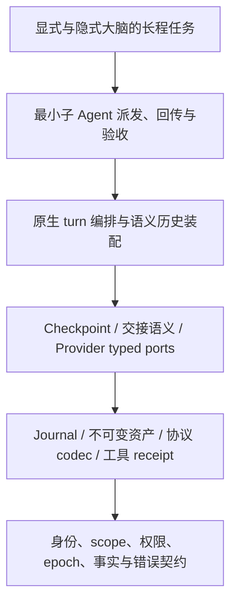
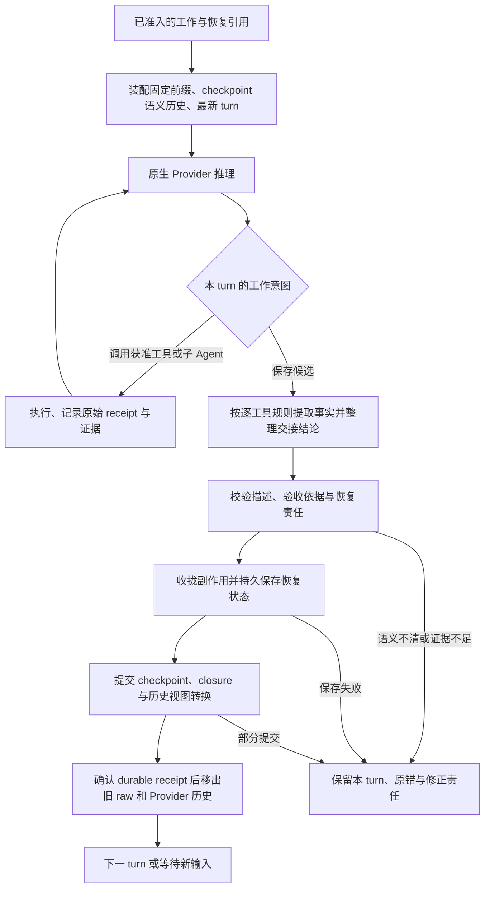

# HumanAgent 原生推理递进实施计划

> 当前目标绑定 `.appsdk/requirements.json` 的 `version: 14`（现场核对），见[双脑产品设计](../architecture/dual-brain-semantic-context-design-2026-10-11.md)与 [Provider 分层 gap](native-provider-gap-plan-2026-10-11.md)。需求继续以账本当前有效原文为准。旧的单子任务递进和“代码执行仍暂停”属于历史快照；当前候选、worker 与依赖以唯一进度记录为准，A–G 生产闭环完成数仍为 0。下文历史不缩小完整产品目标。

状态：PLAN-ACCEPTED / ACTIVE / FULL-NATIVE-INCOMPLETE；当前 Provider 基础作者证据、候选与活动任务见唯一进度记录。完整原生目标未完成。
日期：2026-10-08（America/Los_Angeles）。
初始观察基线：main `f410f134aba33e73c1c783a843389d7fdc8f9d37`；当前执行基线以唯一进度记录中的最新 main 为准。
执行入口：[native-reasoning-goal-2026-10-08.md](native-reasoning-goal-2026-10-08.md)。
当前业务需求绑定：AppSDK `.appsdk/requirements.json` 当前 `version = 14`。显式大脑单最新完整语义 turn、预算内 N 个隐式 runtime、动态重复选择角色能力、turn 收口与通用临时续推，以当前账本原文及 [双脑业务设计](../architecture/dual-brain-semantic-context-design-2026-10-11.md) 为准。显式派单模板提供续推依据，移除重复模型control block；旧设计版本不覆盖这些后续决定。先前单 executor/单 child 描述只表示第一增量，不限定目标态或角色顺序。

本 chat 当前主责原生 Provider 分支，分层 gap 与用户能力交付见 [native-provider-gap-plan-2026-10-11.md](native-provider-gap-plan-2026-10-11.md)。该分支按 AppSDK 当前需求账本 `version = 14` 消费共同需求；较早 Planner 与 T0/T3a 等候选保留为各自时间点的原始证据，不覆盖当前执行。Provider A–G 当前均未达到完整生产闭环，候选、精确依赖与可并发任务以唯一进度记录及已接受的 E2 r3 计划为准。Runtime/Core 继续拥有 context、标准 turn 收口、续推触发与同 turn 恢复，Provider 提供分离输入、协议与执行事实接口；总目标及其余实施历史保持有效。状态与原始证据仍见唯一进度记录。

历史快照（2026-10-11）：当时 Provider 主线按 requirements v13 记录，T0/T3a 及旧 T1–T4 计划状态只供追溯，不是当前执行基线。当前需求版本、Provider 分层计划、候选 SHA 和工作状态统一以本段 v14 绑定与唯一进度记录为准。

## 1. 目标、边界与开发原则

首先完成 HumanAgent 自己拥有推理流程的闭环。使用现有 Provider、工具执行、Journal、checkpoint、Runtime 和 WorkAssignment/WorkResult，不重写框架。ACP、DSH、OpenCode 兼容是后续目标，不是本计划的前置条件或放行依据。相邻 UI semantic-observation 项目保持自身 owner，本计划不吸收其改版范围。

定义自上而下：先锁定职责、契约和验收，再细化每个底层模块。验证自下而上：基础没有有效单测证据，不派依赖它的组合。模块只通过 typed port/不可变引用交互，禁止循环依赖、状态双 owner 和同义实现。编排先保核心，每个可用增量独立交付；随后按实际需求递增。下文是依赖层与能力里程碑，不固定开发轮数；planner 每次只细化当前可执行增量。

本段原“仅落盘计划、goal 和设计图”是初始历史快照。当前 T0/T3a 已有作者定向验证证据，但本次文档作者未执行测试/build；基础验证、源码审计均不证明生产闭环或总目标完成。历史 PASS 只有版本、输入与证据仍匹配才可复用。

## 2. 必须成立的目标定义

| 对象 | 定义与唯一责任 |
| --- | --- |
| 领域控制 | `core` 拥有生命周期、路径/回退规则、权限与恢复不变量；Journal 保存其已接受事实。模型只提出意图，不用业务 payload、metadata 或 debug log 重建控制状态。 |
| Turn | 一个已接受输入/event 的本次处理；其中可有模型和工具子轮次。模型工具请求结束不自动等于业务完成或 turn 已持久收拢。 |
| 编排 Context | 固定身份/规则/当前目标 + 合法 scope 的 checkpoint 历史（时间、description、引用）+ 最新 turn 的完整当前消息和原始工具结果。历史不保存 raw。 |
| Checkpoint | 可信保存时间、可决策 description、准确 recovery state、证据引用、closure/恢复责任。`summary` 优先明确为 description 的现有字段，避免再保留同义字段。时间由 Runtime owner 赋值，不能采信模型时间。 |
| Save | 核对语义及控制依据→收拢/reconcile 受影响操作→保存 recovery state/资产→提交 checkpoint/closure→发布 checkpoint 历史视图。只有 durable receipt 成立才能移出旧 turn raw；失败保留 raw、原错与恢复责任。 |
| 语义质量 | 保留改变后续决策的事实、条件、确定程度、纠正、未知和证据。工具输出成功、派发 ACK、产物存在和验收通过各自独立。description 应足够选择回退点，不要求查询 raw 来做选择。 |
| 子 Agent 交接 | 继续沿用 WorkAssignment/WorkResult。派发和回传引用精简语义工件；原始执行过程留在子 Agent 证据中，不复制成主脑历史。验收与身份绑定由现有 owner 判定。 |
| 回退/前进 | Journal 不改写。选择历史 checkpoint 后追加路径关系，创建新 execution epoch，并重新准入。线性账本的 `previousCheckpointId` 与推理路径父关系分开，不能用改账本实现分支。副作用不随上下文回退自动撤销。 |
| 显式大脑 | 感知输入、匹配任务、确认和反馈；辅助子 Agent 可做受限输入整理/查询/分析。业务需求仍经 RequirementEnvelope FIFO→隐式准入，禁止用 helper 绕过业务派发 owner。 |
| 隐式大脑 | 分类、资源准入与业务子任务编排；先接通单子任务，后续复用现有 OrchestrationManager/assignment graph 扩展必要依赖。 |
| 原生 Provider | 配置与 binding、capability/readiness、独立协议 codec、transport、工具返回、stop/settle 形成完整闭环。RCC 是可用外部入口，厂商身份、协议和 endpoint 是不同维度。 |
| Memory Agent | 使用现有 rewind/path evidence 审计路径变化，提出项目/Agent/全局记忆和 Skill 改进候选；候选不等于批准或发布。 |

每次实际模型请求都要验证历史 raw 排除，包括隐藏的 `previous_response_id` 或 transport 会话链。同一 turn 的协议工具续接可以保留必要原生消息组；新 turn 必须重新从 HumanAgent checkpoint 组装历史。长期历史的窗口装配只消费 checkpoint 语义，必须保留当前目标、约束、待收拢责任和已接受结论；首轮复用现有窗口原语，不引入 Gist 摘要树。窗口不足或语义无法安全装配时显式保存/等待，不能裁掉恢复责任后宣称长程完成；新增历史 compaction 未在本计划授权，出现实际需要先独立规划。

保存时间使用 Harness 提交时记录的 UTC 时间和来源；逻辑顺序仍按 Journal seq/提交关系。重复 commit identity 返回首次事实和时间，不能重试时换时间；时钟回拨保留实际事实，不伪造时间递增。控制关闭意图先冻结新增业务推进，保存资产→checkpoint→closure→Context View 转换事实，分别确认 durable receipt，再清 raw 和 Provider 内存历史。checkpoint 已提交但 closure/View 未提交时不得开新 turn；恢复幂等补齐未完成阶段，不重复工具副作用。save 工具自己的返回关联 receipt，不能为让模型再读 receipt 而把整个已关闭 turn 带到新 turn。

首个增量只复用真实 Task 绑定。无 Task 的显式 interaction helper 是 N3 必需项：将既有 handoff 的共享语义内容与身份绑定分开，在 contracts owner 中定义可信 interaction 分支；保留 Task 分支的准入/验收不变量。禁止伪造 Task 填空，也不新造独立队列或结果状态机。

## 3. 层次与 owner



图上从上往下定义，从下往上取得验证证据。

| Owner | 允许承担 | 不承担 |
| --- | --- | --- |
| `packages/contracts` | 最小中性类型、schema 和负向契约 | Provider/DSH wire、调度算法、存储实现 |
| `packages/core` | checkpoint/path/closure 规则、领域校验 | HTTP、TOML、Journal 写入、Prompt 装配 |
| `packages/adapters/jsonl` / `filesystem` | 追加事实/提交幂等；不可变恢复资产/工具证据 | 判断任务完成、选择有效探索路径 |
| `packages/adapters/provider` | binding、codec、capability、transport、外部 stop/settle | Task/Checkpoint 身份和业务编排 |
| `packages/config` | HumanAgent TOML、绑定配置与凭据引用校验 | 修改 RCC、持久化明文凭据或推理循环 |
| `packages/runtime` | checkpoint 提交、turn、ContextBuilder、工具准入、子任务编排、Memory 触发 | 复制 codec/Journal owner 或 UI taxonomy |
| `packages/agent-templates` | 逐工具语义规则、角色 Prompt、派发/回传模板 | 新建平行 Task/WorkResult 状态机 |
| `packages/app` | 组装真实端口与公开入口 | 私有推理调度、协议/语义算法 |
| `packages/ui` | 已有领域投影和可读结果 | 直接读 raw Journal 或控制 checkpoint |

`context-events` 继续拥有 UI narrative/Memory digest；不升级为主脑历史、路径或恢复真源。

## 4. 当前缺口与证据

- `packages/contracts/src/index.ts:82`：Checkpoint 没有自身时间字段；core 校验尚未约束 decision description。
- `packages/runtime/src/checkpoints/submission.ts:466`：reentry 仅接受 latest；历史点选择尚未接通。
- `packages/runtime/src/context/index.ts` 与 `agent-loop/runtime.ts`：通用拼装/内存 primitive，不是已验收的 durable 语义历史循环。
- `packages/adapters/provider/src/agent-driver.ts:172` 与 `rcc-v3-transport.ts:511`：checkpoint resume 不支持；现有 typed 工具续接限 Responses。不得等同恢复闭环。
- `packages/config/src/index.ts:15` 与 app transport 组装：实际绑定限制为 RCC。原生 Provider 的通用 binding/config 和其他协议闭环仍待验收。
- `packages/runtime/src/explicit-brain/operational-tools.ts`：部分返回 `unknown`；tool catalog、模板与 live provider tool list不一致。
- `packages/contracts/src/explicit-brain.ts`：业务 assignment 派发被禁止，辅助委派需要明确受限接口；不能直接放开现有禁令。
- `packages/runtime/src/admission/implicit-orchestrator.ts`：有子任务 seam，默认单 executor；`WorkAssignment/WorkResult` 和 `OrchestrationManager` 可复用。
- `packages/runtime/src/memory/agent.ts`：已有 rewind chain 与实际/声明路径比较，延伸其接线，不新造审计 agent。

上述为 source evidence。本任务未取得基础测试、真实 Provider 或代码 review PASS。

## 5. 可用增量与依赖

| 增量 | 可交付结果 | 依赖及继续条件 |
| --- | --- | --- |
| D0：定义与逐工具审查 | 冻结上下文/turn/checkpoint/语义交接契约；标出真实启用工具、声明未接通工具；每个工具有语义提取与错误边界 | 先完成；契约与 planned graph 通过设计核对后派基础任务 |
| F1：独立基础可用 | Journal/资产、可信时间与 save、纯 ContextBuilder、交接语义、Responses codec/工具返回分别有单测和负向证据 | 同层独立任务可并行；受共享 schema/产物约束的操作串行。缺基础证据不得开始对应组合 |
| N1：第一条真实原生闭环 | 已确认需求→FIFO→隐式准入→单 native child→语义回传→save→新 turn；重启恢复已提交状态。下一请求无历史 raw/隐藏链 | F1 全部受影响基础通过。先 Responses 同入口，不要求 ACP。验收后可交付此增量但总目标仍 OPEN |
| N2：历史回退、前进与路径审计 | description 选择旧点；工具纠正回退与探索回退；新路径/epoch、side-effect reconcile；Memory 形成有证据候选 | N1 durable 语义上下文成立；回退 foundation 先单测后组装。成功路径只保留有效结论，旧证据仍可校验 |
| N3：双大脑长程语义运行 | 显式大脑受限 helper 交接，含无 Task 的 interaction helper；显式/隐式各自长期 checkpoint 历史；模型决定下一工作意图，Runtime 负责准入、执行和状态 | N1 交接与 N2 恢复边界通过。去除产品总推理上限，资源处置转成有恢复责任的 continuation/wait/stop，不静默无限重试 |
| N4：原生 Provider 完整与必要编排扩展 | OpenAI Chat/Anthropic 与 Responses 各自完成工具、stream/error/stop/恢复；通用 endpoint/binding/credential ref；必要多 child 依赖、结果汇合及失败隔离 | 各协议先叶模块单测/replay，再接已验收 native loop。仅按已证实需要扩展 OrchestrationManager，不另造框架或智能 routing/fallback |
| C：原生目标收口 | 全目标真实入口、安装后运行、review、main/remote 与资源责任证据齐全 | 全验收项有当前有效证据；ACP 仍为单独后续 backlog |

RCC 作为第一条真实 Provider 入口。通用 Provider 机制后续允许显式 endpoint/binding，不能仅换 RCC route 名冒充多厂商。Models discovery 可选；明确的模型绑定、能力和同入口响应必须可证。配置缺失、协议不符或凭据引用不可用显式失败，禁止偷偷换协议/Provider。

## 6. D0 / F1 首轮可派发任务

逐工具语义审查输入已落盘：[native-tool-semantics-plan-2026-10-08.md](../architecture/native-tool-semantics-plan-2026-10-08.md)。它列出各工具决定性事实与证明边界；状态是待 tool-owner review 的设计规则，非提取实现或测试 PASS。D0/F-H 校准实际 inventory 后更新该唯一设计记录，不再另建同义规则文件。

统一输入：执行前 fetch 最新 `origin/main`，读取受影响 diff 和实际声明配置，不建立 HEAD/tree 或配置摘要包装；下表源码路径均相对候选 worktree。代码位于 `/Volumes/Intel/playground/humanagent/<task>`；外置盘不可用停止，不回退主树。共享 `contracts/src/index.ts` 只有 D0 owner 写。编排者派发时把下列合同展开为独占任务记录与精确 allowlist；未列路径禁止写。拟新增路径尚非现有实现或测试证据。

所有 peer 禁止修改 ACP/DSH、外部 RCC、auth/secrets、daemon、部署、全局 Skill/记忆、其他 worktree、主树未归属文件与相邻 UI 改版。发现需要扩大范围先回报依赖缺口。

| ID / owner / 入口 | 独占 allowed paths | 交付物与测试 | 行为验收 / review / 清理 |
| --- | --- | --- | --- |
| D0 / contracts owner / checkpoint 与 WorkAssignment/WorkResult public contract | `packages/contracts/src/index.ts`、`agent-loop.ts`、`tool-execution.ts`；拟新增 `packages/contracts/src/native-reasoning.ts` 仅确需中性类型时；`tests/contracts/`；`docs/architecture/context-contract.md`、`agent-request-response.md`；本计划及 native checkpoint 三图仅编排者协调更新 | 最小时间/description、turn、语义工件/引用与控制边界；复用旧字段，不双存 summary/description；`pnpm test:contracts`、`pnpm typecheck`。更改旧公共类型先列兼容影响 | 外部身份泄漏、proposal 当 committed、业务 payload 控制污染、错 scope/epoch、语义 claim 缺证据必须拒绝。只读独立设计核对；无运行 PASS。无服务资源，回传候选输入与未实现项 |
| F-J / storage owner / Journal.commit + ImmutableAssetStore | `packages/adapters/jsonl/src/index.ts`、`packages/adapters/filesystem/src/index.ts`；`tests/adapters/jsonl/`、`tests/adapters/filesystem/` | 先跑现有单测，只修本目标已证明缺口；追加、digest、同 commitId 幂等、冲突、资产引用可读；测试命令 B-J | 中断/重启后已提交事实不丢、不双写；故障不返回 durable success。单测不依赖模型/app/browser。作者验证后独立 review；只回收自己的临时存储，真实运行 root 归 `~/.humanagent` |
| F-C / checkpoint owner / submitCheckpoint + save facade | `packages/core/src/checkpoint.ts`、`checkpoint-control.ts`；`packages/runtime/src/checkpoints/`、`checkpoint-tools/index.ts`；`tests/core/core.test.ts`、`tests/runtime/checkpoints/` | Runtime clock、description 约束、recovery/closure 保存顺序及 receipt；复用 Journal port；D0 与 F-J 是依赖；测试 B-C | save 失败保留当前 turn；restart/idempotency、unknown operation/reentryAllowed、late epoch、可信时间均有断言。摘要不能判任务成功。独立 review；所有自有操作 settled 后释放资源 |
| F-S / Context owner / ContextBuilder | `packages/runtime/src/context/index.ts`；拟新增同目录 `checkpoint-history.ts`、`tool-semantics.ts`；`tests/runtime/context/` | 纯装配：固定前缀、checkpoint 历史、最新 turn；从已提交事实获取 history；唯一纯语义 mapper 消费各工具 owner 的 typed receipt；测试 B-S | 上一 turn raw sentinel/nested content 不能出现；最新 turn 工具组完整；save 未提交不能更新 view；不同 task/role/epoch 隔离。fixture 单测无需 Provider/存储进程；独立 review，无外部服务 |
| F-H / templates + tool owner / 真实工具注册、WorkAssignment/WorkResult | `packages/agent-templates/src/` 仅角色工具政策和 Prompt loader 必要修改；`templates/builtin/common/`、`interaction/`、`orchestration/`、`execution/`；`packages/runtime/src/explicit-brain/operational-tools.ts`、`tool-registry.ts`；`packages/runtime/src/gateway/` 仅现有 receipt 投影 seam；`tests/agent-templates/`、`tests/runtime/explicit-brain/`、`tests/runtime/gateway/`；`docs/architecture/native-tool-semantics-plan-2026-10-08.md`；拟新增 `docs/architecture/native-agent-handoff.md` | 全部实际启用工具逐项审查，标 declared-only/unavailable；定义派发和回传模板；基于 receipt 提取工具事实，再由大脑综合判断；测试 B-H。新工具开放由 D0/领域 owner 审查，不能自行放开 forbidden tools | query≠变更、search hit≠内容理解、send ACK≠对端完成、candidate≠发布、测试输出≠完整验收。语义测试同时验证事实不丢和结论不过度。交接 refs/身份/条件可校验；独立 review；无真实发信/业务派单 |
| F-P / Provider owner / Responses codec + ProviderAgentDriver | `packages/adapters/provider/src/`；`tests/adapters/provider/`；协议或 config 公共 schema 只向 D0 请求 | 先离线检查现有能力；补原生工具批次、终态、error、stop/settle 与新 turn 清链必要缺口；纯测试 B-P；真实同入口在 N1 组合后运行 | request/toolCall/toolResult 身份配对、部分失败、missing terminal、取消≠停止、release pending 不得成功；新 turn 请求禁止继承旧 raw/外部链。离线测试不启动 app/真实 Provider。独立 review；自有 fetch/controller/stream 收拢 |

若 F-H allowlist 内不能形成一个清晰 owner 的改动，planner 按具体工具拆为不重叠子任务，不能用宽泛目录权限分散复制语义逻辑。F-H 拥有工具规则/角色政策与工具端 typed 输出；F-S 拥有唯一纯 mapper/历史装配，二者不复制提取算法。提取器不执行工具、不提交 Journal 或触发控制命令；纯提取失败可重放但不重做副作用，未知工具返回 semantic-extractor-unavailable 并保留 raw。工具语义与主脑综合语义分开验收，但不新造第二套事件/状态真源。

N1 编排/app owner **只有 F1 依赖通过后才派**：`packages/runtime/src/agent-loop/runtime.ts`、`nodes/agent-runtime.ts`、`admission/implicit-orchestrator.ts`、`orchestration/manager.ts`；`packages/app/src/agent-driver-composition.ts`、`agent-execution.ts`、`agent-operation.ts`、`checkpoint-journal.ts`、`serve-orchestration.ts`、`serve-runtime.ts`、`ui-runtime/index.ts`；相关 `tests/runtime/integration/` 与 `tests/app/`。首轮不做多 child 依赖算法。app 只组装，语义算法仍在 Runtime。planner 用最新具体调用链再收窄 exact file allowlist，共享文件只有一名 writer。

## 7. 单测与验证命令

全部在当前候选 worktree；每个模块的 fake 是 port test double，仅证明契约，不替代真实运行。当前命令已从 package.json/tsconfig 核对，尚未执行。共享 dist/build 产物不得同时写；各 worker worktree 可独立测试。

```sh
# B-J：存储基础
pnpm test:journal
pnpm exec tsc -p tests/adapters/filesystem/tsconfig.json
node --test dist/tests/adapters/filesystem/assets.test.js

# B-C：checkpoint 基础（现有 test:checkpoint 仅覆盖 submission，补 coordinator）
pnpm test:core
pnpm test:checkpoint
node --test dist/tests/tests/runtime/checkpoints/checkpoint-coordinator.test.js

# B-S：上下文基础
pnpm test:context

# B-H：交接与真实工具语义基础
pnpm test:contracts
pnpm test:agent-templates
pnpm test:explicit-brain
pnpm test:gateway

# B-P：Provider 基础直接编译，避免用 build:app 作为叶模块单测前置
pnpm exec tsc -p tests/adapters/provider/tsconfig.json
node --test dist/tests-provider/tests/adapters/provider/provider-adapter.test.js dist/tests-provider/tests/adapters/provider/provider-agent-driver.test.js dist/tests-provider/tests/adapters/provider/provider-replay.test.js dist/tests-provider/tests/adapters/provider/rcc-v3-transport.test.js

# N1 组合验收
pnpm typecheck
pnpm test:config
pnpm test:agent-io
pnpm test:agent-loop
pnpm test:runtime
pnpm test:app
pnpm test:release
```

拟新增测试：`tests/runtime/integration/native-reasoning.test.ts`、`tests/app/native-reasoning-public.test.ts`、`tests/app/real-native-reasoning-proof.mjs`。这些路径尚不存在；实施 owner 创建并注册到现有编译/test入口后，回传真实 compiled path 和精确运行命令，禁止把拟定命令当执行证据。

新增公开 proof 应使用隔离 `~/.humanagent` 子目录，保留 task/operation/epoch/request/call/checkpoint/digest/原始退出码与结果。现有 `tests/adapters/provider/real-rcc-turn-proof.mjs` 只作复用参考，当前临时 root 和单请求证明不能直接作为本目标真实终点。

## 8. 每个可用增量的真实行为验收

N1 的黑盒路径：使用现有真实输入/确认入口→Requirement FIFO→implicit admission→native Responses child→工具执行→语义产物→验收→checkpoint→新输入→新请求；中途正常停止并重启，恢复同一业务任务而不重复已提交副作用。

N1 必须观测实际 outbound 请求（生产行为经脱敏记录/replay sink，不能仅断言内部 ContextBuilder）：上一 turn 的 raw sentinel 不出现、checkpoint description 出现、当前工具 call/result 配对完整、外部 continuation 不跨 turn。还需触发工具失败、缺能力、save/Journal 故障、Provider 中断、取消收拢和迟到事件，证明失败只影响相应责任范围、其他独立任务仍可用。

N2 验收：仅看 description 选择历史点；工具修复后移出错误 raw；探索失败后保留已证实结论；前进/回退追加事实；新 epoch fencing；已执行/未知副作用不被抹去或盲目重放；Memory 审计读到旧/新路径和纠正依据并只提交候选。

N3 验收显式/隐式两条长程链的语义保真：用户目标、约束和修正准确继承；子 Agent ACK 不当作完成；矛盾结论、仍未知项和新证据导致的失效可见；未来轮次继续通过标准 lifecycle，而非靠硬上限终止业务。不得用一次成功请求证明长程运行。

N4 验收：Responses、OpenAI Chat、Anthropic 各有 fake contract、独立录制 replay 和 real same-entry；工具 continuation、errors、stop/settle、restart/context construction 均一致。credential ref 不泄漏；至少证明通用 endpoint/binding 不依赖 RCC 专属身份；外部服务缺失明确不可用。必要多 child 验证依赖先后、产物汇合、失败隔离和资源收拢。

若影响 Dashboard 用户任务，复用 `docs/ui/dashboard-e2e-acceptance.md`；三类真实 receipt 与清理不齐不能声称 Dashboard 总放行。CLI/HTTP 最小 native 增量先按本节证明，不借本任务发起 UI 改版。

## 9. 图、事件、失败与恢复

下面是目标原生 turn 的流程示意，表示设计职责与持久化边界；不表示已接通运行。



新图：[native-turn-checkpoint.graph.json](../dagpipe/native-turn-checkpoint.graph.json)，配套 semantic/binding 文件同名。这是 turn 收拢候选单一对象流的 **DESIGN-PLANNED** 图：校验→reconcile→persist→commit→publish。Operator 名称与 owner 仅为设计绑定，不表示已注册或可执行；无需引入 Rust/SDK 或重写 Runtime。

```sh
dagpipe graph validate docs/dagpipe/native-turn-checkpoint.graph.json
node scripts/dagpipe-bind-graphs.mjs docs/dagpipe/native-turn-checkpoint.graph.json docs/dagpipe/native-turn-checkpoint.graph.binding.json
```

模型请求/工具子轮次、下一个 turn 和重入均是新执行，不把循环塞进静态 DAG。复用 `ci-checkpoint`、memory-curation 及其他既有图的各自 owner。现存新图仅覆盖保存边界；D0 在编排者协调下，另将一个已准入工作到 durable turn receipt 的对象流落为 scoped graph/semantic/binding，并按 SESE 验证后才派 N1 实现。输入整理、helper、控制命令和 Memory 流分别保持自身 scope，禁止把流程示意的所有循环或多源输入硬塞进一个 DAG。

关键事件的生产与消费：Runtime 接受输入→admission；Provider/tool owner 产出 receipt/outcome→Runtime；子 Agent 产出 WorkResult→现有验收 owner；Runtime checkpoint owner 提交 intent→Journal owner；durable receipt→Context 历史 projection；path change→现有 Memory Agent。事件只带 typed 控制事实与关联引用，大对象走资产引用；UI/模型 summary 不能生产 committed 状态。

| 情形 | 领域结果与下一动作 |
| --- | --- |
| 工具/子 Agent 明确失败 | 本责任失败，保留原因、证据与可执行纠正；依赖下游不启动 |
| ACK/无产物/结果未知 | 保持 running/waiting/unknown 对应真实状态；查证或 reconcile，不标 succeeded |
| 语义无法确定/与证据矛盾 | 不接受无依据 claim；保留当前 turn 和候选，进入修正/等待，不丢关键事实 |
| save/资产/Journal 失败 | 不发布新 history，不清 raw；保留首次错误、提交身份和恢复责任 |
| 取消/权限撤销 | 原停止 operation→实际 settle/reconcile→checkpoint；取消返回不等于 stopped |
| 回退/前进后旧结果 | 只记录旧路径证据或 stale，不推进新 epoch |
| 基础测试/review 失败 | 停对应依赖，修 owner 并重验；改变契约/目标时 observation→independent plan |
| 外部 Provider 不可用 | capability/dependency/transport 明确失败；保留可恢复主线，不静默 fake/换协议 |

未知外部副作用禁止按新执行身份盲目重放。recovery state 缺失是阻断恢复的基础错误，不能用 description 补造。旧 checkpoint 没有可信时间/完整恢复数据时，明确 legacy-unavailable；本计划不自动迁移、回填时间或改历史。

## 10. 增量放行、资源与后续

每层基础完成契约、源文件和针对性单测/负向例，内部节点不单独触发 review。完整且重大的可交付 milestone 完成 focused tests、适用真实入口/E2E 和故障/清理验证后，在正式集成前执行一次独立整体 review；模型沿当前编排 Skill 选择。缺少该次 review 不能宣称 milestone 已完成；设计核对不替代代码 review。

每次 peer 回传实际改动、受影响行为结果、真实 receipt、清理列表与剩余风险；已有提交可附普通 Git 回执，不建立候选身份包装。主编排 fetch 最新 main，将候选组合到最新输入，只补受输入变化影响的验证，直接复用仍有效的结果。dirty main先分类，不提交他人的文件。按项目已授权标准流程完成候选→main→重建产物并重启适用本地实例→复验→push origin/main，不逐项再请求授权；破坏性迁移、改历史、清权限等超范围动作仍按原边界。

安装后的 canonical entry 已核对为 `/opt/homebrew/bin/humanagent`。作者 candidate 构建与安装后执行分层，未来 planner依据项目打包/安装入口填实命令；不能只运行 worktree 内临时文件就声称本地实例已更新。只有本任务证明拥有的 PID、stream、worker、worktree、运行 root 和锁可回收；未知/未 settled 责任先保留，清理失败记录 INCOMPLETE。

最终完成 iff：本计划所有 native 验收成立；两类大脑通过时间化语义 checkpoint 续跑；真实请求不带历史 raw；交接语义可决策；重启/两类回退/前进与 Memory 审计有证据；所有 advertised 原生协议能力验证；独立 review、main、安装运行、remote和资源收拢分别可核验。ACP/DSH/OpenCode 后续仍单独 OPEN，不借本目标宣称适配完成。

## 11. S-R2 HTTP capability follow-up (2026-10-09)

Attempt 2 accepted only the narrow direct public readback evidence: `history() -> toolOutput()` before quiesce, after quiesce, and after hydration returned the same qualified 491-byte report with matching digest. The focused suite ran **10 tests: 9 pass, 1 fail, 0 skipped**. Its only failure was `startUiRuntimeServer({port: 0})` failing to bind `127.0.0.1` with `EPERM` before request dispatch. The worker's standalone loopback listener probe failed the same way under its `workspace-write` sandbox. A parent-side local-only ephemeral loopback probe succeeded; that identifies an execution-boundary difference but does not satisfy the required HTTP behavior gate. Regression and full typecheck were not run after the focused gate failed. No product failure is established, and S-R2 remains incomplete.

The attempt-2 candidate inputs remain frozen at base `97950f6d92cc71f1732e7eb4600b65e58adf17ee`, with exactly three modified paths and the accepted production hashes recorded in the progress ledger. Do not modify or overwrite those paths while resolving the environment issue.

The H-O3 execution attempt was **not accepted**. Its worker crossed the observation contract by calling documentation MCP, running diagnostics that attempted Provider reachability, and probing configuration/schema beyond the accepted bounds. Preserve its RUN as audit evidence; do not use its `effective-policy.md` or `capability-matrix.md` as effective-policy proof, and do not repeat help/schema/config probes.

The fresh independent successor plan is **BLOCKED** on one external input (H-I4): a non-sensitive, host-produced receipt bound to the exact fresh GCM invocation that proves the effective local bind/client rules for `127.0.0.1`, wildcard `0.0.0.0`, and IPv6 `::1`, plus the supported invocation/fixture-write contract for the unchanged tests. A policy statement, CLI help/schema, parent-shell result, or config text alone is insufficient. Do not inspect credentials, call MCP/docs, start a service, run doctor/diagnostics, test listeners/clients, contact a Provider/RCC/external host, edit policy, or widen the sandbox to obtain this input. The parent has no accepted command for a local effective-policy readback; do not guess one.

Until H-I4 arrives and is accepted, H-V3 is **not authorized**, no S-R2 implementation or verification worker is ready, and no other already-defined F1 leaf is dependency-ready. C-K1 remains gated by its own worker-local dependency recovery. Preserve the original real HTTP, focused, regression, typecheck, and cleanup acceptance unchanged; after H-I4, create a fresh bounded contract, then run H-V3 and complete S-R2 review/integration before S-M1. F1 remains incomplete and N1 remains gated until all required foundations converge.

Exact raw receipts, H-O3 disposition, and successor planner are referenced by the unique progress ledger. This is an execution-environment blocker; it does not change product ownership, contracts, graph topology, or overall goal scope.

## 12. F-C control lifecycle replan (2026-10-10)

This section supersedes the earlier F-C control-semantics block and planner v5's recommendation to defer compensation. It incorporates the user's decisions: task-scoped grant/revoke is a HumanAgent control; Task submission confirms intent only; a relevant unresolved blocker freezes new business; after revocation the operation owner can settle and persist checkpoint/evidence; an owner may explicitly start a separate compensation operation; no automatic replay.

### Affected DAG and ownership

```text
B: rebind accepted C-J/C-A2/C-A3/R candidates to latest main ─┐
K: Contracts control shapes → Core pure rules ────────────────┤
                                                            ├→ J: JSONL durable facts + cold replay ─┐
                                                            └→ O: Operations identity-bound evidence ┤
                                                                                                      └→ R2: Runtime revisioned controls/native save
                                                                                                             → A: App grant/revoke/admission/CLI save
                                                                                                             → public + fresh-process behavior acceptance
                                                                                                             → one complete F-C review
                                                                                                             → standard delivery
                                                                                                             → F-S durable history and F1 convergence
                                                                                                             → N1 → N2/N3/N4/C
```

Contracts owns immutable control/evidence shapes; Core owns grant, blocker, operation eligibility and recovery transitions; JSONL owns accepted control/operation history and verified replay; Operations owns effect/settlement/reconciliation evidence bound to the original identity; Runtime applies revisions, admission fencing and checkpoint save; App owns the local public entry and assembly. UI, Provider, DSH, ACP and OpenCode do not own this control path.

### Candidate rebinding

Latest fetched baseline is `main=origin/main=c5b88cfa5decb305ab09ccc6e7937e2f76b7d138`; the earlier composition parent `2a25f20a8195e8eda7391a20c059cf04b3c2b541` differs only in `AGENTS.md`. Existing candidates remain uncommitted inputs and must not be edited in place:

- C-A2 base `5bdfb20296cce6e706b82823e2dd9bb8d55558b2`; its accepted three file hashes are bound in the planner result.
- C-J base `69bb4ebdb35b7ea22da42be53ed14f77127bcaac`, candidate tree `4e8a86c2d02e52f303116bf8f16f0713cbf1d997`.
- C-A3 S4 base `358ac63a7ddd6066a80afb64a2fa0cbeda42d8c3`, candidate tree `ee067d35b3e391ba701751cec0409366b0e3acda`.
- Runtime R S5 base `ba086000b62d945211800b9ea9da268f154b8273`, candidate tree `ff01035b38b97daccc36522d2d9521044c12593e`.

B creates a new clean worktree from freshly fetched main, overlays the exact accepted composition delta `2a25f20… → ba086000…` and the three R files, and binds the resulting 23 paths/hashes. C-A2 is already present in S5; overlaying it over C-A3 would regress closure forwarding. B is a frozen input composition, not an integrated progress node.

### Sequenced peer work

| Node | Owner and exact write scope | Exit evidence |
|---|---|---|
| B | Controller-prepared exact S5 delta paths plus R's `packages/runtime/src/checkpoints/{ports.ts,submission.ts}` and `tests/runtime/checkpoints/native-checkpoint-save-public-consumer.test.ts`; no new behavior | Fresh-main candidate binding, exact 23 paths, affected checkpoint/App/Journal consumers and typecheck; worker records actual commands/results in its RUN |
| K | `packages/contracts/src/checkpoint-controls.ts` (new), `packages/contracts/src/index.ts`, `tests/contracts/checkpoint-controls-public-consumer.test.ts` (new), `packages/core/src/task-controls.ts` (new), `packages/core/src/index.ts`, `tests/core/task-controls.test.ts` (new) | Test-first public immutable control contracts and pure Core transitions; test task-intent/grant separation, task/action scope and stale revisions, relevant blocker, revoke/settle, compensation identity/authorization, original operation not reconciled by compensation |
| J | `packages/adapters/jsonl/src/index.ts`, `tests/adapters/jsonl/journal.test.ts`, new `tests/adapters/jsonl/task-controls-journal-public-consumer.test.mjs` | Append-only control/operation facts, revision compare-and-set, integrity/prefix binding, full verified cold replay and interruption behavior; reuse existing Journal lock/digest chain |
| O | `packages/adapters/operations/src/types.ts`, `packages/adapters/operations/src/index.ts`, new `operation-control-evidence.ts` and focused test | Actual route evidence bound to operation/task/epoch/owner; ambiguous or unsupported evidence stays unknown; no journal or compensation policy |
| R2 | new `packages/runtime/src/checkpoints/control-observation.ts`; `ports.ts`, `submission.ts`, `closure.ts`; focused observation and native-save consumers | Current revision/prefix fenced before dispatch and save; persistence separated from business advancement; revoked owner may settle/save evidence; cold restore never converts an old intent into current authority |
| A | new `packages/app/src/task-control.ts`; `cli.ts`, `index.ts`, `agent-operation.ts`, `checkpoint-journal.ts`; new public and CLI cold consumers | Local process principal is verified against control root; no authority fields from Task payload; explicit grant/revoke/inspect/compensation; actual entry denies before driver/tool side effects and uses native save; fresh child reads verified Journal state |

B and K can start concurrently in clean worktrees. After both are accepted, J and O can run concurrently. R2 waits for J/O interfaces; A waits for R2 and accepted App adapter composition. Shared Contracts/Core/Journal/Runtime files have exactly one writer at a time. Every task uses an exact materialized allowlist, its own `/Volumes/Intel/playground/humanagent/<task>` worktree and external RUN; old candidates and dirty main remain untouched.

### F-C public behavior gate

The public CLI/App → Runtime → real JSONL path must show: confirmed Task with no grant is denied with zero execution; exact task/scope grant permits the action; wrong scope and stale revision are typed denials; a relevant blocker freezes new business while an unrelated blocker does not; revoke prevents new dispatch but allows the registered owner to settle and persist checkpoint/evidence; revision races hold without rewriting the attempt; cold restart reconstructs grant/revoke, blocker and operation duties; unknown/possible original effects are never replayed; compensation without its own grant is denied; explicitly authorized compensation has a separate operation/audit identity and never settles the original; failed/ambiguous compensation retains its own recovery duty; wrong-identity evidence is rejected; partial Journal/closure failure retains first error and verified prefix without claiming success or clean state.

Use focused unit/public-consumer tests first, then real local JSONL and fresh-process acceptance. Existing passing candidate receipts are reusable only for unchanged behavior and do not prove this new control lifecycle. The complete joined F-C behavior gets one independent review before standard candidate → main → rebuild/restart canonical instance → runtime verification → push. Until integration succeeds, progress remains **1/7 top-level, 20 integrated nodes**. After F-C, continue F-S durable semantic history and F1 convergence before admitting N1; the overall reasoning goal remains open, and ACP/DSH/OpenCode remain post-goals.

### 12.1 Current-main rebinding after 300e (2026-10-10)

An independent read-only Planner rechecked the goal after `origin/main` advanced from c5 to `300e71063dbed389250508f8aee3e96a3a404f87`. READY plan: `/Volumes/Intel/playground/humanagent/.worker-runs/native-reasoning-d0-20261008/post-fc-main-drift-20261010/plan.md` (SHA-256 `4d883c413157204f8d23a7c2e2581234546adf6065ef4b401f45db3efa8aa337`). Controller fetched `origin/main` after planning and confirmed it remains exactly 300e.

This adds no capability or owner; it only refreshes the foundation binding before J/O:

- B+BF rebind preserves the 300e `packages/app/src/ui-runtime/journal.ts` behavior and applies the c5→B `FileCheckpointStore` increment; materialize the other 22 BF-final paths byte-identically. Re-run current-main build/typecheck plus App attempt/closure, Runtime save forwarding, App event-journal/UI-runtime/semantic-observation, and controller host App 15/config 13 with fresh source/compiled manifests and settled fixtures.
- K rebind keeps the five unchanged K candidate files byte-identical and adds only `export * from './checkpoint-controls.js';` to the 300e Contracts barrel, preserving `export * from './semantic-observation.js';`. Run current Contracts/Core suites plus explicit K public consumers, full typecheck and diff-check.
- B+BF and K are independently owned current-main worktrees and run concurrently. J and O remain gated until controller accepts both against the same exact 300e baseline. J/O then use the already specified §12 path allowlists.
- B's copied R-store incident is explicitly recorded at `.../f-c-control-rebind-20261010/controller-store-incident-disposition.md`. The 23 MiB B-owned copy remains retained and is not reused; resource closure remains `INCOMPLETE`. This does not alone block code composition acceptance, but dependency provenance for the new candidate must be independent and compliant.

Exact source manifests, stop conditions, reusable-vs-fresh evidence and gates are in the linked Planner artifact. These internal rebinds do not count as integrated nodes or trigger review.

## 12.2 Atomic checkpoint control fence replan (2026-10-10)

A fresh read-only OAuth Planner found that the R2 candidate's pre-save replay is not atomic with native attempt persistence. `appendControl` and `commitNativeAttempt` use the same `${journalPath}.lock`, but the locked attempt path does not validate the control revision/prefix. A revoke can therefore append between Runtime's replay and the native attempt commit. The R2 candidate also binds settle ownership to the current grant owner; if another principal revokes, that can reject the registered operation owner whom the user authorized to settle and save evidence.

The plan is READY and accepted as the next execution contract: [`attempt2/plan.md`](/Volumes/Intel/playground/humanagent/.worker-runs/native-reasoning-d0-20261008/post-r2-control-fence-planner-20261010/attempt2/plan.md). Controller acceptance and execution metadata are in that plan RUN. The first planner attempt is retained as incomplete terminal evidence; attempt2 is canonical.

```text
accepted foundation + J + O + R2 candidate
  → R2 rebind: extract one pure verified-snapshot fence; separate business owner from registered settle owner
  → J: validate new attempt's frozen control binding under existing Journal lock
  → joined R2 + real JSONL race/cold verification
  → A: public task-scoped control entry and admission/save assembly
  → canonical-root public + fresh-process F-C acceptance
  → one complete independent F-C review
  → standard delivery
```

R2 is the next writer, on a new clean worktree from the 300e + 33-path joined J/O input and its five prior changed paths. Exact paths: Runtime `ports.ts`, `control-observation.ts`, `submission.ts`, plus `control-observation.test.ts` and `native-checkpoint-save-public-consumer.test.ts`. It must expose one pure validator over a verified replay snapshot for both Runtime preflight and the locked JSONL path, preserve typed stale-revision/prefix holds, and allow a registered operation owner to settle after a different principal revokes. `business` requires the current grant owner; `settle` requires the registered operation owner plus current revision/prefix and exact task/operation/epoch binding. Do not change Core revoke semantics or add a second schema.

After R2 interface acceptance, J owns `packages/adapters/jsonl/src/index.ts` and the existing/new Journal consumers. Under its existing lock, it verifies a **new** attempt's binding before begin append, timestamp sampling, or payload writes; the lock stays held through begin/payload durability barriers. It reuses Runtime's pure snapshot validator over the already verified locked records; it must not call a separately locking `replayControl()` from inside the lock. A stale result leaves begin/payload/closure absent and preserves the Journal bytes. Existing exact attempts remain idempotently resolvable after revoke; changed frozen intent remains conflict. Historical begin validation checks the control prefix that preceded that begin, while later revocation remains valid history.

Then rebind the R2 Runtime candidate on the accepted J result and run joined Runtime/JSONL/App consumer gates. R2/J author counts from their earlier candidates are historical; altered interfaces and source require re-bound tests. The required concurrency proof uses a deterministic barrier and real JSONL lock across two fresh Node processes, not sleeps. Fresh-process recovery must use the canonical `~/.humanagent/test-fixtures/<task>` root and the public App/CLI path; tmpdir-only fake-port behavior is not end-to-end evidence.

The planner also found two boundaries A must resolve before claiming complete F-C behavior: (1) Runtime currently receives `ManagedIssue` blockers from a caller, while J has no blocker fact; A must identify the trusted blocker source and fresh-process read path, never pass an empty list to manufacture admission. (2) operation registration versus revoke is not yet an atomic admission transaction. A must exercise the real dispatch entry; if a check-to-effect race remains, record it and plan its unique owner correction before full F-C acceptance. No automatic side-effect replay or compensation is allowed.

No independent review is required for R2/J internal rebinds. Schedule the single full F-C architecture review only after the joined public and fresh-process behavior acceptance covers task-intent/grant separation, blocker relevance, CAS, cross-principal revoke/settle, unknown effects, separate compensation, persisted closure, canonical root and cleanup. Progress stays **1/7 top-level phases, 20 integrated nodes** until accepted work is formally integrated.

## 12.3 F-C durable blocker and business-start fence (2026-10-10)

A-readiness Planner v2 is accepted as the P implementation contract: `/Volumes/Intel/playground/humanagent/.worker-runs/native-reasoning-d0-20261008/f-c-a-readiness-planner-r2j-20261010/plan-v2.md` (SHA-256 `23b273b651bcf7337d1a50172058f1367e11e247dfe06e8496a4f37077b80344`; metadata `planner-metadata-v2.txt`, SHA-256 `54aa5fd60b5e4fed289521f13b39748be0356fcf9d7869b65af596297a74c97e`). It supersedes §12.2 only for P's blocker producer, actual start/submit fence, App seam, exact path allowlist, and P→A composition gates. The three user decisions remain settled.

The current 35-path R2/J composition passes joined author gates at 132/132; source and evidence binding are in its RUN `result.md`. This proves native checkpoint save atomicity, not business-start atomicity. A remains gated until P is accepted.

P adds the smallest durable blocker capability and business-start linearization point: Contracts/Core only change if the exact issue/admission interface is missing; JSONL owns accepted issue facts, verified replay and its existing serialization; Runtime owns issue production, blocker evaluation and admission; App has exactly one P seam in `packages/app/src/agent-operation.ts` to route actual `runAgentOperation` start and first submit through Runtime admission. P's only App test is the new `tests/app/business-admission-app-public-consumer.test.mjs`, using the actual emitted public `runAgentOperation` path, fresh-process barriers and measured composed-driver/local effects. No callback-only substitute. A follows sequentially and owns principal verification, grant/revoke CLI and complete native outcome assembly; it may later edit `agent-operation.ts` as successor.

The accepted worktree DAG and stop conditions are in Planner v2: Contracts/Core interface freeze → disjoint JSONL and Runtime implementation → joined P composition → one App-seam author and public race/cold proof → current-main recompose and affected P rerun → A → full F-C public/fresh-process matrix → one milestone architecture review and standard delivery. No DSH/Provider/ACP/OpenCode or App CLI control UX work is admitted in P.

### 12.3.1 P issue contract accepted as an internal node

The first Contracts candidate was returned because it copied Core's issue enums. The fixed interface is accepted from `/Volumes/Intel/playground/humanagent/f-c-p-issue-interface-20261010`; final evidence: `/Volumes/Intel/playground/humanagent/.worker-runs/native-reasoning-d0-20261008/f-c-p-issue-interface-20261010/fix1-result.md` and `controller-acceptance.md`. The serialized issue snapshot retains all ManagedIssue fields but keeps classification fields structural strings, so Contracts owns transport shape while Core remains the only classifier/transition validator. Focused consumer 9/9, Contracts 128/128, build/compiles/full typecheck/diff checks passed. No review/commit/merge; this does not complete P or increment integrated nodes.

Before P-J/P-R dispatch, freeze their smallest shared Journal/admission method signatures. Once the contracts and adapter/runtime API boundary is accepted, dispatch the non-overlapping Journal and Runtime owners concurrently; if method contracts cannot be frozen without implementation order, serialize only that dependency. Then recompose their exact manifests before the single P App seam/public race proof.

### 12.4 P API freeze and Core runtime trust validation (2026-10-10)

Independent Planner API freeze is accepted for the bounded P foundation. Full plan and exact signatures are in `/Volumes/Intel/playground/humanagent/.worker-runs/native-reasoning-d0-20261008/f-c-p-jr-api-freeze-planner-20261010/plan.md` (SHA-256 `592f92c7dde8a8f9ad5a21ccec1566cb77b75443a8a5131d81377aaf61e750be`); corrected 35-path input manifest SHA-256 `55b297cac51866f22acbe5b74a90634afa9078b15c2381e92e37afe2627316f8`.

The next prerequisite is one Core-only runtime narrowing fix in `packages/core/src/attention.ts`, exercised through the already-owned `tests/core/task-controls.test.ts`. Persisted issue category/severity/state strings must be checked against Core's sole vocabulary and issue invariants before storage acceptance or business initiation. Contracts remain structural strings; JSONL and Runtime must not clone Core enums. After exact Core source/test hashes are accepted, P-R freezes and compiles the shared declarations in `packages/runtime/src/checkpoints/ports.ts`; P-J and P-R then proceed concurrently on disjoint owners. P-J owns JSONL only; P-R owns Runtime `ports.ts`, `control-observation.ts`, and new `business-admission.ts`. The atomic `withControlTransaction` and replay/append signatures, issue projection semantics, whole-control-root admission prefix, lock lifecycle, and test gates are fully specified by the planner artifact; its method result is storage completion only, never proof of admission or effect start.

The P App gate remains blocked until the existing exported `runAgentOperation` path proves the synchronous actual start/first-submit edge against a committed revoke or relevant blocker, with zero effects on the losing order. A generic callback race or operation registration alone is insufficient. This internal API freeze does not advance integrated-node counts or trigger milestone review. Settled F-C product decisions remain: task-scoped grant/revoke; Task submission confirms intent only; relevant blockers freeze new business while registered owners may settle/save after revoke; unknown side effects are not replayed; separately authorized compensation has its own operation identity and does not settle the original.

## 12.5 P-A actual App start/submit internal gate accepted (2026-10-10)

Controller accepted P-A as an `AUTHOR_VERIFIED_INTERNAL_NODE` on the bound 40-path candidate. Evidence and limits: `/Volumes/Intel/playground/humanagent/.worker-runs/native-reasoning-d0-20261008/f-c-p-a-app-public-races-20261010/controller-acceptance.md`; output manifest SHA-256 `02dff4c26aeeaeae142b42f01e117df5cbf4e7f4b2c995bbc9e16bc5b1b449e1`. The exact test source hash is `8fa231fdf8ee91046041c4c2c3f15e685739bdd61a4e356f90aaa42c2a88a965`; controller reconciled the stale standalone hash in the author receipt against the final manifest and the 13/13 TAP chronology.

The originally planned held-lock rendezvous (child owns the real Journal lock while App start is already waiting) was not executed. The independent narrow planning addendum `planner-lock-schedule-addendum.md` (SHA-256 `b4cf4e2d56574dbfb45fc72f1a8b73f6e21ca2d097af90c31a5d0712927a7f1f`) concludes this is not a distinct acceptance invariant given the actual public evidence for control-first and effect-first orderings, both revoke windows, lock release before pending completion, cold duplicate hold, plus accepted real JSONL CAS and R-live phase exclusion. This accepts the evidence substitution for P-A only; it does not relabel the omitted schedule as run or prove every interleaving. Full App code/architecture review remains part of the complete F-C milestone gate.

P-A's bounded tests/build/typechecks passed as recorded in its controller receipt. This does not advance integrated-node count or complete F-C. Default preparation effects, native public save wiring, principal/CLI surface, power-loss recovery, Provider/DSH/ACP/OpenCode, and the full goal remain open. Next: recompose to fresh current `origin/main`, rerun P-A affected gates if inputs change, then proceed to A under §12.3. Schedule one complete independent F-C review only after full A/public/cold acceptance and resource settlement, before standard integration.

## 12.6 P-A current-main recompose verified (2026-10-10)

After the P-A internal gate acceptance, controller fetched `origin/main`; both `origin/main` and `main` remain `300e71063dbed389250508f8aee3e96a3a404f87`. The exact accepted 40-path manifest was recomposed into `/Volumes/Intel/playground/humanagent/f-c-p-a-main-recompose-20261010`; input/output manifest SHA-256 both remain `02dff4c26aeeaeae142b42f01e117df5cbf4e7f4b2c995bbc9e16bc5b1b449e1`, and current status/hash set matches exactly.

Affected gates were rerun on that current-main composition: offline frozen install with lock hash unchanged; Contracts/App build; App, Runtime and JSONL test TypeScript configs; full typecheck; diff-check; real public App consumer 13/13; Runtime consumer 12/12; JSONL consumer 8/8 with the required Node module-mocks flag. All exited 0. Receipts are in `/Volumes/Intel/playground/humanagent/.worker-runs/native-reasoning-d0-20261008/f-c-p-a-main-recompose-20261010/`.

P-A is now an accepted internal prerequisite composed on latest fetched main. Next plan the existing §12.3 successor A, bound to this exact clean recomposition. No integration/review or progress-count increment has occurred; the one full F-C review remains after A and joined public/fresh-process acceptance.


## 12.7 Successor A plan accepted and dispatched (2026-10-10)

Independent Planner READY plan: `/Volumes/Intel/playground/humanagent/.worker-runs/native-reasoning-d0-20261008/f-c-a-successor-planner-20261010/plan.md`, SHA-256 `118ac28e12e9a143e92d3b5bf73b69977d7d30a45766c3029aa13b6712714617`. It binds the exact accepted P-A latest-main composition: base `300e71063dbed389250508f8aee3e96a3a404f87`, 40-path manifest SHA-256 `02dff4c26aeeaeae142b42f01e117df5cbf4e7f4b2c995bbc9e16bc5b1b449e1`. Planner verified 40/40 content hashes and exact dirty path set; latest fetch still has `main = origin/main = 300e71063dbed389250508f8aee3e96a3a404f87`.

Plan specifies one App author and exactly ten paths: new task-control facade and two public consumers; App CLI/index/agent-operation/checkpoint-journal/node-modules declarations; only minimum compatibility edits to existing business-admission public consumer and app.test. Cross-owner Core/Runtime/JSONL/Operations/Config implementations remain forbidden. Full actual CLI/public App, fresh-process/canonical-root, issue/blocker, start/submit race, native save/closure, unknown/no-replay and compensation matrix is in the bound plan. The three user-confirmed F-C control decisions match prior fixed semantics; no DAG change.

Controller created `/Volumes/Intel/playground/humanagent/f-c-a-app-control-native-save-20261010`, branch `codex/f-c-a-app-control-native-save-20261010`, from clean current main and materialized the exact 40-path overlay. All 40 hashes match; status contains exactly those 40 paths, no staged files. Setup receipt and copied input manifest are in the successor RUN.

A is dispatched to one worker, display name `humanagent-worker-task-control-native-save`; worker contract is `/Volumes/Intel/playground/humanagent/.worker-runs/native-reasoning-d0-20261008/f-c-a-app-control-native-save-20261010/worker-task.md`. Candidate is uncommitted. Do not start full F-C review until A, joined public/cold acceptance and resource settlement pass. Progress remains **1/7 top-level phases, 20 integrated nodes**; P-A and A are internal/unintegrated; F-C and total goal remain INCOMPLETE. No commit/merge/install/restart/push.


## 12.8 Runtime compensation registration lower-owner correction (2026-10-10)

A author discovered the accepted §12.3 conditional gap: Runtime's `admitAndDispatchCheckpointControlCompensation` required a pre-existing running operation and did not atomically register a new compensation operation or append its compensation request fact. A cannot author these Runtime facts. Independent read-only Planner verified this against the frozen 40-path P-A input and accepted that user-authorized independent compensation must use a separate operation identity and grant.

READY plan: `/Volumes/Intel/playground/humanagent/.worker-runs/native-reasoning-d0-20261008/f-c-compensation-registration-planner-20261010/plan.md`, SHA-256 `202a59080b5ced90be09ea4819fb776afd1c2f1f0d15ddcaf5923499f2f469ff`. It preserves the existing Runtime export/signature and uses one real Journal lock: verify fresh identity/ancestry + separate grant/blockers, run Core authorization CAS, append new operation/duty, append compensation request, then synchronously handoff. Any existing/partial/cold identity holds; partial second append preserves duty, produces zero handoff and never auto-replays. No new schema or JSONL port is needed. Exact write paths: Runtime `business-admission.ts`, its existing Runtime public consumer, and one new real-JSONL consumer.

Controller recomposed the exact accepted P-A 40-path overlay into `/Volumes/Intel/playground/humanagent/f-c-runtime-compensation-registration-20261010` on `codex/f-c-runtime-compensation-registration-20261010`; all input hashes and path status match, no staged files. The one Runtime author is dispatched as `humanagent-worker-compensation-registration`. It runs disjoint from A's ten App paths. A keeps compensation fail-closed until the Runtime delta is accepted and recomposed; it continues the other independent App acceptance work. After A reaches a batch boundary and closes test processes/locks, controller will freeze its App delta and compose the accepted Runtime delta, then rerun affected Runtime/App/CLI/P/native-save gates on the joined candidate. This internal correction does not alter goal counts or start F-C milestone review. Overall remains **1/7 phases, 20 integrated nodes**, F-C/goal INCOMPLETE; no integration/review/commit/merge/restart/push.
