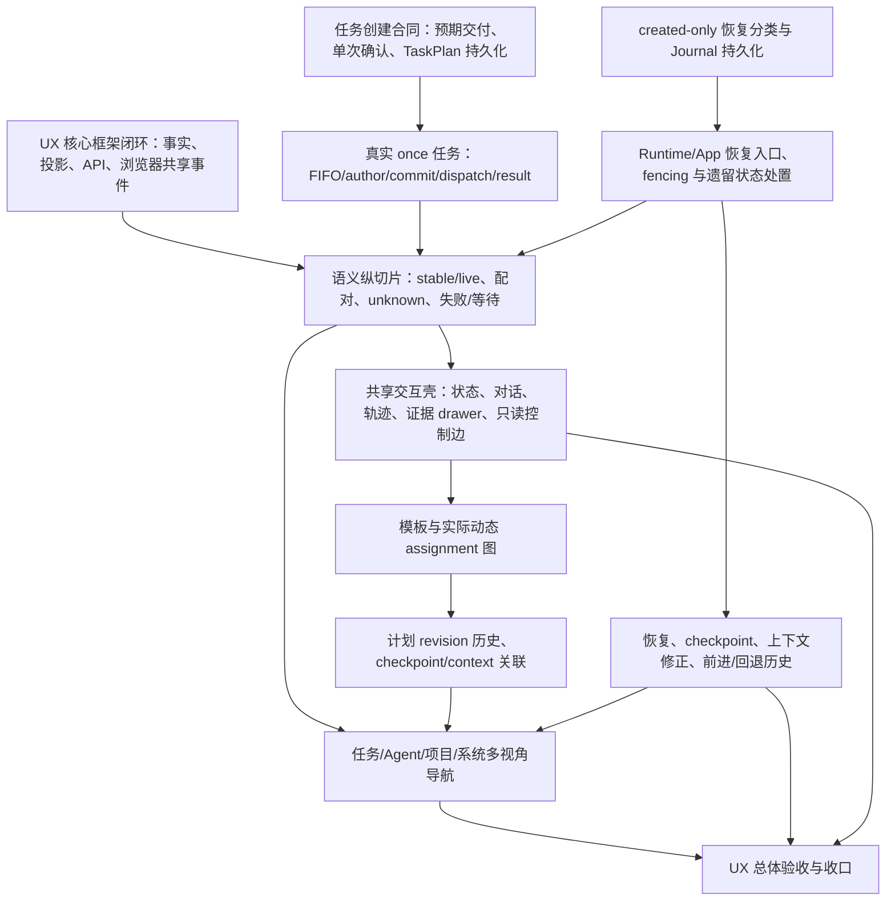

# HumanAgent UX 与交互长程执行计划

> 最新需求绑定：`.appsdk/requirements.json`，`requirements_version: 14`（当前 registry 顶层版本为 14；本次新增记录为 provider 工作顺序/消融治理，不是 UX 需求，相关 UX 记录未变更）。Brain 上下文、N 独立编排实例与产品角色循环按[双大脑设计](../architecture/dual-brain-semantic-context-design-2026-10-11.md)；[项目真相图册](../dagpipe/ux-upgrade-audit-2026-10-11/README.md)已按本次要求更新。

日期：2026-10-11
计划状态：执行基线已更新；里程碑验收仍按下文逐项关闭。
权威需求：[semantic observation audit](../ui/semantic-observation-audit-2026-10-07.md) G1–G14 / F01–F20；分层设计基线：[UX core framework](../ui/ux-core-framework-2026-10-10.md)（DESIGN-CANDIDATE）；生产语义链计划：[semantic observation execution plan](semantic-observation-execution-plan-2026-10-08.md)；旧交互契约：[interaction redesign plan](../ui/interaction-redesign-plan-2026-10-03.md)。
当前执行状态以以下 2026-10-17 增量、[项目状态汇总](../../note.md)和各 owner 的实际交付回执为准。下方 2026-10-14/15 记录保留为历史，不代表当前 main、进程、候选或工作树状态；旧 `.worker-runs/ux-restart-20261011/execution-note.md` 不再作为实时状态来源。

### 2026-10-18 治理消融与完整任务说明已交付

本批 main 集成并推送 `b4de7ac6`。模板内容冻结、mode/lease、DSH 候选身份和 Work/Review 包装摘要已从实际 owner、调用方及相关静态 schema/fixture 消融；源码词表、固定命令顺序和无独立保障的传输测试已删除。保留真实资产、Journal、任务身份、授权、正文和引用正确性。SDK 辅助 verify 仍受上游 FreezeRecord 合同缺陷影响，已登记 `8a8c1be`，未冒报 PASS，也未阻断未受影响的日常入口。

任务说明默认按“目标／范围／约束／交付要求”展示。完整原文、顺序和技术详情保持；未知结构及普通文本保留原文。原成功 Task 的候选双端验收及安装后默认打包 UI 手机入口已通过。原 Task 没有重执行，也没有新增模型请求。

整体 Review 找到两条真实 P1 后保留 FAIL：子执行 review 丢失原资产引用，以及缺实际正文时可接受 caller 正文。修复 `bc34027e` 复用原资产引用并直接绑定实际正文，`fc9f978a` 修正七个正向 fixture；两项有效 RED、真实资产及配置化 CLI GREEN、Runtime 46/46 和 App I2 9/9 已接收。必要 finding 复核独立 OAuth 正常退出，既有 classifier PASS、无 findings；未变架构结论复用，未重做整体审查。

main 重建、打包、全局安装完成；正式 restart gen40→41，端口53007。安装模块上的任务展示10项、review 正文8项和真实资产读取1项原消费者通过。临时服务、cookie 和本批集成工作树已清理。完整交付回执：`/Volumes/Intel/playground/humanagent/.worker-runs/governance-ux-delivery-20261018/`。

### 当前剩余主线与已替代的旧 OPEN

原真实 RCC 约束 Task 已成功，四字段完整进入实际请求，提交正文与 API／浏览器一致，没有子调用或工作区写入；接收见 `original-rcc-prepared-acceptance-execute-20261018/owner-reception.md`。准备态冷恢复已随 PR3／`917ea959` 交付，M3 两周期与计划演进已随 `ed44b1dd` 完成安装验收和推送。以下旧段落中这些子能力的 OPEN 不再代表当前状态。

独立后续计划已接收：`/Volumes/Intel/playground/humanagent/.worker-runs/ux-remaining-plan-oauth-20261018/plan.md` 及 owner-acceptance.md。当前按以下实际缺口推进，不重做已有效的测试：

- 嵌套 Observation 仍有已捕获的机械事件标题、英文固定摘要和错误集合名称。独立 GCM 在单独候选实现人读投影；不改事件分类、生命周期或原始历史，不混入本批已交付代码。
- M3 的源代码、公共 HTTP 和安装后两周期证明有效；成功 fixture 已清理且没有保留完整公开响应，精确数据的浏览器呈现仍待补足。不得从日志重建业务状态或自动重跑业务任务。
- initial-open 安装后恢复及已确认副作用不重放已有接受证据。旧 activity-tail RED 与当前后继的精确等价边界仍未知，不能直接称为当前缺码，也不据此新增崩溃矩阵。
- 原 taskless 问答 epoch6 仍 socket 失败，由 Provider peer 保留原责任及外部交接边界；不再盲重试，不阻断未受影响的 UX 工作。

完整 I1–I5／G1–G14／F01–F20 继续 ACTIVE／INCOMPLETE。以上交付只关闭明确子能力，不替代完整目标的逐项收口。

### 2026-10-18 M5 确认控制可用增量

main 集成 `d2ab27fe`。正式 correction/reentry HTTP→物理owner→Journal/current-state写链已接通；四字段确认输入保真、已知stale409与未知I/O500分离已验证。真实双端浏览器证明精确修正、重入追加、取消零写、失败保留输入、pending单次提交、桌面侧层/手机底抽屉及隐藏表单修复。checkpoint viewed 的原生后退/前进/真实Page.reload已证明，读取不改变Journal。

一次独立Gemini4medium整体Review/现有classifierPASS；main构建打包安装0、正式restart gen35→36/53007；安装模块公开控制consumer1PASS和认证状态200。证据 `/Volumes/Intel/playground/humanagent/.worker-runs/m5-whole-review-20261018/` 与 `m5-confirmed-browser-20261018/`。本增量关闭确认控制和checkpoint导航的明确子能力，不关闭完整G13/G14或整体I1–I5。真实RCC约束交付、prepared冷恢复、M3后继模板及M1活跃组合仍OPEN。以下M5尚未接线的记录为早前过程，不再代表当前行为。

### 2026-10-18 跨项目读取增量与剩余主线

scoped-read 增量已合入 main `66228f09`，完成一次整体独立 Review、构建打包安装、正式 restart gen34→35，以及安装模块公开 HTTP consumer 和默认打包 UI 入口验收。候选双端实际链证明同名 A/B Task 的 semantic、公开正文、Observation 节点和子层不串数据；A 的 789 字符正文与 API/任务页/节点抽屉一致，B 保持受阻且无最终输出。有限 SSE、手机底部抽屉/返回焦点和四 Journal 只读副作用也已验证。完整证据在 `/Volumes/Intel/playground/humanagent/.worker-runs/m4-scoped-read-review-20261018/` 与 `m4-scoped-candidate-browser-r2-20261017/`。

当前只关闭 M4 中上述读取与展示隔离子能力。完整 I1–I5/G1–G14/F01–F20 仍 ACTIVE/INCOMPLETE：原 B 失败历史与用户约束下的新真实任务执行未完成；M5 确认 UI/API 已合流并通过 53 项相关用例，真实 HTTP→物理 owner→Journal/current-state 写链及双端交互尚待接通。下方 2026-10-17 表格是此前进度，涉及本增量的状态以本节为准，不重新执行有效验收。

原生浏览器历史的实例读取切片已补证：安装实例上的合法 epoch 2/3 URL 在原生后退、前进及键盘刷新后，URL、GET 投影与页面实例身份一致。实例选择本身使用 replaceState；本次通过真实 URL 导航形成历史条目，未声称每次选择都会增加历史条目，也未关闭 checkpoint viewed 的独立历史导航验收。回执为 `/Volumes/Intel/playground/humanagent/.worker-runs/m4-native-history-observation-20261018/reception.md`。

M5 后端已建立合法物理前置：同一个公开 App facade 经真实 Journal 成功提交上下文纠正与 checkpoint reentry，精确移除 wrong ref、保留相近 ref、递增 epoch 并追加历史。相同结构 fixture 经真实 HTTP dispatcher 请求 correction route 返回 404 route.not-found，形成有效路由 RED；后续 reentry HTTP 断言尚未到达。接线仍未完成。局部 expected-conflict 在 Runtime submission 包装后可能丢失类型，独立小 Planner 正核对最小传播方案；不以文案匹配或 blanket 409 代替类型边界。当前证据在 `/Volumes/Intel/playground/humanagent/.worker-runs/m5-confirmed-http-execute-20261018/events-stage-a-r2.jsonl` 与 `red.log`。

### 2026-10-17 当前已交付工作与剩余主线

完整 I1–I5 / G1–G14 / F01–F20 继续 ACTIVE / INCOMPLETE。按实际功能与证据记进度，不用节点数、测试数或静态设计完成度替代开发进度。以下是已集成、安装和推送的子成果，不把任一行扩成整个里程碑已验收。

| 里程碑 | 已完成的实际工作 | 仍需完成的用户结果 |
| --- | --- | --- |
| M0 用户任务进入与最小核心 | typed identity、独立 grant、App admission 和原生多轮闭包已合入 main。TaskFlow 正式 HTTP 确认、草稿、信封到持久身份的保真也已交付；新任务同次提交确认，省略保留原声明，冲突和已有任务未确认注入被拒。 | 创建/执行状态码仍不能代替任务成功；安装后的新真实 RCC App Task 整链仍未验收。当前 TaskFlow 证据证明字段绑定，不扩称三类任务均已实际执行成功。 |
| M1 语义事实链与观察框架 | 已发布真实 Journal 派生的 semantic/actions/raw 读取、来源与未知呈现、证据导航；共享 payload 在浏览器发布边界原位不可变并由共同控件消费。GET 与 SSE 的独立反例均已证明能抓到内容污染，安装后的共享引用已验收。原生巡检停止后的 durable-history 读取及安装模块消费者已通过，Journal、Provider 请求与 child 调用保持不变。 | 正在运行的真实任务 live→stable、并行工具、失败与崩溃恢复的生产组合仍待证明；已停止任务的冷读取不代替活跃执行证明。 |
| M2 统一交互与任务体验 | 四角入口、共用 drawer、任务/执行详情、键盘与返回焦点已发布。正式授权入口、目标绑定及 I2 scoped 历史读取已安装。原 165887 字符 capture 正文的内部裁切已修复。已安装默认打包 UI 也通过真实 adopted-child 历史正文双端验收：HTTP 原文与折叠原文一致，产出与主层正文一致，桌面侧层和手机底抽屉无横溢出，返回与焦点恢复通过。 | 不同活跃任务及错误/断连的生产组合仍待证明；受控真实记录的安装后展示不代替新真实 RCC 任务整链，也不扩称全部子交付路径完成。 |
| M3 模板、动态编排与计划演进 | TaskFlow 正式入口声明、计划历史和 inspectionDefinition 已进入 main。正式巡检 producer、原 turn 计划绑定、child 交付、轮次结算与停止恢复已完成完整 milestone 交付。三 turn 原生消费者已证明两个独立 occurrence、真实 child invocation/item 及按检查项 ID 的 changed/not-compared 比较；原停止消费者也在实际安装模块上通过。 | 三类真实 RCC 任务、长程至少两轮 review 后重编及修订采用的生产终点仍待证明。当前两轮/三轮 Planner 与冷重放证据不能自动证明 review 驱动的长程循环；现有 producer 和专用 consumer 由独立计划核实，不能以限定文件未找到调用便断言缺实现。 |
| M4 多 scope 总览与导航 | 系统/项目/任务聚合和真实实例选择已有读取基础；两次历史执行实例的精确选择及错误选择拒绝已验收。两个正式声明的空项目已通过公开 API 与浏览器切换。带 Task 项目的 Config/TCP 聚合、同 TaskId 下钻隔离及只读副作用证据已随本批源码合入 main。正式已安装服务还通过同一角色两个历史 incarnation 的完整身份精确选择、桌面/手机切换及只读验收，键盘刷新保留所选实例。新增正式 RCC 场景中，同一 controlRoot 下两项目各一 Task 均经 TaskFlow 创建、grant 释放，实际运行窗口重叠；同名 TaskId 的项目身份保持独立。 | 双项目整链未通过：A 运行时终态 succeeded，B 收拢时报 inspect 输出与 raw 引用字节不一致并 blocked。两任务成功交付、确认约束下的实际副作用及安装后浏览器隔离继续 OPEN。浏览器后退保持选择仍为 UNVERIFIED。 |
| M5 Context、checkpoint 与恢复 | checkpoint current/viewed 分离、Context 历史、语义→raw 引用与返回已有读取实现。原生两轮/三轮和新进程冷恢复消费者已进入 main；安装后原 Task capture 与真实 adopted-child 历史正文均已双端验收，原文/语义正文/精确来源及返回一致，技术来源默认折叠，两个 Journal 字节未变。安装后的原巡检停止消费者已完整通过 durable cold read。 | 受控记录的安装后冷读取不代替 installed deep-cold 生产证明。纠错/恢复写链的完整生产结果及 G/F 最终矩阵继续 OPEN。 |

本次巡检完整增量已随 `70b0f2b5` 合入并推送 main，正式实例 generation 30；交付与资源清理记录为 `26718444`、`b43ede49`。安装后正文展示证据位于 `/Volumes/Intel/playground/humanagent/.worker-runs/inspection-adopted-body-installed-20261017/reception.md` 与同目录 `browser-evidence.json`、`no-write-and-owner.json`、`cleanup.json`、`shots/`。它复用受控实际 Journal 中 checkpoint 2 / Journal 74 / child delivery 3，经正式已安装 CLI 的默认打包 UI 验收，未创建 Task 或发起模型请求；临时服务已关闭，配对临时文件已删除，53007 未改动。该结果只关闭安装后 adopted-child 正文双端这一项，不关闭全 G14 或全部 UX 目标。

M4 安装后历史实例证据位于 `/Volumes/Intel/playground/humanagent/.worker-runs/m4-installed-same-role-read-20261017/reception.md`、`selected-ui-api-results.json`、`browser-evidence-mobile.json`、`journal-no-write.json` 和 `shots/`。正式 `:53007` 的同角色 epoch 2/3 均由实际 catalogue 导出完整选择身份；HTTP 精确匹配、双端切换和无横向溢出通过，两个 Journal 原始字节未变，本任务 cookie 已删除。`page.reload()` 和 `history.back()` 出现浏览器错误页，但同 URL 导航及键盘刷新成功；原因未确定，后退不计通过。未创建新 Task、发起模型请求或修改原 held turn。

M4 新真实执行证据位于 `/Volumes/Intel/playground/humanagent/.worker-runs/m4-installed-active-isolation-20261017/` 的 `compact-step-A-grant-write.json`、`compact-step-B-grant-write.json` 和 `compact-step-2026-10-18T04-47-17.472Z-{A,B}-task-37.json`。两端 grant 均返回 HTTP 200 / released，保留原 operation 和 epoch；04:47:22–04:49:03 UTC 的同轮读取均显示两项目 running。A 输出含 A marker 且无 B marker，但还保存了工作区文件，确认约束中的 no file edits 尚待核实。B 的文件/asset 交付先出现 unresolved，最终在 accepted inspect/raw bytes 校验失败，不能把 checkpoint 中的完成声明计为交付。诊断只读保留原 Task 和 Journal，不重试或换 binding；两个临时服务现已正常退出、端口关闭，自有 cookie 文件已删除，回执为同目录 `root-cleanup.json`。驱动保存 SSE 时另有序列化错误，独立记为验收工具问题，不替代产品错误原因；本轮未改产品代码或触发 Review。

随后实际浏览器验收发现两个阻断 G4/G6/G7 的读取错误，M4 不能关闭：从服务 B 的系统目录进入项目 A 同名 Task 后，标题和计划正确，但语义请求未传 projectKey/mode，面板读到 B 的工具经过、marker 和受阻状态；同一 A 任务的 bound API 有 789 字符已提交输出，foreign API 却返回空输出和 publicOutput unavailable，页面显示“尚无输出”。证据为 `/Volumes/Intel/playground/humanagent/.worker-runs/m4-installed-two-project-browser-20261017/root-reception.md`、`root-desktop-A.json`、`root-http-a-bound.json`、`root-http-a-foreign.json` 和 `shots/`。Root 已实际查看桌面截图，四个 Journal 字节未变；在充分桌面失败后停止扩展手机矩阵，手机与完整双端验收仍为 UNVERIFIED。独立 App/UI scoped-read 修复计划与 Runtime present 收拢计划并行，均不得以隐藏有效 scope、未提交文本回退或跨进程代理掩盖错误。

Runtime `present` 收拢错误已独立标准交付：来源 `5a72c91c`、main `bb92a996` 已推送，合法 inspect 不再被要求提供可选主输出字段；报告引用、字节与 digest 保持同一已验证数据域，实际文件引用仍在原 accepted result。真实 RED、focused GREEN、旧 inspect 公开 consumer、组合 main 构建及一次独立 Review 均通过。正式安装与 restart 后当前实例为 gen32/PID79769/53007，认证状态 HTTP200 ready；仅链接全局安装模块的同一 Runtime consumer 1 PASS，来源树和临时 layout 已清理。证据为 `/Volumes/Intel/playground/humanagent/.worker-runs/m4-inspect-delivery-review-20261017/delivery.md`。这关闭库级合法 `present` 误拒绝，不把原 B 历史任务改称已恢复，不关闭跨 scope、约束传递或整个真实 RCC 任务验收。前端 scope 候选 `3300cea4` 已合入独立集成分支，尚未交付 main；后端公开 HTTP consumer 已实际复现三项读取断言失败，正在实现。

早前两项独立标准交付如下。完整源码、作者验证、整体审查、安装入口及清理证据见[项目状态汇总](../../note.md)，不在本计划重复建立验收账本。

- 观察界面分层：源码 `837dc952`，集成 `feaa72cd`，交付记录 `18827bc4`。原状态/引用反例确实失败，恢复及组合浏览器检查通过；已安装双端界面保留受阻/未知/覆盖不完整，13个系统目录节点不再虚构执行边。
- MVP 传输消融：源码 `519ad633`、测试拆分 `a30c3292`，集成 `e61a6fdf`，交付记录 `c4cef143`。删除生效的 Origin、cookie安全标志及supervisor远端地址拒绝；保留身份、签名、会话过期、generation、grant、token和lease约束。安装后的无Origin配对/登出/探测及LAN授权差异通过。原活跃执行SSE强用例保留为独立待验项，不为它扩实现fake App，也不随本次PASS声称整套执行通过。

下列本批增量已通过标准 Git 合入唯一 native candidate，并随首个 native+UX milestone 交付到 main。独立整体 Review、构建/打包/安装、官方 restart 和适用安装后检查完成，集成提交 `e87751d4` 已推送，交付记录 `f38288aa`。当前正式实例为 generation 24，PID 22814，端口 53007。组合冷恢复五个消费者、main 冷恢复/授权及安装后 I2 UI 的证据沿原生 owner 回执；不扩称 installed deep-cold 或新真实 RCC App Task 已完成。完整行为与资源回执保存在各自独占 run，不另建账本。

- 任务授权：后端 `69c3aa87`、前端 `ff534a21`。正式 Task 导航保留完整 scope，用户明确进入共享控制抽屉；后端确认当前绑定目标，UI 将已记录命令与最新读回分开。main 缺入口的有效红测、错误项目实际写入的红测、非零 revision 错写为 0 的失败反例均已取得；正确来源及组合后公开 HTTP、双端浏览器通过。证据：`/Volumes/Intel/playground/humanagent/.worker-runs/ux-task-grant-entry-20261017/root-final-reception.md` 与相邻 `task-control-target-20261017/root-reception.md`。两来源树已收口。
- 两个带 Task 项目的公开读取：`67507112`。复用原 TCP consumer 和正式 Config catalog，两个项目使用同一 TaskId、不同正文和 TaskIdentity 来源，系统/项目计数与下钻一致；A 的断言实际拒绝 B 的公开响应，GET 前后任务及相关文件未改变。证据：`/Volumes/Intel/playground/humanagent/.worker-runs/ux-task-bearing-projects-execute-20261017/root-reception.md`。来源树已收口；该证明不包含两个项目的活跃执行。
- I2 scope 基础：来源 `2f788ad3`、组合 `2f92fe91`。六类历史投影保留可选 scope，不匹配 TaskId 显式失败，旧无 scope 调用不变。合法编译后取得投影丢失 scope 的实际 Node 红测，实现及组合后同用例通过。证据：`/Volumes/Intel/playground/humanagent/.worker-runs/ux-i2-foundation-execute-20261017/root-reception.md`。来源树已收口；后续 App 与浏览器状态见下两项。
- I2 App scoped reader：`cb1fd426` 已进入本批 main 安装。六类入口通过正式 Config、mode root、canonical control Journal 和 TaskIdentity 确定归属；未绑定 live runtime 时显示当前位置未知，旧无 scope 入口保持原行为。原 HTTP consumer 在有效跨项目历史读取上取得 404 与预期 200 的红测，实现后及组合后通过。证据：`/Volumes/Intel/playground/humanagent/.worker-runs/ux-i2-app-execute-20261017/root-final-reception.md`。来源树已收口。
- I2 浏览器 scoped history：来源 `b0520813` 已正常合流并随本批安装。正式 System→Project→Task 路径保留 scope；拒绝其他项目记录和非所选巡检轮次；当前/查看历史分离；技术字段按需展开。源树及组合双端消费者均为 36 项通过；移除配对判断时，两端错误显示 occ-stale 且断言失败，恢复后通过。重复的通用错误技术弹层测试已消融。证据：`/Volumes/Intel/playground/humanagent/.worker-runs/ux-i2-browser-execute-20261017/root-final-reception.md`。来源树已正常 remove/prune 并确认不存在；不扩称真实巡检 producer 已完成。

后续完整 UX 增量也已标准交付：TaskFlow 来源 `97a2a5e1`、`7882933f` 与正文排版 `7f151ccc` 组成八文件闭包，经一次独立整体 Review、main 组合 focused 验证、构建/安装和官方 restart 后推送；集成 `3c684427`，交付记录 `e2c3f040`。当前实例 generation 25、PID 92806、端口 53007。Root 已用原 Task 做生产 capture 双端复验，无新任务或 Provider 执行，p3 未操作；旧失败 attempt 保留。真实 receipt 位于该 control 由 Config 派生的 `run-notes/g14-installed-capture-layout-fixed-20261017/receipt.json`。TaskFlow/CSS 两来源树均已正常 remove/prune 并确认不存在。

当前分工：正式巡检定义基础 `2179cb6b`、occurrence logicalTurnId `3d0921c6` 与 child typed binding `4626965c` 已正常组合到唯一候选。对应消费者为 2/2、1/1、1/1；来源树均已收口，仍不称生产执行完成。独立设计复核已逐项关闭原五项阻断。最后的 selection 合同要求在原 `binding-opened` 中持久接受 `ActiveTurnBinding.acceptedPlan`，恢复读取原 turn 的精确计划；任务级 currentPlan 推进不能自动使原 turn 失效，cycle-opening 只证明 cycle 关系。完整 selection context 显式传递真实 opening receipt；控制事实不进入 inputRefs、metadata 或正文。未执行检查保持 missing，不造 cancelled 记录。

后继基础已完成候选组合：三组既有 DAG `58039143`；typed delivery/acceptedPlan/check-port 共享合同 `ea11de39`；manager 透传 `0e4a1f41`；纯接受交付 adapter `f51dcfc1`、`215608ce`；Runtime/JSONL 持久绑定 `59b95565`、`11231520`；boundary 基础 `dad3ebb0`；Planner 模板 `c8abb025`、`0399ea4e`。各来源经过针对性验证和候选组合后已正常清理，独占 run 保留原始 RED/GREEN 和接收记录。这些是 Contracts/Runtime/App 的实际开发增量，不等于完整 producer 已进入 main。

App 新 turn 接受精确计划已完成候选组合：`b52cbd65`、`b1e32b2b` 把真实计划 publication receipt 写入原 turn binding，并让边界续跑不再读取当前 plan/identity。原三轮冷恢复消费者实际抓到 acceptedPlan 缺失，原边界消费者实际抓到多余读取；修复及候选组合后两个消费者均通过，来源树已正常关闭。该证据证明持久保留，不代替“最新计划已变化时仍选择原 turn 计划”的生产读取证明，也不代替安装后验收。接收记录见独占 run `inspection-turn-plan-admission-20261017/root-reception.md`。

以下增量已完成候选组合和来源清理。后续 App 接线已进入候选，原生入口已实际执行巡检 child；完整三轮、公开比较、停止与冷读尚未验收，不能扩称已安装交付。

- 正式 child producer 已传递真实 criterion、inputRefs、checkId 和 typed delivery；新交付及已落盘交付的补交走同一纯接受路径。来源 `4b48d753`、`1152c5c6`；接收记录保留在 `inspection-child-producer-20261017` 独占 run。该消费者证明 typed producer 接缝，不代替实际配置子代理、标准结束及公开比较的完整证明。
- Runtime helper `902ba88f` 已拥有原 turn 计划读取、定义复用、occurrence 开启、交付事实及精确 stop cut 读取。后继 `b2bd7f5d` 去掉 stop source 对尚未创建的 NativeSaveIntent 的依赖，使用真实 turn、boundary、segment 与提交 receipt；普通无 occurrence 停止先返回，不读取 physical capture。coordinator 来源 `ecd6126f`、`f964898d` 已接入停止补交及纯 inventory 查询；动作直接消费本次结算结果，删除随后的重复查询。接收记录见 `inspection-runtime-helpers-20261017`、`inspection-runtime-stop-source-20261017` 和对应 stop 独占 run。
- 聚合结果已与 cycle 下一动作分离。Contracts `0b0a8d34`、Runtime `aee3aebc`、App wire `3a0a99b0` 共同保留唯一的 `closure.summary.inspectionOutcome`。completed 必须有真实判断，其他结果必须说明原因；无声明保持 unknown，missing 不自动变失败，非空摘要不自动当作完成。原反例能抓到把 continue 误判为 blocked 和 wire 丢字段。重复结算不追加，相冲突的显式声明被拒；这些证据仍是模块消费者，未覆盖原生两轮的整体判断。
- App `2fb247eb` 已补标准结束前停止的真实 capture 路径。不存在标准关闭候选时不查询虚构 save key；实际 key 存在时保留原 exact progress、phase receipt 和未知错误处理。真实 stopped/cancelled 且无 acceptedEnd 才走 capture-only；普通 no-end 错误仍保留恢复责任。公开 CLI/HTTP 消费者读到 capture 先于停止 checkpoint，且没有伪造标准 intent、closure 或 Planner；普通标准结束消费者仍通过。v2、显式 Provider close-once 计数、安装后行为尚未独立证明。组合回执为 `inspection-app-stop-capture-20261017/root-reception.md`。

App 最终物理接线和普通 turn 结算已进入候选：资源按真实 turn、invocation、checkpoint 读取，child 使用实际 selection 与纯接受端口，stop 动作和纯查询分开；普通结算消费权威恢复结果中的 closure、alignment 与 evidence context，不再把 Planner 前的 checkpoint 等待屏障当作最终 cycle 决策。`72113582` 保留了终态 cycle 关闭的原生断言；在实际执行到断言前仍标为未验证。

实际执行已逐步越过 producer 接缝。`56967bc2` 将完整检查指令传入 child canonical context，受控 wire 前后对照确认原先丢失的 check ID、criterion 和 input refs；普通两轮 child/adoption 消费者通过。`43814ab9` 修复同一 invocation 合法 adoption 历史被误拒，组合后的原生三轮继续推进，随后暴露 capture 与 Journal 的 delivery 仅因 key 顺序不同而冲突。`5d40b99b` 已提交语义 JSON 等值的一行修复和实际红绿消费者，尚待组合后的完整原入口结果。

当前剩余主线是：取得原三轮及按检查项 ID 的公开比较完整回执；补真实已打开巡检的 stop 与新进程只读 inventory；完成真实 child 正文的桌面侧层、手机底抽屉及安装后验收。新 stop consumer `7bc2ede2` 已提交，但仍停在 definition shape 前提断言，独立核对尚在进行；不能把 fixture 错误记为产品停止缺陷，也不能把下游未执行记为通过。独立生命周期核对仍复用 `parent.runProducer` 与 `ActiveTurnProducerBarrier.closeAndDrain` 的已有证据，不增加 helper 关闭状态。缺 CLI 构建、测试产物、类型错误和错误 fixture 计数不算需求 RED；只有后续意图的退出不计完成。

代码前设计已认可不等于运行行为通过。完整 producer 仍须真实 native 两轮、公开比较及适用恢复反例，再进入一次整体 milestone Review 和标准交付。设计与逐项复核证据保留在独占 run：`inspection-producer-design-attack-20261017/{plan,two-findings-plan,selection-context-plan-r3}.md` 和 `inspection-producer-design-review-20261017/{followup-attack-review,followup-two-review,selection-r3-review}.md`。原生 owner 独立推进 installed deep-cold 与真实 RCC App Task；本 I2 生产补全不扩成 Provider 新增放行条件。局部依赖只约束真实下游，不为已交付增量追加全局门禁；其他 owner 资源保持其责任边界。

### 2026-10-14 当前执行入口

最新入口收敛：entry最终1829e1d7…/Task6b2f2ca6…已采用，相关source/dist一致。Task重复新建流程已消融；原interaction占位Task误读已在同Ego14实际修复，正确GET/无假卡/精确诊断及双端详情焦点GREEN。精确Task关联已删除title/new-row及baseline错误吞空；原consumer旧21/24错B的RED保留，最终既有24/24 GREEN（三配置精确own A、保澄清/失败输入草稿/诊断/双提交）。正常提交关联只接受receipt身份，confirmed retry仍待native；不把scripted结果当生产执行成功。B已有typedJournal/projection及受限HTTP同Task身份相等证据，native/coordinator及正文仍peer推进。TaskList同scope真实GET证明served忽略scope=system、返回旧Dashboard且缺scope/coverage/complete/projects；最终tasks4ea345e9…/shellbf42a679…已采用并实际双端验证缺合同展示：不造0总数或complete=false、质量说明各一次、四角可见无溢出，API缺口不隐藏。原I4源码包已由peer准备，组合前正核与当前task-control Journal的checkpoint/public-output owner，真实System→Project→Task验收仍等该producer。TaskList r2已移除额外committed-baseline循环依赖，fresh origin独占树只采用两个展示输入，没有API/control导入。receipt同attempt/root-ux-task-list-missing-scope-partial-20261014.md及之前partial；恢复以checkpoint顶部为准。本轮3home+1自有temp副本和之前9home已回收，源树/日志/证据保留到集成。无leaf Review/全套或安全扩面，完整I/G/F和正式main交付仍OPEN。

登录展示新进展：已采用后继login1ec2942e…单一失败分支修正；真实网络Failed to fetch的旧误拒绝反例RED→GREEN，真实wrongcode仍保原typed拒绝及可重试表单，两端技术详情/关闭焦点通过。会话读取失败不冒错码拒绝。正式pair CLI仅内存传码，同Ego14成功返回/、auth200/true、tasks200/count0，无业务Task；同attempt已持久化root-ux-pairing-partial-20261014.md、九图/结果JSON和manifest。Ego14已配对/desktop，完整业务仍未验收。Task新建空卡已另经独立Planner接受最小task-local懒挂载+真实Task读guard/history顺序修正，GCM30528在新独占tree执行；另按原pairing计划只简化login介绍一句，不动login.js writer。无leaf Review/安全扩面，整体I/G/F仍OPEN。

状态展示增量：已采用作者正常build0对应固定runtime-shell快照9ed02085…到原served，真实配对/未配对主层中文语义、保留演示模式，机械字段在点击技术详情后与实际GET/登录上下文字段一致。desktop侧板/mobile底抽屉与关闭焦点已有实际证据；同attempt存root-ux-status-partial-20261014.md、六图/两个JSON/manifest。原配对writer仍活动，登录catch把未知失败说成配对码拒绝的缺口尚未采用，须继续修正。原Ego14现未配对，Root正式pair恢复；不外推native成功，不关闭完整G/F。

最新UX补充（优先于下表旧阻塞）：Root已通过合法审批接回唯一Ego14/p1并完成desktop1280×900、mobile390×844真实只读布局验收；手机底部抽屉、关闭返回焦点、无横向溢出已有截图。空入口entry.js最小修复已采用到原served fake候选，双端零任务不再显示假工作卡/空draft，手机未提交输入仍不建卡。修后source/dist e2389333…一致；同配置派生attempt已保存root-ux-empty-entry-partial-20261014.md和两图。真实返回内容的正向显示仍待流水线；配对/状态展示修复GCM仍在原独占worktree，不称已交付。Root旧Ego bootstrap限制已解除，不继续列为当前阻塞；fake页面证据不替代native任务成功。全部I/G/F及正式交付仍OPEN。

以下状态优先于本文 10 月 11–12 日的阶段状态。旧状态保留为过程记录，不能继续据此派发已完成的基础实现。完整目标仍为 I1–I5 / G1–G14 / F01–F20；未完成整体交付。

当前事实和接受边界见 [本轮接收记录](../../.worker-runs/ux-restart-20261012/20261014-source-receiving.md)；恢复入口为 [current checkpoint](../../.worker-runs/ux-restart-20261012/current-checkpoint.md)。候选源码、真实入口通过和正式交付分别记录。已实现的设计及源码计入开发工作量；缺完整用户入口证据的能力仍不标整项验收完成。

最新后端组合候选为 `38e1d6065212b1dde519e74ff61aff23a8ac84b0`，包含 `5522667` 的恢复/摘要上下文实现和 `da8a1bb9` 的模型请求前 child-manager 绑定；不是正式 main 交付。新一轮七个 GCM 执行任务与一个独立 oauth/gpt-6.1-sol Planner 已有实际启动回执，任务分工见恢复记录；启动本身不增加开发完成度。

| 当前工作 | 已有实质实现 | 下一必要动作与责任 |
| --- | --- | --- |
| 标准 turn 与持续执行 | 同一 turn 多次请求、标准收拢、checkpoint/native 保存、结束后 Planner、精确 current-plan 选择已有实现与限定证据；已撤掉错误的强制开局 Planner。摘要 helper 新增原 v1 child 来源到新 runtime/epoch 的证明，正常 App 编译、consumer 编译和原真实 consumer 均通过；同引用 fresh-owner 冷读及既有 foreign/unrelated 拒绝保留。 | 组合 owner 采用已冻结 helper 及 B 的同源 reader 接线，继续原 Task/CLI。prior-v2 链、App 对旧/prior child 的 summary-context 构造仍未证明；旧 dist 的拒绝未绑定构建，不作新路径 RED。局部 helper 通过不关闭 I5。 |
| 独立 child 与 review | 独立实例调用、调用前 checkpoint、结果保留及同调用重试基础已实现；非采纳合同、Runtime、Journal codec 已限定接收。review 身份及后续持久化失败保留已有 receipt 的修复已交最终源码，并已组合到 8d2946a1；原失败反例、恢复后 7/7 组件及真实受控 HTTP 的 7/7、十次实际请求证据齐全。 | App owner 接 call/adopt/not-select 和独立于 adoption 的 review 后 checkpoint；真实 App 父 tool producer、native、完整冷恢复和生产 RCC 仍待验证。I0 受控 HTTP 的旧启动权限缺口已修正，不再据旧 EPERM 报阻塞。 |
| 历史 turn 恢复 | checkpoint/context、业务与物理身份分离及恢复 API 已接入 App；原 namespace、历史引用、业务 epoch 和阶段状态映射修正保留。r4/r5材料过滤、digest消融和共享结束身份修正已组合。原获准host两例仍1 PASS/1 FAIL，新首错已到review的criteria内容与digest不符；保留HyIH2p，不再按旧材料歧义排障，完整成功尾部未验。 | 独立只读criteria Planner判定producer与测试setup的实际不一致，保内容/digest校验，不改既有历史或业务断言；必要setup更正须由canonical owner构造并保原失败证据。binder根修正、纯文本App组装已由两个GCM并行开工，不等cold整链。Task final、unknown/recovery及适用review责任不变。 |
| 多视角与历史 UI | System/Project/Task、I2/I5 查询与界面基线已交候选，context/checkpoint GET 已有证据。App r5/r6已接通同Journal独立publication读取。r7 service已冻结，正常App编译/build通过；原无hydrate GET由9/10变为10/10，正文准确显示已提交文本，提交前仍为空，exact ref/seq/digest/watermark保持。修正在既有pure projection输入边，没有新join或renderer fallback。 | 将r7必要hunks采用到served候选再做桌面/手机和原真实Task/CLI/RCC。r7仍有EMFILE关闭错误，不称runtime全部清理。旧served PID在执行侧最新ps未出现，交接URL不能当当前可访问证据；执行侧负责核原服务/attempt生命周期及合法Ego入口。Root当前sandbox Ego bootstrap失败，无页面证据；局部条件不阻塞后端接线。 |
| 完整 child creator | producer35c7源码已冻结，正常App/consumer编译通过；原两例1/2。真实首错发生在Provider.start前：初始输入写入资产主根，binder raw reader却从child-raw子根读，locator不符。fake session错误为次生症状，不能据此重写Provider。此前binder1/1没有覆盖这条requestContext reader。 | fresh GCM binder唯一owner最小统一现资产根，保locator/digest约束和原fixture/断言；复用原creator及受影响binder consumer。完整正文、独立review和postReview checkpoint仍未通过；真实App composition ports/export由其唯一owner接入。 |
| 直接纯文本交付 | M1合同、M2 Runtime精确正文reader/binder、M3实际广告schema/control及真实HTTP raw arguments冷读分别交回。M2 library1/1、M3 HTTP1/1是限定组件证据；M3实际CLI仍blocked。M3未修改execution-composition，没有M2要求的deliveryTextBody独立正文资产/readDelivery/readOutput。 | 接续App composition owner，采用冻结M2及既有B/cold必要读端，补真实接受end source、独立正文资产和Runtime readback边，再复用原HTTP case验收标准收拢、CP/Planner/WorkResult。不能只copy两组件或用rawArguments JSON代替正文资产就宣称交付。其它工具报告、child、多output、binary义务仍按原materials plan保留。 |
| 整体交付 | 尚无本轮完整 milestone Review、正式 main 集成、安装实例更新或 push。 | 作者完成适用完整入口验收后，一次整体独立 Review；按最新 main 标准组合、build/restart/live/push 并核对自有资源清理。 |

调度保持阻塞链优先，独立 UI 工作与 Provider/恢复接线并行。仅真实文件写冲突和接口依赖串行；不按旧节点表重新跑测试或另派 leaf Review。当前 root 外置候选树只读，不在 dirty main 实现产品代码；peer 仅在其自身已授权 scope 执行。root 新 GCM observer 在首条任务命令前连接失败，已收终态，不计实际采证或开发进度。最新 worker 存活与补位须以实际执行回执确认，不沿用旧并发数量。

### 2026-10-12 当前基线刷新

- `origin/main` 为 `300e71063dbed389250508f8aee3e96a3a404f87`；主树 `4fe42f5418e21a8bb98fcff0bd7e73595bf6e546` 领先一条语义观察 UX/E2E 提交，且有既存 dirty/untracked 内容，均保留。`762d94653fd0cf27115286204ad4e900fe0f2130` 直接基于 `origin/main`，只包含 Task 标题 owner 修复，不包含语义 UI。M0 候选 worktree `/Volumes/Intel/playground/humanagent/ux-m0-author-preflight-20261012` 当前干净。
- I1 的 canonical narrative → typed GET/SSE → 共享浏览器消费代码位于本地 `4fe42f54` 主树提交；不在 M0 的 `762d9465` 候选中。I1 是否整体验收关闭仍须绑定该提交组合后的真实入口 receipt 与独立 milestone review。
- M0 最近 RCC E1 receipt 为 `INCOMPLETE`：Task `ui-task-implicit-draft-2` 保持 `created/unknown`、没有 `operation.started`。独立源码观察与 receipt 对齐到 Runtime author 开始前未消费的 `driver.capabilities()` 调用。独立计划审阅已完成，方案可执行；审阅要求删除本变更范围外的重复套件重跑，只保留同一 consumer 的 RED→GREEN→反向 RED→恢复 GREEN、App build、一次 served 错误可见性与一次新隔离 root 的真实 E1。
- 该 attempt 的服务进程 PID `89942` 仍在运行、监听 `127.0.0.1:56523`；PID `24239` 是 AGY MCP，不是 E2E runner。旧 attempt 的未配对 GET 曾返回 `401 auth.session.missing`，不能据此核对任务 readback。保留旧 process、root、workspace、Journal 和 receipt，不重跑、不删除、不宣称 settled；新 E1 必须使用独立 root，不能替旧记录结案。
- 四角配置在当前 UX 文档图中已定为四个持续可见按钮；桌面旁侧面板与手机底部抽屉规则扩展到所有下一层内容。候选提交 `a798de093d1259d51e400bd23950923cb81ce69c`（基于 `4fe42f5418e21a8bb98fcff0bd7e73595bf6e546`）已在共享 shell 实现这四个持续可见入口，右上收拢现有四模式选择（不再有行内模式按钮）；该候选尚未独立 review、未组合进 main，故仍按设计/差距状态计，不计生产 UX 完成。旧 README/实现文档中的五角色固定链条已改为动态 assignment 合同。

该历史基线来自当时的 Git、receipt、进程和只读 API 记录，不能作为当前准入或用户入口 PASS。日常流程沿当前 AGENTS 与治理 Skill，不延续旧候选身份包装要求。

## 目标和计量规则

目标是让用户能从新建任务、观察运行、理解动态计划、切换任务/项目/Agent 视角，到复盘历史与恢复责任，持续获得真实、可追溯且只读边界明确的体验。实现顺序从共用事实和交互框架开始，再接入具体功能；不按页面逐个造状态解释。

开发进度按完整目标的工作量估算，包含已完成的语义设计、核心框架、候选实现和适用行为验证。依据是可接收的产物及其剩余工作，不按节点、测试、worker 数量或耗时计算；重复排障和无效尝试不重复增加完成度。报告给出粗粒度估算区间，明确哪些还只是候选实现。已完成设计和基础框架有实际开发工作量，不能因为整体入口尚未通过就报为零。

开发工作量与用户功能验收分别记录。里程碑可以显示 `未开始 / 进行中 / 候选待组合 / 验收通过 / 阻塞（限定影响）`。部分通过只关闭其明确的子能力；没有完整入口证据就不关闭整项 G/F。G1–G14/F01–F20仍逐项按真实证据闭环，工作量估算不改变验收或放行条件。

2026-10-14本次汇报基线：总开发工作量约55%（50%–60%），不是工时统计。估算权重为语义/分层设计15%、执行与语义核心25%、长程恢复/上下文/材料25%、UX组件与响应式交互20%、整体入口与正式交付15%；对应进展约85%–90%、70%、50%、55%–60%、整体收口未完成。源码/行为变化再更新估算，不因接收报告、增派worker或局部测试数量增加而上调；本轮完整milestone Review、main、安装/restart/live、push和资源收口仍未完成。

一项产品能力只有在唯一 owner 的实现、受影响 focused tests、公开服务/真实浏览器入口以及该里程碑所需的用户结果都通过后，才计为用户可用。编排图合法、类型存在、Mock 原型、候选提交、仅测试通过均不能代替用户入口。真实 E2E 缺权限或环境时保留 `UNVERIFIED/INCOMPLETE`，说明具体影响面。

## 当前状态基线（2026-10-11 最新记录）

| 事项 | 当前证据与状态 | 计入用户可见进度 |
|---|---|---|
| 六层 UX 核心框架 | [核心框架](../ui/ux-core-framework-2026-10-10.md) 为 DESIGN-CANDIDATE；语义 owner、UI projection、app、浏览器、四模式、多视角边界明确。 re-baseline 显示已有接口/壳可复用，但真实消费和交互行为待重新验证；语义事实到生产 UX 的全链路仍 OPEN。 | 设计已推进；无生产功能计数。 |
| TaskFlow 新建交付目标输入（D1） | 最新记录称 UI 候选 `8da1d85` 已提交，focused consumer 9/9；新增“预期交付结果”并绑定同次提交合同。该局部交互进入候选基线，未证明端到端 TaskFlow 成功执行。 | 不关闭 G1 或任务执行纵切片；作为表单子能力已有证据。 |
| TaskFlow exact-submit/App（D2） | D2-S 候选 `f3d5ae9a` 已冻结；宿主真实 HTTP 专项 **2/2**，证明同次提交字段进入最终 revision/hash/确认来源和幂等重放，也覆盖无 policy 绑定。旧 baseline 的 0/2 red 保留。整体 author/empty-input/执行门仍待组合验收。 | 确认来源与重放子能力已有证据；不关闭完整新建任务功能。 |
| TaskFlow TaskPlan / once path（D3/M0） | D3 direct consumer 候选 `70b84a7...` 的既有 2/2 只证明 once guard 与有效 author→durable commit→dispatch 子能力。最新真实 RCC E1 是 `INCOMPLETE`：只有 `task.created`、没有 `operation.started`；Runtime 未消费 `driver.capabilities()` 阻断 `start()` 已定位，窄修复已派发至干净候选 worktree。Task 标题 owner 修复候选 `762d9465` 存在，但未组合进主树。 | 不关闭用户提交到真实执行结果；当前根因修复与新的独立 root E1 仍 OPEN。 |
| 创建后失败/恢复责任（R1） | R1-C/J/R 已冻结；typed author outcome `28b17ea0` 专项 **16/16**，App settlement forwarding `6a59e83c` **3/3**，UI recovery projection `9f9a56cc` **3/3**，已组合到 `03ea23bf`。R1-A 公开路由、浏览器共享卡片和 E1 receipt consumer 正在并发接线。遗留 root 仍只有 `task.created`；PID 不存在不等于 settlement。 | 分类、持久化、Runtime 控制结果与 UI 投影有实现证据；公开恢复闭环和遗留任务结案未通过。 |
| 语义计划修订、语义观测和 shared observation | 本地 `4fe42f54` 已提交 semantic observation 浏览器共享消费、TaskFlow UI 等源码；它基于 `origin/main` 之上的本地提交，尚未 push，且与 `762d9465` M0 Task 标题候选分支分离。源码差异可见，不等于真实 Browser/API 纵切片成功；此前真实 RCC receipt 是 M0 `INCOMPLETE`，也不能替代 M1 对 GET/SSE→Browser、刷新/断流和只读不变量的验收。 | 有候选实现证据；整体 M1 与 G/F 条目仍 OPEN，待组合后的受影响浏览器证据和 milestone review。 |
| 交互契约文档 AGY 节点 | 曾尝试将 TaskFlow 交互合同写入外置 worktree；AGY 对该精确文件 `write_file` 返回用户拒绝，未生成交付物。不得改走其他写入渠道。 | 不计进度；按该工具拒绝规则等待授权，不阻断独立可推进的 UX 主线。 |
| AItest / Panda | 不属于本 UX 任务的验收与 review。 | 排除。 |

旧的 `U-shared-observation`、`N-submit-confirm` 等候选状态来自早期设计记录，不能覆盖本 checkpoint 的真实 owner/基线。R1/D2/M0 的具体变更必须继续在 `/Volumes/Intel/playground/humanagent/<task>` 的独立 clean worktree 执行；主树既有 dirty/untracked 内容不在本计划处理范围。

## 总体依赖 DAG

图中并行边只表示文件 owner 和真实依赖允许并行。任何节点占用同一 service/coordinator/schema/UI 控件 owner 时都串行；不为用满并发创建无依赖工作。测试和 review 只验证本 UX 里程碑影响范围；每个完整重大里程碑进入集成时执行一次整体独立 review，不在内部节点重复 review。

本轮按首版功能完整性安排验证：只保留直接证明目标用户行为、任务/Journal 正确性和运行资源边界的检查，不开独立传输安全工作流，不新增 TLS/CORS/CSRF/来源限制/限流等安全测试或防护。已有服务接线照常复用，不为本 UX 增量重复验证其安全配置；若某项安全机制直接改变本功能的可用行为，再由对应 owner 证明该具体行为。

## 里程碑

### M0 — 用户任务进入与可恢复的最小核心

**用户结果：**提交一项有明确交付目标的新任务；已确认内容只提交一次且可追溯。任务若停在 created-only 或出现失败，系统能保留责任并呈现准确状态，不伪装成成功或已清理。

**唯一 owner / DAG：**`packages/contracts` 与 `packages/core` 拥有确认/恢复不变量；`packages/adapters/jsonl` 拥有权威追加记录；`packages/runtime` 拥有 author/settle/恢复编排；`packages/app` 拥有公开提交与恢复入口；`docs/ui` 的 TaskFlow 表单与投影归产品 UI。确认路径 `D1/D2-S/D3 → 组合` 与恢复路径 `R1-C → R1-J → R1-R` 独立推进；冻结 Runtime snapshot 后即可做 R1-U projection，App 组合冻结后做 R1-A 接线。typed author outcome、App settlement forwarding、projection 与组合由不同文件 owner 并发，公开 readback 等对应接线。各节点由其代码 owner 实施，master 只编排、验收和集成。

**交付物：**typed 交付目标与 TaskFlow/trigger 的区别；确认输入与规范化 revision/hash 一致；同次确认、幂等重放与 durable commit；FIFO author→dispatch 真实 once 路径；失败分类和 created-only root 的 Journal/Runtime/App 恢复责任入口。已有 D1/R1-C/J 候选只作为对应子节点证据，需按合并基线重新组合验证。

**验证：**contracts/core/jsonl/runtime/app 受影响 focused consumers；真实公开 Dashboard/App 提交入口证明有效/空输入、重复提交、revision mismatch、commit 前后失败和成功终态；创建后断裂路径证明 checkpoint/Journal/recovery owner。真实收拢或清理受阻时保留资源并标 `INCOMPLETE`。不把模拟 provider 或无 author 响应算成执行成功。

**进入条件：**现有提交合同、D1 子能力候选与 R1-C/J 准确基线可复用；M0 当前红测和遗留 root 证据已定位。
**退出条件：**真实用户提交得到确认 receipt；TaskPlan durable commit 后才 dispatch；成功/失败/未知/settlement 状态由公开入口正确区分；恢复操作和资源责任可独立查询；相关 E2E receipt 与清理/保留核对齐全。若 R1 恢复能力实现完成但既有 root 仍无法安全处置，则产品能力可另判，遗留资源单列 `INCOMPLETE`，不得宣称旧 root 已关闭。

R1-X 旧 root 收口与独立新 E1 并行。新 E1 在功能组合和公开消费边就绪后，以现有 runner `main(argv, {controlRoot})` 显式传入 `~/.humanagent/e2e/<本轮>` 子 root；config owner 派生项目、Journal、锁和 receipt。默认共享 mainRoot 的启动方式不用作本次验收。旧资源状态与责任单列，不随新 receipt 关闭；一次 genuine 新 receipt 及其本轮 cleanup 足以证明这条用户链。
**状态：进行中，未验收。**组合 App 的三项真实 HTTP 恢复消费者通过；单次表单→同 task GET/Journal→卡片与 reload 的 served 链通过，使用 fake Provider，不能计为真实 Provider 成功。截图发现 canonical JSON 被当作任务标题，唯一 App owner 修复中；最终真实 once 搜索 receipt 仍待执行。旧 root 保持独立 INCOMPLETE，不阻塞新隔离 E1。

### M1 — 语义事实链与可复用观察框架

**用户结果：**在真实任务卡片上分清当前活动、已确认结果、等待、失败和未知；打开工具结果或证据能看到来源；刷新后语义事实一致。阅读、导航、切换展示模式只读，不改变领域状态。

**唯一 owner / DAG：**`packages/runtime` 提供持久的 RuntimeTaskEvent 与合法 scope；`packages/context-events` 独占 canonical、权威配对与 narrative；`packages/ui/projection` 只按视角整理 typed 语义；`packages/app` 只组装 API/typed 更新；`docs/ui` 共用对象引用、事件、工作卡和 drawer。顺序为 `typed contract → semantic owner → runtime source/settlement → App GET/SSE → browser shared reference → task consumer`。M0 提供一条真实任务入口，但语义基础不要求全部多视角先完工。

**交付物：**四模式 `current/semantic/actions/raw` 互不混淆；unknown/unmapped 有原因和来源；stable/live 水位正确；工具 invoke/result 按 task/operation/epoch/request/call 等真实身份配对；失败、断连、stale、空态区分；共享引用只解码一次、更新不可变、scope 隔离和卸载退订；观察 API 无控制副作用。

**验证：**context-events 与 projection/app focused suites；交错/并行工具、重复/迟到结果、缺身份、unknown、失败、settle 和 Journal replay；实际 HTTP/SSE 至浏览器一致性；UI 切换前后 Journal/domain refs 无变化；真实 Dashboard 用户任务从输入到结果展示及失败/取消路径。仅源码接口或历史 prototype 不通过。

**进入条件：**M0 至少有已验证的真实 task/run 来源，或对公开 consumer 使用的真实持久 fixture 明确注明受限范围；共享 schema owner 已冻结。
**退出条件：**一个真实任务的成功、失败、等待/未知、刷新复盘链路通过公开入口；source→canonical→projection→API→UI 同一关联/水位；只读副作用断言通过。此时关闭 F01–F03 与 G3/G4/G8 的明确覆盖部分，不自动关闭 F07/F08/F14/F15–F18 全项。
**状态（2026-10-15）：语义读取与公开正文基础已有实际实现，真实任务四模式和 served 退出条件仍未满足。** canonical System/Project/Task/records HTTP consumer 已验证同源读取；受控 native consumer 已验证独立正文、精确发布 receipt 与 GET 对应且 GET 不触发 generation。公开终态曾与实际任务终态不一致，原 owner 修复中。真实 RCC 成功、同候选浏览器的成功/失败/等待/刷新和只读副作用验收仍待完成。已有 fixture/HTTP 证据按其范围复用，不替代这些退出条件。

### M2 — 统一交互组件与任务体验基础

**用户结果：**不同任务/执行卡片用一致的状态栏、对话、轨迹、证据与操作入口；技术细节按需展开；键盘、阅读位置与 reduced-motion 状态可用。TaskFlow 页面消费同一个真实投影与交互组件。

**唯一 owner / DAG：**`packages/ui` 负责 view model 和模块化；`docs/ui/runtime-shell.js`、共享 work card 与 observation controls 拥有浏览器壳及公共控件；`packages/config` 只负责版本化偏好合同和 root 派生；App 提供 typed 数据/事件。依赖 M1 的语义输入和 D2/M0 已稳定的任务确认入口；文档合同工具拒绝不成为改用旁路写入的理由。

**交付物：**状态/对话/轨迹共用组件；request/result 关联与分页；证据 drawer 稳定焦点归还；保留阅读位置；未提供、加载、断连、过期与错误呈现；明确 allowedActions，只调用原控制 owner；UI 模块通过声明事件更新，不猜 raw、不自造轮询状态。

当前设计增量还包括全表面持续可见的四角配置按钮：左上工作范围、右上查看方式、左下显示设置、右下输入设置；右上收拢现有四模式选择，避免重复行内入口。所有下一层内容在桌面旁侧展开、手机底部抽屉递进。四角配置候选由 `a798de093d1259d51e400bd23950923cb81ce69c`（基于 `4fe42f5418e21a8bb98fcff0bd7e73595bf6e546`）推进到 `19ec337458e9733f521aaa5a208f5b5e030e53a7`；原始 P1（未接入语义投影的共享 shell 页面显示空 mode host）已修复，并通过 finding-only OAuth review PASS（`findings: []`）。dispatcher 在 `19ec3374` 上运行 canonical served browser 脚本通过：desktop/mobile 下 unsupported Memory 显示不可用原因且无 selector，Observation 保留单个真实 selector。七个共享 shell consumer 都显示四角；未接入语义投影的页面显示不可用原因，只有 Task Dashboard 与 Pipeline Observation 挂载现有模式选择器。

**验证：**真实 served 浏览器入口而非静态 mock；目标视口/键盘/reduced motion；drawer 开关、Esc、焦点、历史阅读位置；断连后旧内容 stale 保留；TaskFlow 与 observation 消费同一控件；观测和展示偏好不写入 task payload/Journal。

**进入条件：**M1 的 typed projection 和事件边稳定；任务卡与 observation 至少一个真实浏览器消费者可运行。
**退出条件：**两个不同产品消费者复用相同语义控件并保留一致交互/无障碍结果；真实失败态及断连态可见；无跨消费者状态或 payload 复制。
**状态：四角配置候选由 `a798de09` 推进到 `19ec3374`，原始 P1 已修复并 finding-only OAuth review PASS；canonical served browser 在 desktop/mobile 验证了 unsupported Memory 显示原因且无 selector、Observation 保留单 selector。候选尚未组合进主树；共享交互一致性仍 OPEN（仅 Task Dashboard 与 Pipeline Observation 挂载模式选择器，其余共享 shell 页面显示不可用原因）。M2 整体未验收；总体 UX 仍未验收。**

### M3 — 任务模板、实际执行图与计划演进

**用户结果：**用户能识别单次、巡检、长程流程；查看实际执行图而不是静态角色骨架；理解计划为什么和怎样改变，并能查阅已发布修订而不丢失已发生的事实。

**唯一 owner / DAG：**`packages/contracts` 定 typed template/revision 身份；`packages/core` 定 lifecycle/允许转移；`packages/runtime` 生成实际 assignment、attempt、cycle 与 published revision 并负责恢复；Journal 追加权威历史；`packages/ui/projection` 展示同一 typed 数据；共享 renderer 负责图/节点/边/checkpoint/cycle。模板类型与触发频率分离。不得先造 UI 假图代替 runtime 绑定。

**交付物：**单次四阶段、巡检重复可比检查、长程有界 cycle/review；任务实际图与固定 Harness 骨架分开；attempt 与 execution epoch 不混用；每个已发布 revision 保存 why/what、差异、前后关系、checkpoint/结果证据；`current` 仅最新图，`semantic` 展示有序历史，actions/raw 保留真实记录。

**验证：**三类型真实任务入口；兼容与不兼容巡检对比；至少两轮长程 cycle 并经 review 后更新编排；并行 assignment、重试与旧 epoch late result；revision Journal replay 与刷新；旧快照不重建、不冒充 current。调度风险如漏槽/复杂度须真实复现后列入修复，不从图描述推断故障。

**进入条件：**M1 稳定/live 语义与 M2 共享图控件可消费；合同 owner 已定版。
**退出条件：**三种模板有真实绑定；current 与 semantic 历史一致且互不污染；至少一条真实运行产生可读修订并在 replay 后保留。F13 仍须恢复压力/崩溃证据才可关闭。
**状态（2026-10-15）：三类型输入、分类显示和计划历史已有实质代码，完整真实任务循环未验收。** 单一 Entry 表单已实现可选三类型声明和同次确认；简单问答保留不声明任务类型的路径。任务类型投影/分组、计划历史 reader 与四模式前端已形成冻结候选；巡检 occurrence 记录/结算基础已有真实 Journal consumer。服务采用和浏览器验收仍待完成；三类型真实执行、两次按检查项 ID 比较、长程两轮 review/Planner/修订采用仍未闭环。

### M4 — Agent、项目、系统总览与深链导航

**用户结果：**从系统概要进入真实项目，再到任务、Agent 实例、节点和证据；同角色不同实例、同名任务及不同项目不串数据。深链刷新保留合法 scope 与历史查看选择。

**唯一 owner / DAG：**Runtime 提供真实 lease/assignment/Agent 身份；config 提供校验项目身份；app 在授权 scope 内组装只读聚合；UI projection/UI 负责导航、面包屑、视角组合和展示偏好。依赖 M1 的通用语义事实、M3 的模板/revision scope、M2 的共享控件。不得从目录名、标题或角色 frame 生成身份。

**交付物：**任务 live/复盘、功能/Agent 实例查看、系统→项目→任务→执行下钻；scope-safe 深链；显式链接 > 保存偏好 > 冷启动 current；过期/断连保留上次内容；未知、未授权、矛盾 scope 显式失败。偏好只保存版本化展示字段在 `~/.humanagent`，不进入 project workspace 或领域控制状态。

**验证：**两项目、两任务、同角色多实例隔离；总览数字与明细一致；权限/未知项目明确失败；刷新/深链、历史选择与面包屑返回；直接手动模式选择才改变 follow-last；导航/Tour/初始化不保存偏好；领域 refs 不变。

**进入条件：**M1 的真实身份/语义 projection 可用；M3 产生受支持 scope/revision；偏好 typed/config owner 明确。
**退出条件：**上述多 scope 的公开入口与浏览器验收通过。F11 仅在 M5 的 checkpoint/history 查询完成后最终关闭；Agent 或项目身份任一未公开时不得宣称全视角完成。
**状态（2026-10-15）：系统/项目/任务聚合及实例观测基础已开发，生产多视角尚未验收。** canonical 聚合读取已有真实 HTTP 证据。实例目录/精确选择投影、共享实例 renderer 和独立 URL 选择已实现，保留同角色多实例及 native/acquired 两类真实身份；显示偏好资源和计划历史已有独立消费者。新前端 successor 正采用冻结候选并接共享下钻；App typed reader 的真实 codec consumer、无 turn 的 task-only 入口及当前归属/子实例来源仍在补齐。两项目/两任务隔离、真实桌面/手机下钻、偏好与历史深链整体验收仍未完成。

### M5 — Context 修正、checkpoint 浏览、恢复与 UX 总收口

**用户结果：**用户能区分 runtime 当前游标与自己正在查看的历史；从 checkpoint/修订追到语义、动作与 raw 证据；上下文纠错、回退或继续都保留旧历史、未完成义务和真实副作用状态。恢复后导航与执行责任仍正确。

**唯一 owner / DAG：**Core 拥有纠错后的义务/生命周期；Runtime 拥有 ContextView/ContextReplacement、checkpoint 与恢复编排；JSONL Journal 是追加真源；不可变文件系统资产保存大对象；App 提供合法只读查询与已有控制入口组装；UI 只选择 viewed checkpoint/revision/cycle/occurrence。依赖 M0 恢复事实、M1 semantic/actions/raw 关联、M3 revision、M4 scope navigation。

**交付物：**仅排除明确错误 refs；历史前缀、旧 checkpoint、raw/action/evidence 和 recovery responsibility 留存；checkpoint 身份、编号、简介、当前/查看游标及语义/raw refs 可独立读；未知/未提交/跨任务目标显式失败；回退/前进产生新的历史记录，不假装 undo；stop 必须完成标准 stop operation、收拢 checkpoint 和实际副作用结果。

**验证：**真实 checkpoint 导航、未知目标、scope 不匹配、修正前后 refs、Journal replay/crash recovery、fencing、旧 epoch 结果；查询/导航不改变领域状态；回退/前进保留副作用和历史；安装后真实入口与 owned resource 清理/保留回执。F13 只有在适用计划、checkpoint、未完成义务、恢复和 fencing 均通过时关闭。

**进入条件：**M0 的恢复能力和 M1/M3/M4 的身份、语义、历史查询可用。
**退出条件：**G1–G14 与 F01–F20 的最终矩阵逐项有真实证据或明确不适用依据；所有用户可见路径成功/失败/未知状态可解释；资源全部结案或逐项标记 `INCOMPLETE` 并交代 owner。执行适用的 focused tests、真实 UX E2E 和一次完整里程碑独立 review 后，按项目标准交付流程集成。AItest/Panda 不属于该验收。
**状态（2026-10-15）：checkpoint 只读基础已实现并验证，修正与恢复生产闭环未完成。** C1 已用真实 Journal/Context/native/semantic/capture/typed reentry consumer 验证 current/viewed、精确身份、四段语义、引用和 effective/original epoch 分离，查询保持 Journal/位置/文件集不变。C2 的 pure Core correction 已按独立计划解除对 UI reader 的错误串行依赖并派发；C5 共享 checkpoint 界面已派发。原 App 控制/查询挂载、精确 wrong refs 持久化与后续装配、实际恢复/CAS/fencing、新进程恢复和浏览器验收继续按原条件执行；库级 consumer 不关闭 G13/G14/F13。

## 依赖、停点与并发编排

- 当前执行以 execution-note 为准：typed outcome/forwarding/projection 已冻结并组合；R1-A App、R1-U 浏览器消费、E1 输入/receipt consumer 作者已结束并冻结为候选，HTTP/served/真实 E1 尚未完成。本轮按用户要求只做审计后的测试消融：基础 7 项与 D1 源码字符串 1 项已删除并组合，补充消费者重复断言/helper 和无用 fixture 状态也已删除并冻结为干净候选。本轮确认的消融项全部落实；后续 runner recovery 消费、App unknown fixture、两个恢复输入已补齐并验证，AItest 既有删除已进入组合；served readback 已通过，当前 task 标题修复和真实 Provider E1 继续推进。完整 UX 功能验收仍 OPEN。不新增测试、不扩功能、不触发内部 Review。独立必要性规划已删除旧 R1-X→新 E1，保留该 attempt 的实际状态和资源责任。
- R1 Runtime 节点只使用已组合并定向验证的 `1051ce12...` Contracts/Core/JSONL 输入；不得退回缺 TaskPlan author/settle 的旧基线。R1-C/J 的子通过不能替代 R1-R/A/U 闭环。
- 一个文件/唯一 owner 同时只有一个 writer。共享合同先于消费者；上游交付满足依赖就释放下游，不建立冻结材料。每次填充并发先检查真正 unblocked、互斥路径的任务；无适用任务就保持空槽，不造 filler work。
- 每个代码节点必须在外置 `playground/<task>` clean worktree，任务指令包含入口、owner、精确 allowlist/禁止路径、focused 命令、真实 UX 入口、review 条件和自有资源清理条件。父级只组织并行、依赖与验收，不替 peer 实现其 owner 文件。
- 实现测试只覆盖本节点和里程碑受影响范围，按 [最小充分测试与失败模式](/Users/fanzhang/.codex/skills/coding-principals/references/workflow.md) 同时回答充分性与抓错能力。每项绑定具体失败行为及必须失败的断言；匹配红测或实际执行反例才证明能抓错，未验证明确标记。新增前考虑失败依据（概率可未知）、影响、执行和维护成本；未考虑默认不加。证据充分即停，不按数量/覆盖率/场景类别扩面。完整重大里程碑集成前才做一次独立 Review。
- 测试消融证据：删去表单 handler 调用后旧源码字符串用例仍绿，已退役；跳过失败 author 的 settle、丢弃 wrapper settlement、移除 once guard 三种反例已在保留用例触发实际断言 RED，恢复后通过。仅这些匹配断言可称抓错已验证，其余仍按独立审计标记。resource-release pending 输入与未知 author 的已提交计划直接 dispatch 仍未验证；App 规划 driver 到达、browser served 接线和 runner recovery 获取仍待补足，不以当前绿测数量关闭 M0。
- Git shared index-lock 拒绝时，保留 worktree 和已有行为结果，解决锁归属后走标准 Git，不用其他写通道补提交。普通 Git 尚未提交不阻断读取实际 diff 和接收有效结果，也不追加候选身份包装；提交、测试数量、图校验都不改变用户功能进度。依项目 AGENTS 完成最新 main 组合、受影响验证、适用真实实例验证和 push。

## 汇报格式

每次长程状态只报告：当前里程碑及用户结果；本轮新增/关闭的用户可见子能力（附真实入口证据）；候选或基础层证据（单独列）；精确阻塞和影响范围；下一个已解锁的唯一 owner 节点；真实资源清理/保留状态。不要给“整体 23%”一类混合统计，也不要把执行小时、并发 worker 数、PR/测试数说成 UX 功能进度。

最终交付矩阵以审计 G1–G14/F01–F20 为索引。允许可追踪的分阶段上线，但任何阶段声明必须说明终验仍 OPEN 的条目；阶段成功不自动提升全量完成状态。
